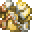
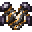
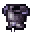
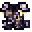
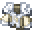
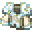

# Lista de armaduras

Todos os **110 conjuntos** de Velária: 11 Ordens, 5 tiers e duas linhas por material. Cada material tem a **linha de Defesa** (Guardiã: mais armadura, resistência e vida, mas pesa e deixa mais lento) e a **linha de Ataque** (menos defesa, mais dano ou poder mágico; leves e médias rolam mais e mais longe). Com as **4 peças do mesmo conjunto** vestidas, você ganha um efeito passivo leve da Ordem (nível II no tier 5): Defesa = sobrevivência (Resistência, Regeneração ou Velocidade), Ataque = agressão (Força, Pressa ou Velocidade). **Defesa** é a soma das 4 peças (sem qualidade da forja). Os bônus também aparecem na dica de cada peça no jogo.

!!! tip "Para testar (operadores)"
    `/provar modo` libera vestir qualquer Ordem e tier. `/provar conjunto <id>` entrega as 4 peças, `/provar ordem <ordem>` entrega a Ordem inteira e `/provar lista <ordem>` mostra os ids no chat (clique para pegar).

## Guerreiro

Armadura pesada.

| | Tier | Linha | Peças | Defesa | Resist. | Bônus do conjunto | Id (/provar) |
| --- | --- | --- | --- | --- | --- | --- | --- |
|  | 1 | Defesa (Guardiã) | Elmo de Estanho · Peitoral de Estanho · Grevas de Estanho · Botas de Estanho | 16 | 1 | +0.1 resist. a empurrão, +2 vida, -8% velocidade, +1 resistência | `estanho_pesada` |
|  | 1 | Gladiador | Elmo Feroz de Estanho · Peitoral Feroz de Estanho · Grevas Ferozes de Estanho · Botas Ferozes de Estanho | 13 | 0.45 | +0.11 resist. a empurrão, +5.6% dano, +2.8% vel. de ataque, -4% velocidade, +4% pressa mágica | `estanho_gladiador` |
|  | 2 | Defesa (Guardiã) | Elmo de Oricalco · Peitoral de Oricalco · Grevas de Oricalco · Botas de Oricalco | 20 | 2 | +0.14 resist. a empurrão, +4 vida, -8% velocidade, +2 resistência | `oricalco_pesada` |
|  | 2 | Gladiador | Elmo Feroz de Oricalco · Peitoral Feroz de Oricalco · Grevas Ferozes de Oricalco · Botas Ferozes de Oricalco | 16 | 0.9 | +0.16 resist. a empurrão, +8.4% dano, +4.2% vel. de ataque, -4% velocidade, +8% pressa mágica | `oricalco_gladiador` |
|  | 3 | Defesa (Guardiã) | Elmo de Aço Legionário · Peitoral de Aço Legionário · Grevas de Aço Legionário · Botas de Aço Legionário | 23 | 3.5 | +0.2 resist. a empurrão, +6 vida, -8% velocidade, +3 resistência | `aco_legionario_pesada` |
|  | 3 | Gladiador | Elmo Feroz de Aço Legionário · Peitoral Feroz de Aço Legionário · Grevas Ferozes de Aço Legionário · Botas Ferozes de Aço Legionário | 19 | 1.58 | +0.22 resist. a empurrão, +11.2% dano, +5.6% vel. de ataque, -4% velocidade, +12% pressa mágica | `aco_legionario_gladiador` |
|  | 4 | Defesa (Guardiã) | Elmo de Escama Legionária · Peitoral de Escama Legionária · Grevas de Escama Legionária · Botas de Escama Legionária | 29 | 5 | +0.24 resist. a empurrão, +8 vida, -8% velocidade, +4 resistência | `escama_legionaria_pesada` |
|  | 4 | Gladiador | Elmo Feroz de Escama Legionária · Peitoral Feroz de Escama Legionária · Grevas Ferozes de Escama Legionária · Botas Ferozes de Escama Legionária | 22 | 2.25 | +0.27 resist. a empurrão, +14% dano, +7% vel. de ataque, -4% velocidade, +16% pressa mágica | `escama_legionaria_gladiador` |
|  | 5 | Defesa (Guardiã) | Elmo de Aço Estelar · Peitoral de Aço Estelar · Grevas de Aço Estelar · Botas de Aço Estelar | 33 | 6 | +0.3 resist. a empurrão, +10 vida, -8% velocidade, +5 resistência | `aco_estelar_pesada` |
|  | 5 | Gladiador | Elmo Feroz de Aço Estelar · Peitoral Feroz de Aço Estelar · Grevas Ferozes de Aço Estelar · Botas Ferozes de Aço Estelar | 24 | 2.7 | +0.34 resist. a empurrão, +16.8% dano, +8.4% vel. de ataque, -4% velocidade, +20% pressa mágica | `aco_estelar_gladiador` |

## Paladino

Armadura pesada.

| | Tier | Linha | Peças | Defesa | Resist. | Bônus do conjunto | Id (/provar) |
| --- | --- | --- | --- | --- | --- | --- | --- |
|  | 1 | Defesa (Guardiã) | Elmo de Bronze Solar · Peitoral de Bronze Solar · Grevas de Bronze Solar · Botas de Bronze Solar | 14 | 0 | +2 cura, +2 vida, -8% velocidade, +1 resistência | `bronze_solar_pesada` |
|  | 1 | Portador da Luz | Elmo Radiante de Bronze Solar · Peitoral Radiante de Bronze Solar · Grevas Radiantes de Bronze Solar · Botas Radiantes de Bronze Solar | 11 | 0 | +3.64 cura, +4.2% dano, -4% velocidade, +4% pressa mágica | `bronze_solar_radiante` |
|  | 2 | Defesa (Guardiã) | Elmo de Cobalto · Peitoral de Cobalto · Grevas de Cobalto · Botas de Cobalto | 18 | 1 | +3 cura, +4 vida, -8% velocidade, +2 resistência | `cobalto_pesada` |
|  | 2 | Portador da Luz | Elmo Radiante de Cobalto · Peitoral Radiante de Cobalto · Grevas Radiantes de Cobalto · Botas Radiantes de Cobalto | 15 | 0.45 | +5.46 cura, +5.6% dano, -4% velocidade, +8% pressa mágica | `cobalto_radiante` |
|  | 3 | Defesa (Guardiã) | Elmo de Aço Auroral · Peitoral de Aço Auroral · Grevas de Aço Auroral · Botas de Aço Auroral | 21 | 2.5 | +4 cura, +6 vida, -8% velocidade, +3 resistência | `aco_auroral_pesada` |
|  | 3 | Portador da Luz | Elmo Radiante de Aço Auroral · Peitoral Radiante de Aço Auroral · Grevas Radiantes de Aço Auroral · Botas Radiantes de Aço Auroral | 17 | 1.12 | +7.28 cura, +8.4% dano, -4% velocidade, +12% pressa mágica | `aco_auroral_radiante` |
|  | 4 | Defesa (Guardiã) | Elmo de Escama Áurea · Peitoral de Escama Áurea · Grevas de Escama Áurea · Botas de Escama Áurea | 25 | 4 | +6 cura, +8 vida, -8% velocidade, +4 resistência | `escama_aurea_pesada` |
|  | 4 | Portador da Luz | Elmo Radiante de Escama Áurea · Peitoral Radiante de Escama Áurea · Grevas Radiantes de Escama Áurea · Botas Radiantes de Escama Áurea | 19 | 1.8 | +10.22 cura, +11.2% dano, -4% velocidade, +16% pressa mágica | `escama_aurea_radiante` |
|  | 5 | Defesa (Guardiã) | Elmo de Estelita · Peitoral de Estelita · Grevas de Estelita · Botas de Estelita | 28 | 5 | +8 cura, +10 vida, -8% velocidade, +5 resistência | `estelita_pesada` |
|  | 5 | Portador da Luz | Elmo Radiante de Estelita · Peitoral Radiante de Estelita · Grevas Radiantes de Estelita · Botas Radiantes de Estelita | 21 | 2.25 | +13.16 cura, +14% dano, -4% velocidade, +20% pressa mágica | `estelita_radiante` |

## Berserker

Armadura pesada.

| | Tier | Linha | Peças | Defesa | Resist. | Bônus do conjunto | Id (/provar) |
| --- | --- | --- | --- | --- | --- | --- | --- |
|  | 1 | Defesa (Guardiã) | Elmo de Ferro-Brasa · Peitoral de Ferro-Brasa · Grevas de Ferro-Brasa · Botas de Ferro-Brasa | 12 | 0 | +4% dano, +8% vel. de ataque, +10% rage modifier, +2 vida, -8% velocidade, +1 resistência | `ferro_brasa_pesada` |
|  | 1 | Nortenho | Elmo Boreal de Ferro-Brasa · Peitoral Boreal de Ferro-Brasa · Grevas Boreais de Ferro-Brasa · Botas Boreais de Ferro-Brasa | 11 | 0 | +10.1% dano, +9% vel. de ataque, +11.2% rage modifier, -4% velocidade, +4% pressa mágica | `ferro_brasa_boreal` |
|  | 2 | Defesa (Guardiã) | Elmo de Ferro Sombrio · Peitoral de Ferro Sombrio · Grevas de Ferro Sombrio · Botas de Ferro Sombrio | 16 | 1 | +10% dano, +8% vel. de ataque, +20% rage modifier, +4 vida, -8% velocidade, +2 resistência | `ferro_sombrio_pesada` |
|  | 2 | Nortenho | Elmo Boreal de Ferro Sombrio · Peitoral Boreal de Ferro Sombrio · Grevas Boreais de Ferro Sombrio · Botas Boreais de Ferro Sombrio | 13 | 0.45 | +19.6% dano, +9% vel. de ataque, +22.4% rage modifier, -4% velocidade, +8% pressa mágica | `ferro_sombrio_boreal` |
|  | 3 | Defesa (Guardiã) | Elmo de Vulcanita · Peitoral de Vulcanita · Grevas de Vulcanita · Botas de Vulcanita | 19 | 2.5 | +16% dano, +10% vel. de ataque, +30% rage modifier, +6 vida, -8% velocidade, +3 resistência | `vulcanita_pesada` |
|  | 3 | Nortenho | Elmo Boreal de Vulcanita · Peitoral Boreal de Vulcanita · Grevas Boreais de Vulcanita · Botas Boreais de Vulcanita | 15 | 1.12 | +29.1% dano, +11.2% vel. de ataque, +33.6% rage modifier, -4% velocidade, +12% pressa mágica | `vulcanita_boreal` |
|  | 4 | Defesa (Guardiã) | Elmo de Sangue de Dragão · Peitoral de Sangue de Dragão · Grevas de Sangue de Dragão · Botas de Sangue de Dragão | 21 | 4 | +20% dano, +12% vel. de ataque, +36% rage modifier, +8 vida, -8% velocidade, +4 resistência | `sangue_dragao_pesada` |
|  | 4 | Nortenho | Elmo Boreal de Sangue de Dragão · Peitoral Boreal de Sangue de Dragão · Grevas Boreais de Sangue de Dragão · Botas Boreais de Sangue de Dragão | 17 | 1.8 | +36.4% dano, +13.4% vel. de ataque, +40.3% rage modifier, -4% velocidade, +16% pressa mágica | `sangue_dragao_boreal` |
|  | 5 | Defesa (Guardiã) | Elmo de Supernova · Peitoral de Supernova · Grevas de Supernova · Botas de Supernova | 23 | 5 | +24% dano, +14% vel. de ataque, +40% rage modifier, +10 vida, -8% velocidade, +5 resistência | `supernova_pesada` |
|  | 5 | Nortenho | Elmo Boreal de Supernova · Peitoral Boreal de Supernova · Grevas Boreais de Supernova · Botas Boreais de Supernova | 17 | 2.25 | +43.7% dano, +15.7% vel. de ataque, +44.8% rage modifier, -4% velocidade, +20% pressa mágica | `supernova_boreal` |

## Ladino

Armadura média.

| | Tier | Linha | Peças | Defesa | Resist. | Bônus do conjunto | Id (/provar) |
| --- | --- | --- | --- | --- | --- | --- | --- |
|  | 1 | Defesa (Guardiã) | Capacete de Âmbar · Cota de Âmbar · Perneiras de Âmbar · Botas de Âmbar | 10 | 0 | +12% evasion chance, +16% vel. de ataque, +2 vida, -4% velocidade, +0.4 resistência | `ambar_media` |
|  | 1 | Shinobi | Capacete Shinobi de Âmbar · Cota Shinobi de Âmbar · Perneiras Shinobis de Âmbar · Botas Shinobis de Âmbar | 10 | 0 | +13.4% evasion chance, +17.9% vel. de ataque, +5.6% dano, +2 distância do rolamento, +1 rolamento seguido, +4% pressa mágica | `ambar_shinobi` |
|  | 2 | Defesa (Guardiã) | Capacete de Sombraço · Cota de Sombraço · Perneiras de Sombraço · Botas de Sombraço | 11 | 0 | +16% evasion chance, +20% vel. de ataque, +8% dano, +4 vida, -4% velocidade, +0.8 resistência | `sombraco_media` |
|  | 2 | Shinobi | Capacete Shinobi de Sombraço · Cota Shinobi de Sombraço · Perneiras Shinobis de Sombraço · Botas Shinobis de Sombraço | 10 | 0 | +17.9% evasion chance, +22.4% vel. de ataque, +17.4% dano, +2 distância do rolamento, +1 rolamento seguido, +8% pressa mágica | `sombraco_shinobi` |
|  | 3 | Defesa (Guardiã) | Capacete de Sangue Velado · Cota de Sangue Velado · Perneiras de Sangue Velado · Botas de Sangue Velado | 14 | 0 | +20% evasion chance, +20% vel. de ataque, +12% dano, +6 vida, -4% velocidade, +1.2 resistência | `sangue_velado_media` |
|  | 3 | Shinobi | Capacete Shinobi de Sangue Velado · Cota Shinobi de Sangue Velado · Perneiras Shinobis de Sangue Velado · Botas Shinobis de Sangue Velado | 11 | 0 | +22.4% evasion chance, +22.4% vel. de ataque, +24.6% dano, +2 distância do rolamento, +1 rolamento seguido, +12% pressa mágica | `sangue_velado_shinobi` |
|  | 4 | Defesa (Guardiã) | Capacete de Umbrita · Cota de Umbrita · Perneiras de Umbrita · Botas de Umbrita | 18 | 0 | +24% evasion chance, +24% vel. de ataque, +16% dano, +8 vida, -4% velocidade, +1.6 resistência | `umbrita_media` |
|  | 4 | Shinobi | Capacete Shinobi de Umbrita · Cota Shinobi de Umbrita · Perneiras Shinobis de Umbrita · Botas Shinobis de Umbrita | 15 | 0 | +26.9% evasion chance, +26.9% vel. de ataque, +31.9% dano, +2 distância do rolamento, +1 rolamento seguido, +16% pressa mágica | `umbrita_shinobi` |
|  | 5 | Defesa (Guardiã) | Capacete de Vazio Velado · Cota de Vazio Velado · Perneiras de Vazio Velado · Botas de Vazio Velado | 20 | 0 | +28% evasion chance, +28% vel. de ataque, +20% dano, +10 vida, -4% velocidade, +2 resistência | `vazio_velado_media` |
|  | 5 | Shinobi | Capacete Shinobi de Vazio Velado · Cota Shinobi de Vazio Velado · Perneiras Shinobis de Vazio Velado · Botas Shinobis de Vazio Velado | 16 | 0 | +31.4% evasion chance, +31.4% vel. de ataque, +39.2% dano, +2 distância do rolamento, +1 rolamento seguido, +20% pressa mágica | `vazio_velado_shinobi` |

## Arqueiro

Armadura média.

| | Tier | Linha | Peças | Defesa | Resist. | Bônus do conjunto | Id (/provar) |
| --- | --- | --- | --- | --- | --- | --- | --- |
|  | 1 | Defesa (Guardiã) | Capacete de Verdecobre · Cota de Verdecobre · Perneiras de Verdecobre · Botas de Verdecobre | 11 | 0 | +20% dano à distância, +2 vida, -4% velocidade, +0.4 resistência | `verdecobre_media` |
|  | 1 | Andarilho | Capacete Errante de Verdecobre · Cota Errante de Verdecobre · Perneiras Errantes de Verdecobre · Botas Errantes de Verdecobre | 10 | 0 | +30.8% dano à distância, +2 distância do rolamento, +1 rolamento seguido, +4% pressa mágica | `verdecobre_errante` |
|  | 2 | Defesa (Guardiã) | Capacete de Mitril · Cota de Mitril · Perneiras de Mitril · Botas de Mitril | 12 | 0.5 | +32% dano à distância, +12% haste, +4 vida, -4% velocidade, +0.8 resistência | `mitril_media` |
|  | 2 | Andarilho | Capacete Errante de Mitril · Cota Errante de Mitril · Perneiras Errantes de Mitril · Botas Errantes de Mitril | 10 | 0.22 | +47% dano à distância, +13.4% haste, +2 distância do rolamento, +1 rolamento seguido, +8% pressa mágica | `mitril_errante` |
|  | 3 | Defesa (Guardiã) | Capacete de Tempestita · Cota de Tempestita · Perneiras de Tempestita · Botas de Tempestita | 14 | 1.25 | +36% dano à distância, +16% haste, +6 vida, -4% velocidade, +1.2 resistência | `tempestita_media` |
|  | 3 | Andarilho | Capacete Errante de Tempestita · Cota Errante de Tempestita · Perneiras Errantes de Tempestita · Botas Errantes de Tempestita | 11 | 0.56 | +54.3% dano à distância, +17.9% haste, +2 distância do rolamento, +1 rolamento seguido, +12% pressa mágica | `tempestita_errante` |
|  | 4 | Defesa (Guardiã) | Capacete de Asa Tempestuosa · Cota de Asa Tempestuosa · Perneiras de Asa Tempestuosa · Botas de Asa Tempestuosa | 18 | 2.5 | +44% dano à distância, +20% haste, +8 vida, -4% velocidade, +1.6 resistência | `asa_tempestuosa_media` |
|  | 4 | Andarilho | Capacete Errante de Asa Tempestuosa · Cota Errante de Asa Tempestuosa · Perneiras Errantes de Asa Tempestuosa · Botas Errantes de Asa Tempestuosa | 15 | 1.12 | +66.1% dano à distância, +22.4% haste, +2 distância do rolamento, +1 rolamento seguido, +16% pressa mágica | `asa_tempestuosa_errante` |
|  | 5 | Defesa (Guardiã) | Capacete de Cometa · Cota de Cometa · Perneiras de Cometa · Botas de Cometa | 22 | 3 | +52% dano à distância, +24% haste, +10 vida, -4% velocidade, +2 resistência | `cometa_media` |
|  | 5 | Andarilho | Capacete Errante de Cometa · Cota Errante de Cometa · Perneiras Errantes de Cometa · Botas Errantes de Cometa | 16 | 1.35 | +77.8% dano à distância, +26.9% haste, +2 distância do rolamento, +1 rolamento seguido, +20% pressa mágica | `cometa_errante` |

## Bruxo

Armadura média.

| | Tier | Linha | Peças | Defesa | Resist. | Bônus do conjunto | Id (/provar) |
| --- | --- | --- | --- | --- | --- | --- | --- |
|  | 1 | Defesa (Guardiã) | Capacete de Prata Lupina · Cota de Prata Lupina · Perneiras de Prata Lupina · Botas de Prata Lupina | 11 | 0 | +60% sign intensity, +8% adrenaline modifier, +8% dano, +2 vida, -4% velocidade, +0.4 resistência | `prata_lupina_media` |
|  | 1 | Escola do Gato | Capacete Ágil de Prata Lupina · Cota Ágil de Prata Lupina · Perneiras Ágeis de Prata Lupina · Botas Ágeis de Prata Lupina | 10 | 0 | +67.2% sign intensity, +9% adrenaline modifier, +9% dano, +5.6% vel. de ataque, +2 distância do rolamento, +1 rolamento seguido, +4% pressa mágica | `prata_lupina_agil` |
|  | 2 | Defesa (Guardiã) | Capacete de Glaciarita · Cota de Glaciarita · Perneiras de Glaciarita · Botas de Glaciarita | 13 | 0 | +80% sign intensity, +12% adrenaline modifier, +12% dano, +4 vida, -4% velocidade, +0.8 resistência | `glaciarita_media` |
|  | 2 | Escola do Gato | Capacete Ágil de Glaciarita · Cota Ágil de Glaciarita · Perneiras Ágeis de Glaciarita · Botas Ágeis de Glaciarita | 11 | 0 | +89.6% sign intensity, +13.4% adrenaline modifier, +13.4% dano, +8.4% vel. de ataque, +2 distância do rolamento, +1 rolamento seguido, +8% pressa mágica | `glaciarita_agil` |
|  | 3 | Defesa (Guardiã) | Capacete de Abissita · Cota de Abissita · Perneiras de Abissita · Botas de Abissita | 16 | 0 | +100% sign intensity, +20% adrenaline modifier, +16% dano, +6 vida, -4% velocidade, +1.2 resistência | `abissita_media` |
|  | 3 | Escola do Gato | Capacete Ágil de Abissita · Cota Ágil de Abissita · Perneiras Ágeis de Abissita · Botas Ágeis de Abissita | 13 | 0 | +112% sign intensity, +22.4% adrenaline modifier, +17.9% dano, +11.2% vel. de ataque, +2 distância do rolamento, +1 rolamento seguido, +12% pressa mágica | `abissita_agil` |
|  | 4 | Defesa (Guardiã) | Capacete de Lobo-Sombra · Cota de Lobo-Sombra · Perneiras de Lobo-Sombra · Botas de Lobo-Sombra | 20 | 0 | +108% sign intensity, +24% adrenaline modifier, +20% dano, +8 vida, -4% velocidade, +1.6 resistência | `lobo_sombra_media` |
|  | 4 | Escola do Gato | Capacete Ágil de Lobo-Sombra · Cota Ágil de Lobo-Sombra · Perneiras Ágeis de Lobo-Sombra · Botas Ágeis de Lobo-Sombra | 16 | 0 | +121% sign intensity, +26.9% adrenaline modifier, +22.4% dano, +14% vel. de ataque, +2 distância do rolamento, +1 rolamento seguido, +16% pressa mágica | `lobo_sombra_agil` |
|  | 5 | Defesa (Guardiã) | Capacete de Eclipse Lupino · Cota de Eclipse Lupino · Perneiras de Eclipse Lupino · Botas de Eclipse Lupino | 24 | 0 | +120% sign intensity, +30% adrenaline modifier, +24% dano, +10 vida, -4% velocidade, +2 resistência | `eclipse_lupino_media` |
|  | 5 | Escola do Gato | Capacete Ágil de Eclipse Lupino · Cota Ágil de Eclipse Lupino · Perneiras Ágeis de Eclipse Lupino · Botas Ágeis de Eclipse Lupino | 18 | 0 | +134.4% sign intensity, +33.6% adrenaline modifier, +26.9% dano, +16.8% vel. de ataque, +2 distância do rolamento, +1 rolamento seguido, +20% pressa mágica | `eclipse_lupino_agil` |

## Monge

Armadura média.

| | Tier | Linha | Peças | Defesa | Resist. | Bônus do conjunto | Id (/provar) |
| --- | --- | --- | --- | --- | --- | --- | --- |
|  | 1 | Defesa (Guardiã) | Capacete de Jade Monástico · Cota de Jade Monástico · Perneiras de Jade Monástico · Botas de Jade Monástico | 10 | 0 | +8% vel. de ataque, +40% poder arcano, +2 vida, -4% velocidade, +0.4 resistência | `jade_monastico_media` |
|  | 1 | Mestre Samurai | Capacete Xogum de Jade Monástico · Cota Xogum de Jade Monástico · Perneiras Xoguns de Jade Monástico · Botas Xoguns de Jade Monástico | 10 | 0 | +9% vel. de ataque, +44.8% poder arcano, +5.6% dano, +2 distância do rolamento, +1 rolamento seguido, +4% pressa mágica | `jade_monastico_xogum` |
|  | 2 | Defesa (Guardiã) | Capacete de Ônix · Cota de Ônix · Perneiras de Ônix · Botas de Ônix | 11 | 0.5 | +12% vel. de ataque, +60% poder arcano, +4 vida, -4% velocidade, +0.8 resistência | `onix_media` |
|  | 2 | Mestre Samurai | Capacete Xogum de Ônix · Cota Xogum de Ônix · Perneiras Xoguns de Ônix · Botas Xoguns de Ônix | 10 | 0.22 | +13.4% vel. de ataque, +67.2% poder arcano, +8.4% dano, +2 distância do rolamento, +1 rolamento seguido, +8% pressa mágica | `onix_xogum` |
|  | 3 | Defesa (Guardiã) | Capacete de Trovejade · Cota de Trovejade · Perneiras de Trovejade · Botas de Trovejade | 14 | 1.25 | +20% vel. de ataque, +80% poder arcano, +6 vida, -4% velocidade, +1.2 resistência | `trovejade_media` |
|  | 3 | Mestre Samurai | Capacete Xogum de Trovejade · Cota Xogum de Trovejade · Perneiras Xoguns de Trovejade · Botas Xoguns de Trovejade | 11 | 0.56 | +22.4% vel. de ataque, +89.6% poder arcano, +11.2% dano, +2 distância do rolamento, +1 rolamento seguido, +12% pressa mágica | `trovejade_xogum` |
|  | 4 | Defesa (Guardiã) | Capacete de Draconita · Cota de Draconita · Perneiras de Draconita · Botas de Draconita | 18 | 2.5 | +24% vel. de ataque, +88% poder arcano, +8 vida, -4% velocidade, +1.6 resistência | `draconita_media` |
|  | 4 | Mestre Samurai | Capacete Xogum de Draconita · Cota Xogum de Draconita · Perneiras Xoguns de Draconita · Botas Xoguns de Draconita | 15 | 1.12 | +26.9% vel. de ataque, +98.6% poder arcano, +14% dano, +2 distância do rolamento, +1 rolamento seguido, +16% pressa mágica | `draconita_xogum` |
|  | 5 | Defesa (Guardiã) | Capacete de Jade Celestial · Cota de Jade Celestial · Perneiras de Jade Celestial · Botas de Jade Celestial | 20 | 3 | +28% vel. de ataque, +100% poder arcano, +10 vida, -4% velocidade, +2 resistência | `jade_celestial_media` |
|  | 5 | Mestre Samurai | Capacete Xogum de Jade Celestial · Cota Xogum de Jade Celestial · Perneiras Xoguns de Jade Celestial · Botas Xoguns de Jade Celestial | 16 | 1.35 | +31.4% vel. de ataque, +112% poder arcano, +16.8% dano, +2 distância do rolamento, +1 rolamento seguido, +20% pressa mágica | `jade_celestial_xogum` |

## Lâmina Arcana

Armadura média.

| | Tier | Linha | Peças | Defesa | Resist. | Bônus do conjunto | Id (/provar) |
| --- | --- | --- | --- | --- | --- | --- | --- |
|  | 1 | Defesa (Guardiã) | Capacete de Âmbar Crepuscular · Cota de Âmbar Crepuscular · Perneiras de Âmbar Crepuscular · Botas de Âmbar Crepuscular | 11 | 0 | +32% poder arcano, +32% poder de fogo, +32% poder de gelo, +8% dano, +2 vida, -4% velocidade, +0.4 resistência | `ambar_crepuscular_media` |
|  | 1 | Ronin | Capacete Ronin de Âmbar Crepuscular · Cota Ronin de Âmbar Crepuscular · Perneiras Ronins de Âmbar Crepuscular · Botas Ronins de Âmbar Crepuscular | 10 | 0 | +47% poder arcano, +35.8% poder de fogo, +35.8% poder de gelo, +14.6% dano, +2 distância do rolamento, +1 rolamento seguido, +4% pressa mágica | `ambar_crepuscular_ronin` |
|  | 2 | Defesa (Guardiã) | Capacete de Ônix Crepuscular · Cota de Ônix Crepuscular · Perneiras de Ônix Crepuscular · Botas de Ônix Crepuscular | 13 | 0.5 | +40% poder arcano, +40% poder de fogo, +40% poder de gelo, +12% dano, +4 vida, -4% velocidade, +0.8 resistência | `onix_crepuscular_media` |
|  | 2 | Ronin | Capacete Ronin de Ônix Crepuscular · Cota Ronin de Ônix Crepuscular · Perneiras Ronins de Ônix Crepuscular · Botas Ronins de Ônix Crepuscular | 11 | 0.22 | +58.8% poder arcano, +44.8% poder de fogo, +44.8% poder de gelo, +21.8% dano, +2 distância do rolamento, +1 rolamento seguido, +8% pressa mágica | `onix_crepuscular_ronin` |
|  | 3 | Defesa (Guardiã) | Capacete de Sangrita · Cota de Sangrita · Perneiras de Sangrita · Botas de Sangrita | 16 | 1.25 | +48% poder arcano, +48% poder de fogo, +48% poder de gelo, +16% dano, +6 vida, -4% velocidade, +1.2 resistência | `sangrita_media` |
|  | 3 | Ronin | Capacete Ronin de Sangrita · Cota Ronin de Sangrita · Perneiras Ronins de Sangrita · Botas Ronins de Sangrita | 13 | 0.56 | +70.6% poder arcano, +53.8% poder de fogo, +53.8% poder de gelo, +29.1% dano, +2 distância do rolamento, +1 rolamento seguido, +12% pressa mágica | `sangrita_ronin` |
|  | 4 | Defesa (Guardiã) | Capacete de Crepúsculo Eterno · Cota de Crepúsculo Eterno · Perneiras de Crepúsculo Eterno · Botas de Crepúsculo Eterno | 20 | 2.5 | +56% poder arcano, +56% poder de fogo, +56% poder de gelo, +20% dano, +8 vida, -4% velocidade, +1.6 resistência | `crepusculo_eterno_media` |
|  | 4 | Ronin | Capacete Ronin de Crepúsculo Eterno · Cota Ronin de Crepúsculo Eterno · Perneiras Ronins de Crepúsculo Eterno · Botas Ronins de Crepúsculo Eterno | 16 | 1.12 | +82.3% poder arcano, +62.7% poder de fogo, +62.7% poder de gelo, +36.4% dano, +2 distância do rolamento, +1 rolamento seguido, +16% pressa mágica | `crepusculo_eterno_ronin` |
|  | 5 | Defesa (Guardiã) | Capacete de Eclipsita · Cota de Eclipsita · Perneiras de Eclipsita · Botas de Eclipsita | 24 | 3 | +64% poder arcano, +64% poder de fogo, +64% poder de gelo, +24% dano, +10 vida, -4% velocidade, +2 resistência | `eclipsita_media` |
|  | 5 | Ronin | Capacete Ronin de Eclipsita · Cota Ronin de Eclipsita · Perneiras Ronins de Eclipsita · Botas Ronins de Eclipsita | 18 | 1.35 | +94.1% poder arcano, +71.7% poder de fogo, +71.7% poder de gelo, +43.7% dano, +2 distância do rolamento, +1 rolamento seguido, +20% pressa mágica | `eclipsita_ronin` |

## Sacerdote

Armadura leve.

| | Tier | Linha | Peças | Defesa | Resist. | Bônus do conjunto | Id (/provar) |
| --- | --- | --- | --- | --- | --- | --- | --- |
|  | 1 | Defesa (Guardiã) | Capuz de Prata · Manto de Prata · Calças de Prata · Sapatos de Prata | 7 | 0 | +80% cura, +2 vida, +0.4 resistência | `prata_leve` |
|  | 1 | Absolvição | Capuz Celeste de Prata · Manto Celeste de Prata · Calças Celestes de Prata · Sapatos Celestes de Prata | 7 | 0 | +103.6% cura, +9.6% pressa mágica, +1.4 distância do rolamento, +1 rolamento seguido | `prata_celeste` |
|  | 2 | Defesa (Guardiã) | Capuz de Argêntea Celeste · Manto de Argêntea Celeste · Calças de Argêntea Celeste · Sapatos de Argêntea Celeste | 9 | 0 | +100% cura, +12% pressa mágica, +4 vida, +0.8 resistência | `argentea_celeste_leve` |
|  | 2 | Absolvição | Capuz Celeste de Argêntea Celeste · Manto Celeste de Argêntea Celeste · Calças Celestes de Argêntea Celeste · Sapatos Celestes de Argêntea Celeste | 8 | 0 | +134.4% cura, +29.8% pressa mágica, +1.4 distância do rolamento, +1 rolamento seguido | `argentea_celeste_celeste` |
|  | 3 | Defesa (Guardiã) | Capuz de Animita · Manto de Animita · Calças de Animita · Sapatos de Animita | 11 | 0 | +120% cura, +16% pressa mágica, +6 vida, +1.2 resistência | `animita_leve` |
|  | 3 | Absolvição | Capuz Celeste de Animita · Manto Celeste de Animita · Calças Celestes de Animita · Sapatos Celestes de Animita | 10 | 0 | +162.4% cura, +41.1% pressa mágica, +1.4 distância do rolamento, +1 rolamento seguido | `animita_celeste` |
|  | 4 | Defesa (Guardiã) | Capuz de Chama Pálida · Manto de Chama Pálida · Calças de Chama Pálida · Sapatos de Chama Pálida | 15 | 1 | +140% cura, +20% pressa mágica, +8 vida, +1.6 resistência | `chama_palida_leve` |
|  | 4 | Absolvição | Capuz Celeste de Chama Pálida · Manto Celeste de Chama Pálida · Calças Celestes de Chama Pálida · Sapatos Celestes de Chama Pálida | 12 | 0.45 | +190.4% cura, +52.4% pressa mágica, +1.4 distância do rolamento, +1 rolamento seguido | `chama_palida_celeste` |
|  | 5 | Defesa (Guardiã) | Capuz de Alva Estrela · Manto de Alva Estrela · Calças de Alva Estrela · Sapatos de Alva Estrela | 18 | 1.5 | +160% cura, +24% pressa mágica, +10 vida, +2 resistência | `alva_estrela_leve` |
|  | 5 | Absolvição | Capuz Celeste de Alva Estrela · Manto Celeste de Alva Estrela · Calças Celestes de Alva Estrela · Sapatos Celestes de Alva Estrela | 15 | 0.68 | +221.2% cura, +63.7% pressa mágica, +1.4 distância do rolamento, +1 rolamento seguido | `alva_estrela_celeste` |

## Mago

Armadura leve.

| | Tier | Linha | Peças | Defesa | Resist. | Bônus do conjunto | Id (/provar) |
| --- | --- | --- | --- | --- | --- | --- | --- |
|  | 1 | Defesa (Guardiã) | Capuz de Âmbar Rúnico · Manto de Âmbar Rúnico · Calças de Âmbar Rúnico · Sapatos de Âmbar Rúnico | 7 | 0 | +100 mana, +8% poder mágico, +4% recarga, +4% resist. a magia, +2 vida, +0.4 resistência | `ambar_runico_leve` |
|  | 1 | Elementalista | Capuz Elemental de Âmbar Rúnico · Manto Elemental de Âmbar Rúnico · Calças Elementais de Âmbar Rúnico · Sapatos Elementais de Âmbar Rúnico | 7 | 0 | +112 mana, +17.4% poder mágico, +4.5% recarga, +4.5% resist. a magia, +5.6% lançamento, +1.4 distância do rolamento, +1 rolamento seguido, +4% pressa mágica | `ambar_runico_elemental` |
|  | 2 | Defesa (Guardiã) | Capuz de Cobalto Rúnico · Manto de Cobalto Rúnico · Calças de Cobalto Rúnico · Sapatos de Cobalto Rúnico | 9 | 0 | +160 mana, +12% poder mágico, +6% recarga, +8% resist. a magia, +4 vida, +0.8 resistência | `cobalto_runico_leve` |
|  | 2 | Elementalista | Capuz Elemental de Cobalto Rúnico · Manto Elemental de Cobalto Rúnico · Calças Elementais de Cobalto Rúnico · Sapatos Elementais de Cobalto Rúnico | 8 | 0 | +179.2 mana, +24.6% poder mágico, +6.7% recarga, +9% resist. a magia, +8.4% lançamento, +1.4 distância do rolamento, +1 rolamento seguido, +8% pressa mágica | `cobalto_runico_elemental` |
|  | 3 | Defesa (Guardiã) | Capuz de Adamantita · Manto de Adamantita · Calças de Adamantita · Sapatos de Adamantita | 11 | 0 | +240 mana, +16% poder mágico, +8% recarga, +12% resist. a magia, +6 vida, +1.2 resistência | `adamantita_leve` |
|  | 3 | Elementalista | Capuz Elemental de Adamantita · Manto Elemental de Adamantita · Calças Elementais de Adamantita · Sapatos Elementais de Adamantita | 10 | 0 | +268.8 mana, +31.9% poder mágico, +9% recarga, +13.4% resist. a magia, +11.2% lançamento, +1.4 distância do rolamento, +1 rolamento seguido, +12% pressa mágica | `adamantita_elemental` |
|  | 4 | Defesa (Guardiã) | Capuz de Umbra Arcana · Manto de Umbra Arcana · Calças de Umbra Arcana · Sapatos de Umbra Arcana | 13 | 1 | +340 mana, +20% poder mágico, +10% recarga, +16% resist. a magia, +8 vida, +1.6 resistência | `umbra_arcana_leve` |
|  | 4 | Elementalista | Capuz Elemental de Umbra Arcana · Manto Elemental de Umbra Arcana · Calças Elementais de Umbra Arcana · Sapatos Elementais de Umbra Arcana | 11 | 0.45 | +380.8 mana, +39.2% poder mágico, +11.2% recarga, +17.9% resist. a magia, +14% lançamento, +1.4 distância do rolamento, +1 rolamento seguido, +16% pressa mágica | `umbra_arcana_elemental` |
|  | 5 | Defesa (Guardiã) | Capuz de Vacuíta · Manto de Vacuíta · Calças de Vacuíta · Sapatos de Vacuíta | 16 | 1.5 | +440 mana, +24% poder mágico, +12% recarga, +20% resist. a magia, +10 vida, +2 resistência | `vacuita_leve` |
|  | 5 | Elementalista | Capuz Elemental de Vacuíta · Manto Elemental de Vacuíta · Calças Elementais de Vacuíta · Sapatos Elementais de Vacuíta | 13 | 0.68 | +492.8 mana, +49.3% poder mágico, +13.4% recarga, +22.4% resist. a magia, +16.8% lançamento, +1.4 distância do rolamento, +1 rolamento seguido, +20% pressa mágica | `vacuita_elemental` |

## Druida

Armadura leve.

| | Tier | Linha | Peças | Defesa | Resist. | Bônus do conjunto | Id (/provar) |
| --- | --- | --- | --- | --- | --- | --- | --- |
|  | 1 | Defesa (Guardiã) | Capuz de Malaquita · Manto de Malaquita · Calças de Malaquita · Sapatos de Malaquita | 7 | 0 | +80% poder da natureza, +2 vida, +0.4 resistência | `malaquita_leve` |
|  | 1 | Selvagem | Capuz Selvagem de Malaquita · Manto Selvagem de Malaquita · Calças Selvagens de Malaquita · Sapatos Selvagens de Malaquita | 7 | 0 | +103.6% poder da natureza, +1.4 distância do rolamento, +1 rolamento seguido, +4% pressa mágica | `malaquita_selvagem` |
|  | 2 | Defesa (Guardiã) | Capuz de Bronze Verdejante · Manto de Bronze Verdejante · Calças de Bronze Verdejante · Sapatos de Bronze Verdejante | 9 | 0 | +100% poder da natureza, +4 vida, +0.8 resistência | `bronze_verdejante_leve` |
|  | 2 | Selvagem | Capuz Selvagem de Bronze Verdejante · Manto Selvagem de Bronze Verdejante · Calças Selvagens de Bronze Verdejante · Sapatos Selvagens de Bronze Verdejante | 8 | 0 | +134.4% poder da natureza, +1.4 distância do rolamento, +1 rolamento seguido, +8% pressa mágica | `bronze_verdejante_selvagem` |
|  | 3 | Defesa (Guardiã) | Capuz de Ferrocerne · Manto de Ferrocerne · Calças de Ferrocerne · Sapatos de Ferrocerne | 11 | 0 | +120% poder da natureza, +6 vida, +1.2 resistência | `ferrocerne_leve` |
|  | 3 | Selvagem | Capuz Selvagem de Ferrocerne · Manto Selvagem de Ferrocerne · Calças Selvagens de Ferrocerne · Sapatos Selvagens de Ferrocerne | 10 | 0 | +162.4% poder da natureza, +1.4 distância do rolamento, +1 rolamento seguido, +12% pressa mágica | `ferrocerne_selvagem` |
|  | 4 | Defesa (Guardiã) | Capuz de Viridita · Manto de Viridita · Calças de Viridita · Sapatos de Viridita | 17 | 1 | +140% poder da natureza, +8 vida, +1.6 resistência | `viridita_leve` |
|  | 4 | Selvagem | Capuz Selvagem de Viridita · Manto Selvagem de Viridita · Calças Selvagens de Viridita · Sapatos Selvagens de Viridita | 13 | 0.45 | +190.4% poder da natureza, +1.4 distância do rolamento, +1 rolamento seguido, +16% pressa mágica | `viridita_selvagem` |
|  | 5 | Defesa (Guardiã) | Capuz de Seiva Estelar · Manto de Seiva Estelar · Calças de Seiva Estelar · Sapatos de Seiva Estelar | 20 | 1.5 | +160% poder da natureza, +10 vida, +2 resistência | `seiva_estelar_leve` |
|  | 5 | Selvagem | Capuz Selvagem de Seiva Estelar · Manto Selvagem de Seiva Estelar · Calças Selvagens de Seiva Estelar · Sapatos Selvagens de Seiva Estelar | 16 | 0.68 | +221.2% poder da natureza, +1.4 distância do rolamento, +1 rolamento seguido, +20% pressa mágica | `seiva_estelar_selvagem` |

