# Crafts e receitas

Todas as receitas de Velária desenhadas do jeito que aparecem no jogo. No servidor, passe o mouse num item e aperte **R** no EMI para ver a receita ao vivo.

## Ligas

Uma **liga** mistura minérios **na bigorna** (Overgeared): coloque os ingredientes no formato da receita e martele. Cada receita rende **2 lingotes**. A bigorna precisa ser do tier da liga.

### Tier 1

| Receita na bigorna | Liga | Ordem |
| --- | --- | --- |
| 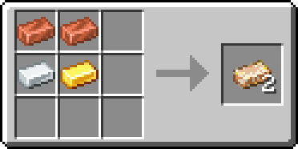 | **Bronze Solar** Bigorna de Pedra | Paladino |
| 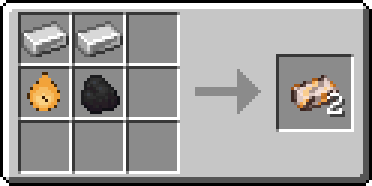 | **Ferro-Brasa** Bigorna de Pedra | Berserker |
| 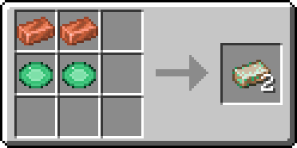 | **Verdecobre** Bigorna de Pedra | Arqueiro |
| 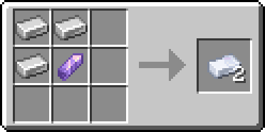 | **Prata Lupina** Bigorna de Pedra | Bruxo |
| 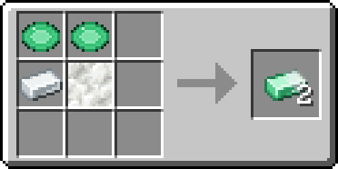 | **Jade Monástico** Bigorna de Pedra | Monge |
| 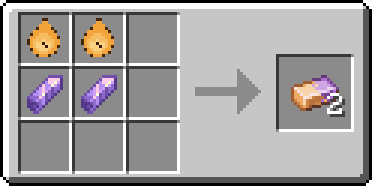 | **Âmbar Crepuscular** Bigorna de Pedra | Lâmina Arcana |
| 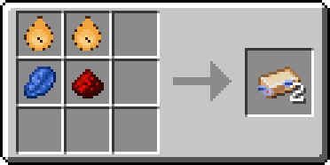 | **Âmbar Rúnico** Bigorna de Pedra | Mago |

### Tier 2

| Receita na bigorna | Liga | Ordem |
| --- | --- | --- |
| 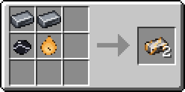 | **Sombraço** Bigorna do Ferreiro | Ladino |
| 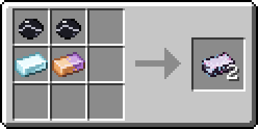 | **Ônix Crepuscular** Bigorna do Ferreiro | Lâmina Arcana |
| 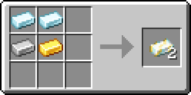 | **Argêntea Celeste** Bigorna do Ferreiro | Sacerdote |
| 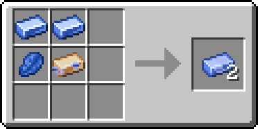 | **Cobalto Rúnico** Bigorna do Ferreiro | Mago |
| 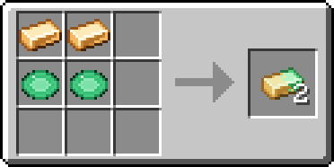 | **Bronze Verdejante** Bigorna do Ferreiro | Druida |

### Tier 3

| Receita na bigorna | Liga | Ordem |
| --- | --- | --- |
| 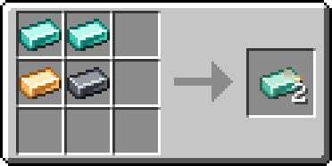 | **Aço Legionário** above_a | Guerreiro |
| 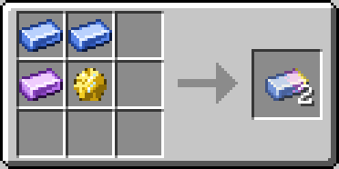 | **Aço Auroral** above_a | Paladino |
| 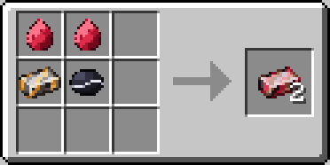 | **Sangue Velado** above_a | Ladino |
| 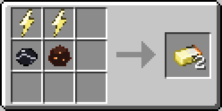 | **Trovejade** above_a | Monge |
| 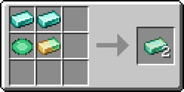 | **Ferrocerne** above_a | Druida |

### Tier 4

| Receita na bigorna | Liga | Ordem |
| --- | --- | --- |
| 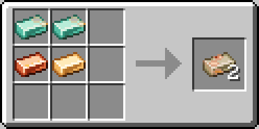 | **Escama Legionária** above_b | Guerreiro |
| 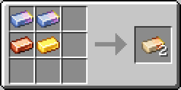 | **Escama Áurea** above_b | Paladino |
| 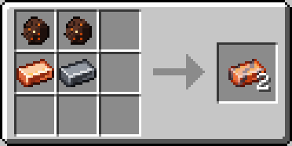 | **Sangue de Dragão** above_b | Berserker |
| 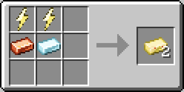 | **Asa Tempestuosa** above_b | Arqueiro |
| 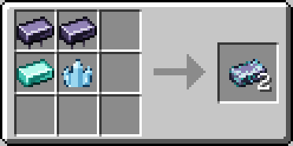 | **Lobo-Sombra** above_b | Bruxo |
| 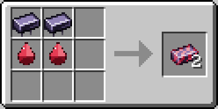 | **Crepúsculo Eterno** above_b | Lâmina Arcana |
| 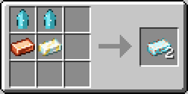 | **Chama Pálida** above_b | Sacerdote |
| 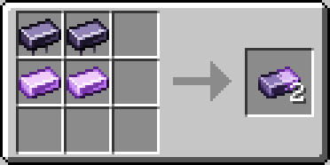 | **Umbra Arcana** above_b | Mago |

### Tier 5

| Receita na bigorna | Liga | Ordem |
| --- | --- | --- |
| 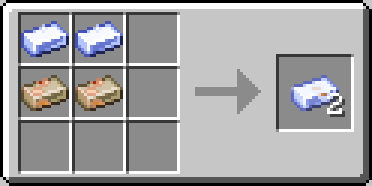 | **Aço Estelar** above_b | Guerreiro |
| 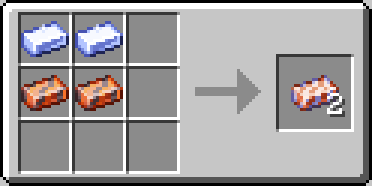 | **Supernova** above_b | Berserker |
| 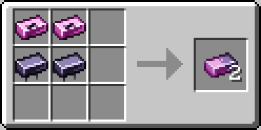 | **Vazio Velado** above_b | Ladino |
| 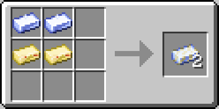 | **Cometa** above_b | Arqueiro |
| 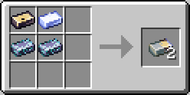 | **Eclipse Lupino** above_b | Bruxo |
| 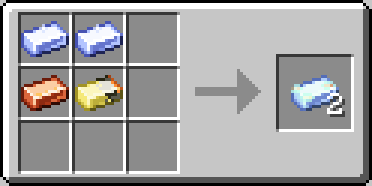 | **Jade Celestial** above_b | Monge |
| 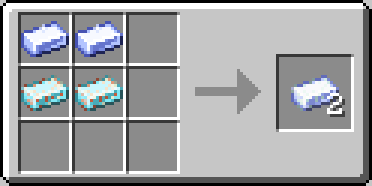 | **Alva Estrela** above_b | Sacerdote |
| 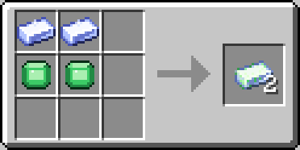 | **Seiva Estelar** above_b | Druida |

## Picaretas e machados

As ferramentas continuam na **bancada**, com o mesmo molde das de ferro. Cada picareta quebra o minério seguinte da cadeia.

| Material | Picareta | Machado |
| --- | --- | --- |
| **Lingote de Cobre** | 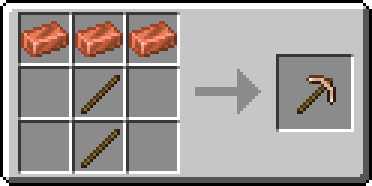 | 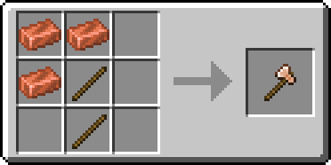 |
| **Estanho Ingot** | 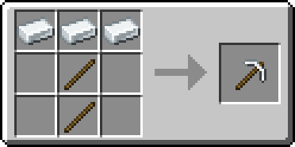 | 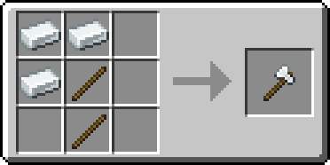 |
| **Ambar** | 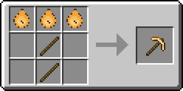 | 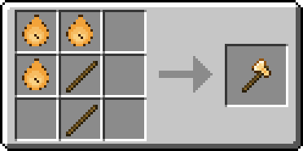 |
| **Malaquita** | 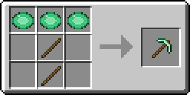 | 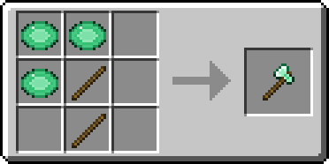 |
| **Mitril Ingot** | 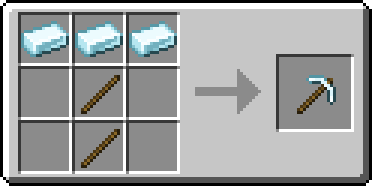 | 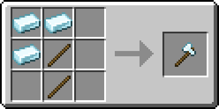 |
| **Cobalto Ingot** | 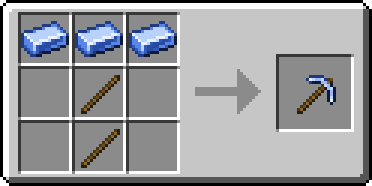 | 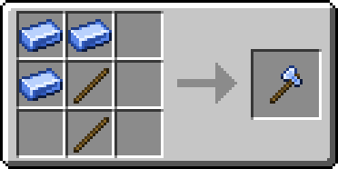 |
| **Glaciarita** | 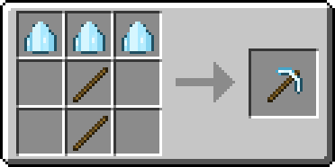 | 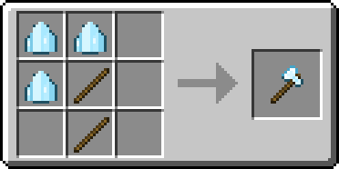 |
| **Ferro Sombrio Ingot** | 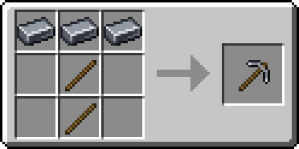 | 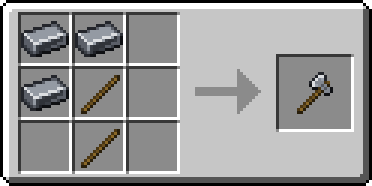 |
| **Oricalco Ingot** | 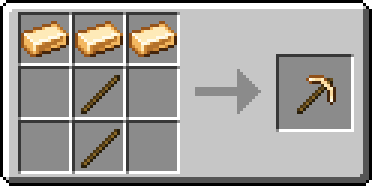 |  |
| **Onix** |  |  |
| **Sangrita** |  |  |
| **Animita** |  |  |
| **Vulcanita** |  |  |
| **Adamantita Ingot** |  |  |
| **Abissita Ingot** |  |  |
| **Tempestita** |  |  |
| **Umbrita Ingot** |  |  |
| **Draconita Ingot** |  |  |
| **Viridita** |  |  |
| **Estelita Ingot** |  |  |
| **Vacuita Ingot** |  |  |
| **Eclipsita Ingot** |  |  |

## Bigornas

As duas primeiras bigornas saem como no Overgeared (agachar e clicar com o martelo numa pedra ou bloco de ferro). As do tier 3 em diante são feitas na bancada:

**Bigorna da Fornalha (tier 3)** — veja no EMI (overgeared:smithing_anvil).

**Bigorna Dracônica (tier 4)** — veja no EMI (overgeared:tier_a_smithing_anvil).

**Base Estelar (tier 5, vai embaixo da Bigorna Dracônica)**

**Lingote de Adamantita (4 chapas + 4 Ouro Rosa)**

