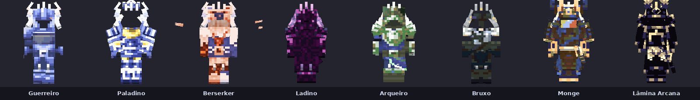
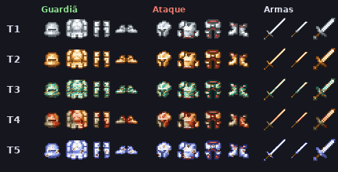
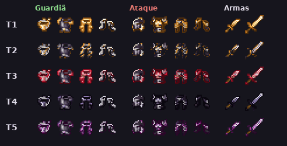
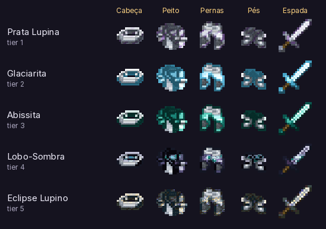
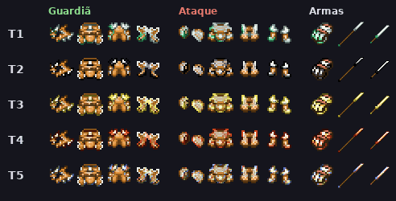
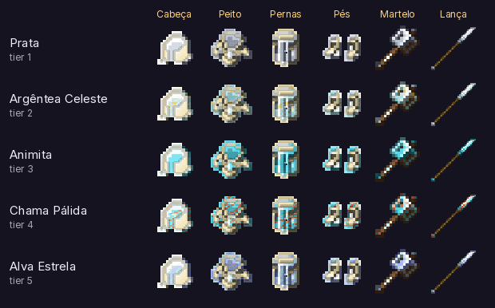
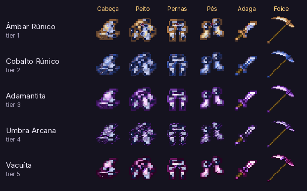
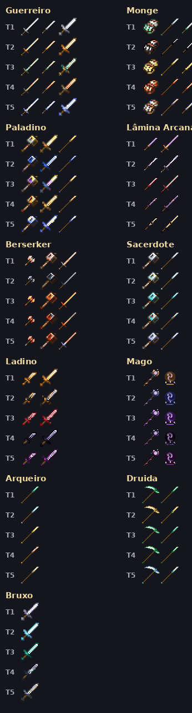

# Armas e armaduras

Todo equipamento de Ordem sai da **bigorna** (veja [A forja](forja.md)). O desenho vem dos mods de classe: o Guerreiro veste a armadura gótica do Epic Knights, o Mago o manto de mago, o Bruxo a armadura do Lobo do Witcher. O **material** pinta a peça, e os **frisos e tecidos** levam a cor da Ordem.

## Materiais que ganham vida

Os materiais raros têm **efeito animado** em tudo que é feito com eles: lingote, picareta, arma e armadura.

<h3>Estelita</h3>
Estrelas piscando no metal.

<h3>Vacuíta</h3>
Um vazio girando no centro da peça.

<h3>Eclipsita</h3>
Um eclipse dourado que pulsa.

<h3>Draconita</h3>
Brasas que acendem e apagam.

<h3>Umbrita</h3>
Sombra escorrendo da peça.

<h3>Adamantita</h3>
Um brilho violeta correndo pelo metal.

<h3>Gemas raras</h3>
Tempestita solta faíscas; Vulcanita, Animita, Sangrita e Viridita pulsam na própria cor.

<h3>Ligas de tier 4 e 5</h3>
Um brilho corre pela peça; no tier 5 aparece uma estrela.

## Duas linhas de armadura por material

A lista completa, com defesa e bônus de cada conjunto, está em [Lista de armaduras](armaduras.md).

Cada um dos 55 materiais forja **dois conjuntos** da sua Ordem. Você escolhe o que combina com o seu jeito de jogar:

<h3>Linha Guardiã</h3>
A armadura de sempre: mais defesa, o bônus da Ordem e <b>vida extra</b> por peça a partir do tier 3 (+0,5 / +1 / +1,5). Receita com <b>forro</b> (couro, ou lã nos mantos) no lugar de um lingote.

<h3>Linha de Ataque</h3>
Tema novo, de outro conjunto do mod da classe. <b>15% menos defesa</b>, resistência menor, sem as penalidades da Guardiã, bônus da Ordem <b>60% maior</b> e bônus ofensivos próprios. Receita com a <b>insígnia da Ordem</b> no lugar de um lingote.

| Ordem | Linha de Ataque | Nome das peças | Modelo | Brilho |
| --- | --- | --- | --- | --- |
| Guerreiro | **Gladiador** | Feroz / Ferozes | Guerreiro (Rogues) | reflexos no metal |
| Paladino | **Portador da Luz** | Radiante / Radiantes | Lightbringer (Armory) | pulso dourado |
| Sacerdote | **Absolvição** | Celeste / Celestes | Absolution (Armory) | pulso dourado |
| Berserker | **Nortenho** | Boreal / Boreais | Northling (Berserker) | brasas |
| Ladino | **Shinobi** | Shinobi / Shinobis | Ninja (Samurai Dynasty) | veios violeta |
| Arqueiro | **Andarilho** | Errante / Errantes | Strider (Armory) | rajada de vento |
| Bruxo | **Escola do Gato** | Ágil / Ágeis | Escola do Gato (Witcher) | sinais que piscam |
| Monge | **Mestre Samurai** | Xogum / Xoguns | Mestre Samurai (Samurai Dynasty) | energia que sobe |
| Lâmina Arcana | **Ronin** | Ronin / Ronins | Samurai de duas espadas (Samurai Dynasty) | runas em onda |
| Mago | **Elementalista** | Elemental / Elementais | Tempest (Armory) | runas em onda |
| Druida | **Selvagem** | Selvagem / Selvagens | Wildling (Berserker) | seiva |

Três linhas de Ataque têm **estilo samurai**: o **Shinobi** do Ladino, o **Mestre Samurai** do Monge (kabuto com chifres) e o **Ronin** da Lâmina Arcana (duas espadas na cintura).

**Cada tier é mais intimidador:** a pintura fica mais escura e com mais contraste, e as peças ganham enfeites. No tier 3 aparecem espinhos nos ombros. No tier 4 vêm chifres (pesada), lâminas no elmo (média) ou cristais (leve), mais espinhos e joelheiras. No tier 5 entram chifres grandes, uma coroa de pontas e lâminas nas costas (ou estilhaços flutuando nos mantos).

Os bônus ficam **na própria peça** e aparecem na dica do item (passe o mouse). Exemplo: o Peitoral Feroz de Estanho mostra o dano extra; o Manto Elemental mostra a mana e o poder mágico.

## Endgame: o equipamento da Ordem é o melhor do jogo

A partir do tier 4, nada de fora compensa mais que o equipamento da sua Ordem:

- **Tiers 4 e 5 mais fortes:** mais armadura e resistência (a pesada de tier 5 chega perto do teto do jogo) e armas com **+6,5** (tier 4) e **+8** (tier 5) de dano.
- **Aço de dragão (Ice and Fire) mais fraco na origem:** dano base 12 (era 25), durabilidade 3000 (era 8000), armadura 5/9/7/4 (era 7/12/9/6) e resistência 4 (era 6). Com a redução abaixo, uma espada de aço de dragão fica perto de uma de tier 4 da Ordem.
- **Equipamento de outros mods reduzido:** os atributos positivos (armadura, resistência, dano, poder mágico) caem para uma fração do original. Continuam ótimos para **aparência** (slot cosmético) e decoração.

| Mods | Fica com |
| --- | --- |
| Ice and Fire (aço de dragão, escamas), L_Ender's Cataclysm | 65% |
| Simply Swords | 70% |
| Mowzie's Mobs, Bosses of Mass Destruction, Iron's Spells (armaduras e armas) | 75% |
| Epic Knights e addons, Immersive Armors, Fantasy Armor, Samurai Dynasty | 80% |
| Mods de classe (Wizards, Paladins, Rogues, Archers, Berserker, Witcher, Forcemaster, Druids, Armory, Arsenal, Spellblades) | 85% |
| Jewelry | 90% |

## Efeitos visuais

- **Brilho animado:** toda armadura de Ordem tem uma camada que brilha no escuro e se mexe: runas que acendem em onda (Mago, Lâmina Arcana), pulso dourado (Paladino, Sacerdote), brasas (Berserker), veios violeta (Ladino), rajada de vento (Arqueiro), sinais que piscam (Bruxo), energia que sobe (Monge), seiva (Druida) e reflexos no metal (Guerreiro). Quanto maior o tier, mais forte.
- **Aura:** com as 4 peças do mesmo conjunto, do tier 3 em diante, você solta partículas do tema da Ordem.
- **Golpes:** cada acerto com arma da Ordem desenha o rastro do golpe (arco largo da espada longa, corte duplo da katana, estocada da lança, onda de choque do martelo e do machado). No tier 3+ o rastro usa a partícula do material (fogo da Vulcanita, gelo da Glaciarita, faíscas da Tempestita...), e no tier 4-5 o golpe explode no alvo.
- **Flechas:** qualquer arco ou besta deixa rastro conforme o seu tier (faísca, encantamento, luz, chama de alma e sopro de dragão no tier 5) e estoura no alvo.

## Equipamento de cada Ordem

Cada linha é um tier: a linha Guardiã, a linha de Ataque e as armas da Ordem (o Mago tem cajado e orbe).

=== "Legião de Ferro"
    
=== "Ordem da Aurora"
    
=== "Clã da Fúria"
    
=== "Irmandade do Véu"
    
=== "Patrulheiros do Vento"
    
=== "Escola do Lobo"
    
=== "Mosteiro do Punho"
    
=== "Lâminas do Crepúsculo"
    
=== "Chama Branca"
    
=== "Círculo Arcano"
    
=== "Círculo do Carvalho"
    

## Na mão e no corpo

As armas têm volume quando você segura, e as armaduras saltam do corpo em 3D.

=== "Arsenal"
    

=== "Linha Guardiã vestida"
    

    

=== "Linha de Ataque vestida"
    

    

## Ferramentas

Picaretas, machados, **pás e enxadas** seguem a cadeia de minérios: cada material quebra o minério seguinte. São feitas na bancada, com o molde das ferramentas de ferro do Minecraft. As de Eclipsita, a última da cadeia, são as melhores ferramentas do jogo (4000 de durabilidade e a mineração mais rápida).

!!! tip "Magia"
    O **Mago** não usa armas físicas: luta com **cajado** (mão principal) e **orbe** (mão secundária), que dão poder mágico, mana e recarga (Iron's Spells, veja [Magia](magia.md)). Sacerdote e Druida lançam magia com o cajado ou varinha da classe e, com martelo, foice ou lança, lutam corpo a corpo.
