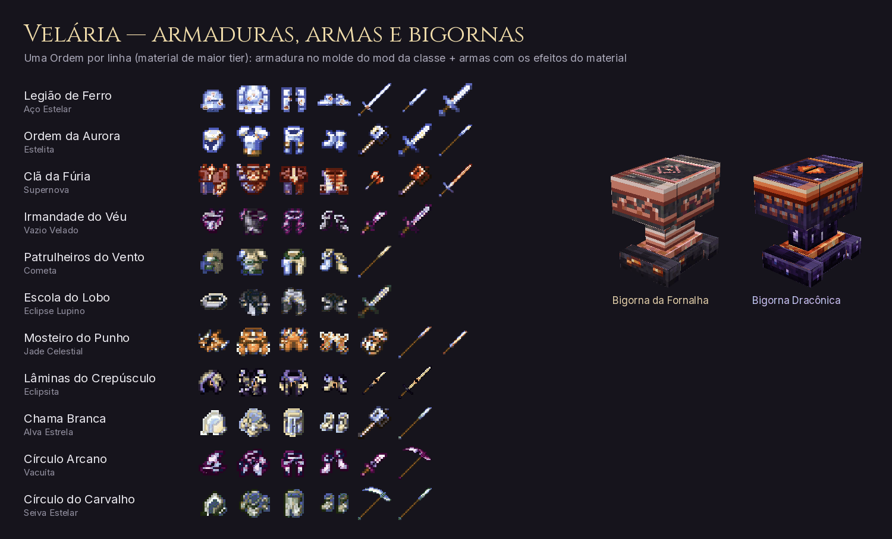
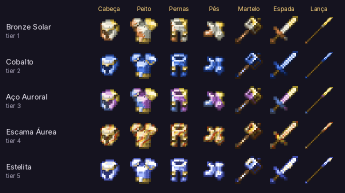
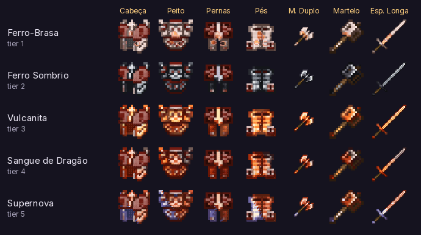
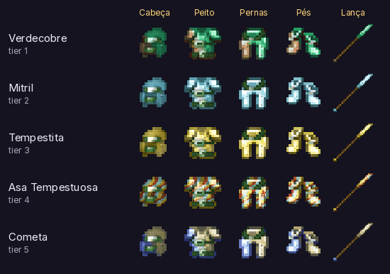
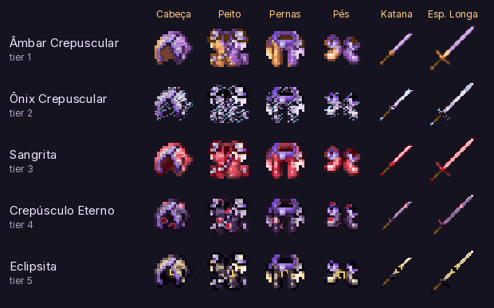
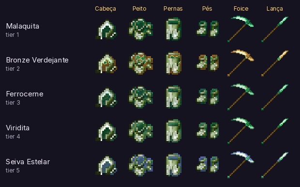
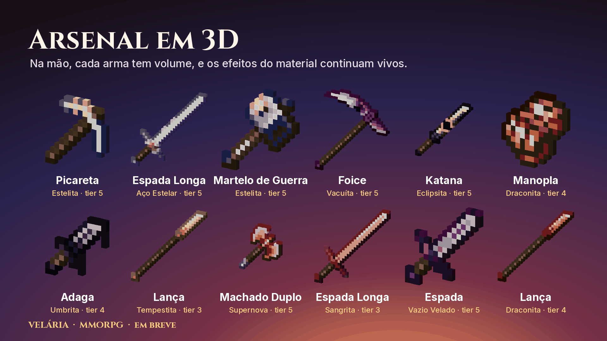
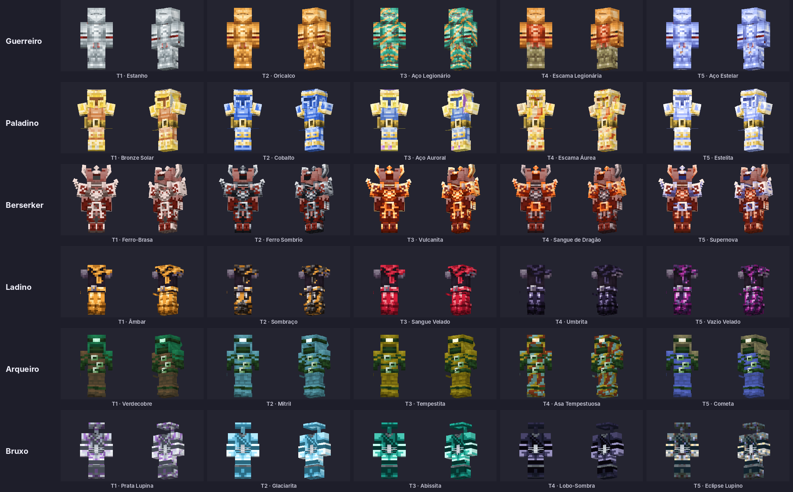
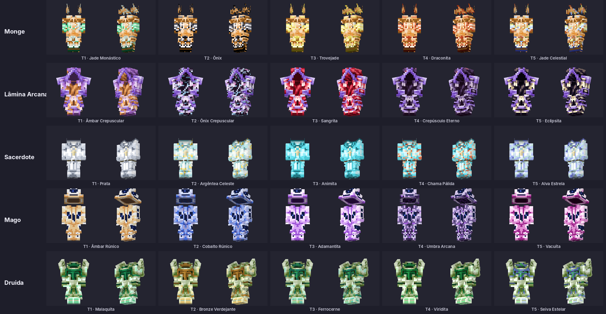
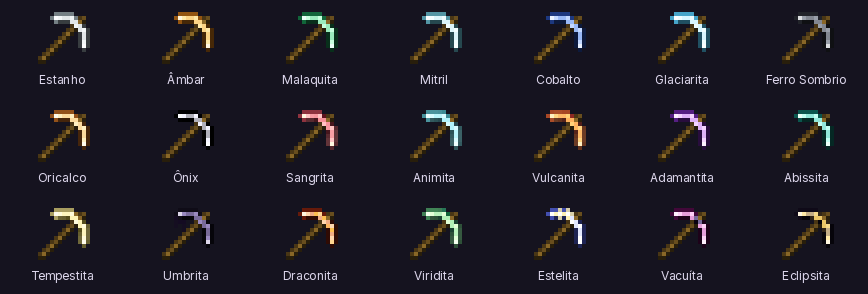

# Armas e armaduras

Todo equipamento de Ordem sai da **bigorna** (veja [A forja](forja.md)). O desenho vem do mod da própria classe: o Guerreiro veste a armadura gótica do Epic Knights, o Mago o manto do Wizards, o Bruxo a armadura do Lobo do Witcher. O **material** pinta a peça, e os **frisos e tecidos** levam a cor da Ordem.

## Materiais que ganham vida

Os materiais raros têm **efeito animado** em tudo que é feito com eles: lingote, picareta, arma e armadura.

<h3>Estelita</h3>
Estrelas piscando no metal.

<h3>Vacuíta</h3>
Um vazio girando no centro da peça.

<h3>Eclipsita</h3>
Um eclipse dourado que pulsa.

<h3>Draconita</h3>
Brasas que acendem e apagam.

<h3>Umbrita</h3>
Sombra escorrendo da peça.

<h3>Adamantita</h3>
Um brilho violeta correndo pelo metal.

<h3>Gemas raras</h3>
Tempestita solta faíscas; Vulcanita, Animita, Sangrita e Viridita pulsam na própria cor.

<h3>Ligas de tier 4 e 5</h3>
Um brilho corre pela peça; no tier 5 aparece uma estrela.

## Equipamento de cada Ordem

Cada linha é um tier, com a armadura (cabeça, peito, pernas e pés) e as armas da Ordem.

=== "Legião de Ferro"
    
=== "Ordem da Aurora"
    
=== "Clã da Fúria"
    
=== "Irmandade do Véu"
    
=== "Patrulheiros do Vento"
    
=== "Escola do Lobo"
    
=== "Mosteiro do Punho"
    
=== "Lâminas do Crepúsculo"
    
=== "Chama Branca"
    
=== "Círculo Arcano"
    
=== "Círculo do Carvalho"
    

## Na mão e no corpo

As armas têm volume quando você segura, e as armaduras saltam do corpo em 3D.

=== "Arsenal em 3D"
    

=== "Armaduras vestidas"
    

    

## Picaretas

As picaretas seguem a cadeia de minérios: cada uma quebra o minério seguinte. O molde é o da picareta de ferro do Minecraft.

!!! tip "Magia"
    Mago, Sacerdote e Druida lançam magia com **cajado ou varinha** na mão: o Mago começa com a Varinha de Novato, o Sacerdote com a Varinha de Acólito e o Druida com a Varinha da Natureza. Com adaga, foice, martelo ou lança, eles lutam corpo a corpo.
