# Forja de cada Ordem

Armaduras e armas das Ordens saem da **bigorna** (Overgeared): o formato é o mesmo da bancada, mas você martela no minigame e a peça ganha **qualidade** (Ruim até Obra-prima). Escolha sua Ordem:

=== "Guerreiro"
    ??? note "Tier 1: Estanho"
        <figure>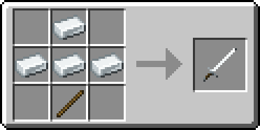<figcaption>Espada Longa de Estanho</figcaption></figure><figure>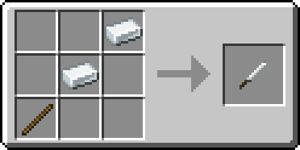<figcaption>Katana de Estanho</figcaption></figure><figure>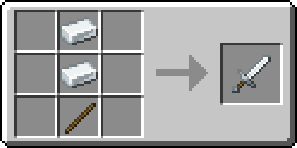<figcaption>Espada de Estanho</figcaption></figure><figure>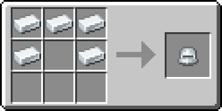<figcaption>Elmo de Estanho</figcaption></figure><figure>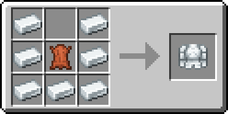<figcaption>Peitoral de Estanho</figcaption></figure><figure>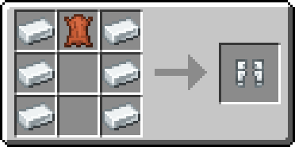<figcaption>Grevas de Estanho</figcaption></figure><figure>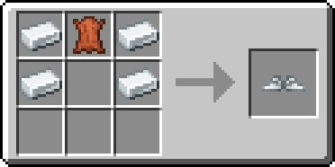<figcaption>Botas de Estanho</figcaption></figure><figure>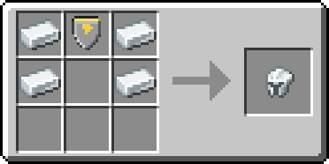<figcaption>Elmo Feroz de Estanho</figcaption></figure><figure>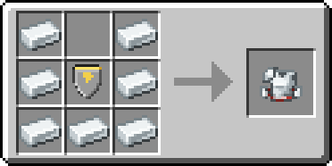<figcaption>Peitoral Feroz de Estanho</figcaption></figure><figure>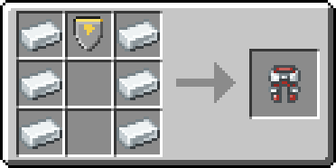<figcaption>Grevas Ferozes de Estanho</figcaption></figure><figure>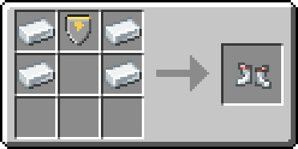<figcaption>Botas Ferozes de Estanho</figcaption></figure>

    ??? note "Tier 2: Oricalco"
        <figure>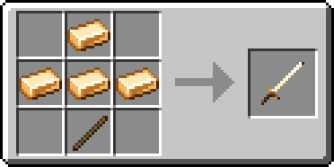<figcaption>Espada Longa de Oricalco</figcaption></figure><figure>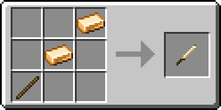<figcaption>Katana de Oricalco</figcaption></figure><figure>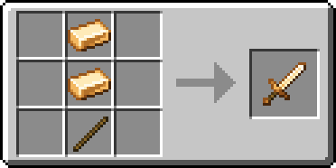<figcaption>Espada de Oricalco</figcaption></figure><figure>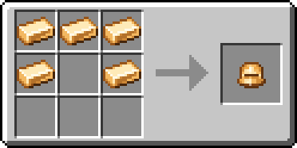<figcaption>Elmo de Oricalco</figcaption></figure><figure>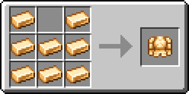<figcaption>Peitoral de Oricalco</figcaption></figure><figure>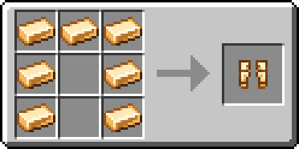<figcaption>Grevas de Oricalco</figcaption></figure><figure>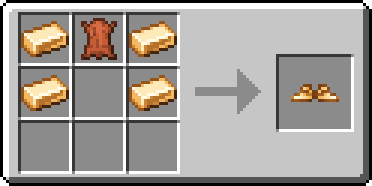<figcaption>Botas de Oricalco</figcaption></figure><figure>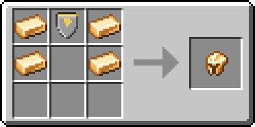<figcaption>Elmo Feroz de Oricalco</figcaption></figure><figure>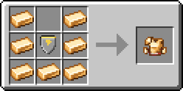<figcaption>Peitoral Feroz de Oricalco</figcaption></figure><figure>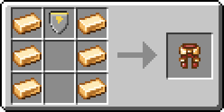<figcaption>Grevas Ferozes de Oricalco</figcaption></figure><figure>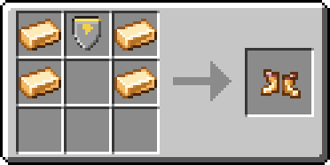<figcaption>Botas Ferozes de Oricalco</figcaption></figure>

    ??? note "Tier 3: Aço Legionário"
        <figure>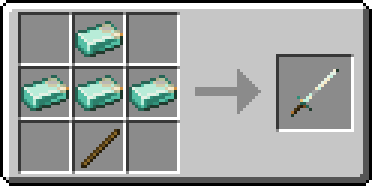<figcaption>Espada Longa de Aço Legionário</figcaption></figure><figure>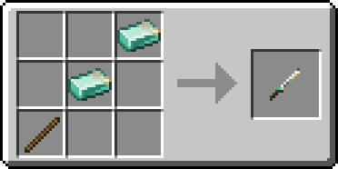<figcaption>Katana de Aço Legionário</figcaption></figure><figure>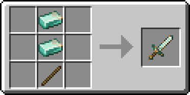<figcaption>Espada de Aço Legionário</figcaption></figure><figure>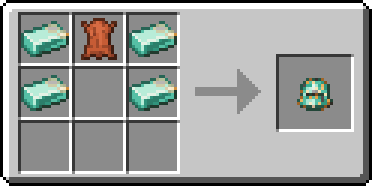<figcaption>Elmo de Aço Legionário</figcaption></figure><figure>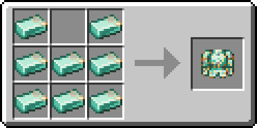<figcaption>Peitoral de Aço Legionário</figcaption></figure><figure>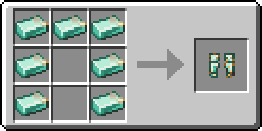<figcaption>Grevas de Aço Legionário</figcaption></figure><figure>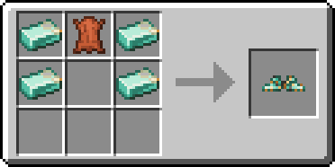<figcaption>Botas de Aço Legionário</figcaption></figure><figure>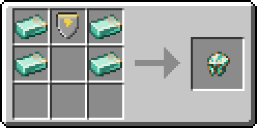<figcaption>Elmo Feroz de Aço Legionário</figcaption></figure><figure>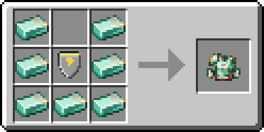<figcaption>Peitoral Feroz de Aço Legionário</figcaption></figure><figure>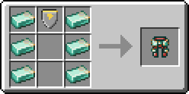<figcaption>Grevas Ferozes de Aço Legionário</figcaption></figure><figure>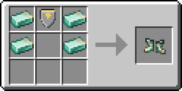<figcaption>Botas Ferozes de Aço Legionário</figcaption></figure>

    ??? note "Tier 4: Escama Legionária"
        <figure>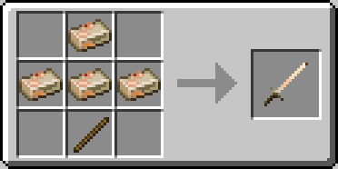<figcaption>Espada Longa de Escama Legionária</figcaption></figure><figure>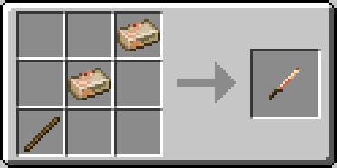<figcaption>Katana de Escama Legionária</figcaption></figure><figure>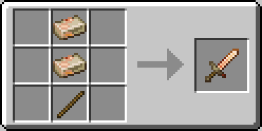<figcaption>Espada de Escama Legionária</figcaption></figure><figure>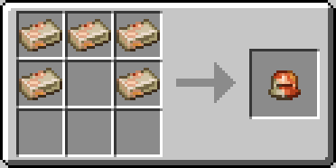<figcaption>Elmo de Escama Legionária</figcaption></figure><figure>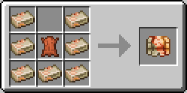<figcaption>Peitoral de Escama Legionária</figcaption></figure><figure>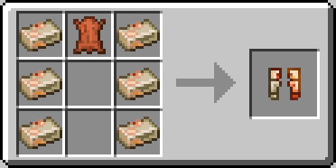<figcaption>Grevas de Escama Legionária</figcaption></figure><figure>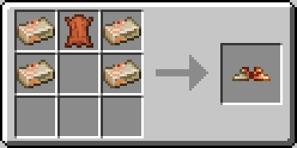<figcaption>Botas de Escama Legionária</figcaption></figure><figure>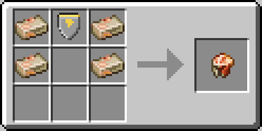<figcaption>Elmo Feroz de Escama Legionária</figcaption></figure><figure>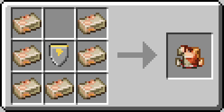<figcaption>Peitoral Feroz de Escama Legionária</figcaption></figure><figure>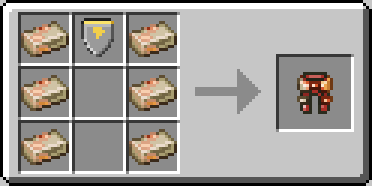<figcaption>Grevas Ferozes de Escama Legionária</figcaption></figure><figure>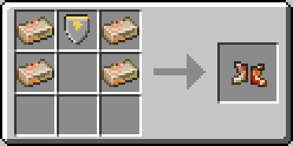<figcaption>Botas Ferozes de Escama Legionária</figcaption></figure>

    ??? note "Tier 5: Aço Estelar"
        <figure>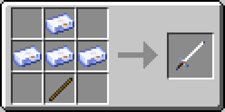<figcaption>Espada Longa de Aço Estelar</figcaption></figure><figure>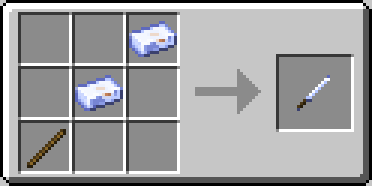<figcaption>Katana de Aço Estelar</figcaption></figure><figure>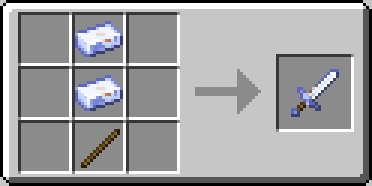<figcaption>Espada de Aço Estelar</figcaption></figure><figure>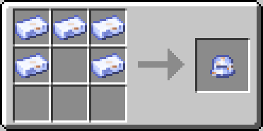<figcaption>Elmo de Aço Estelar</figcaption></figure><figure>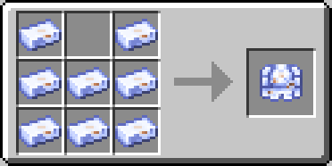<figcaption>Peitoral de Aço Estelar</figcaption></figure><figure>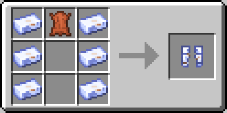<figcaption>Grevas de Aço Estelar</figcaption></figure><figure><figcaption>Botas de Aço Estelar</figcaption></figure><figure><figcaption>Elmo Feroz de Aço Estelar</figcaption></figure><figure><figcaption>Peitoral Feroz de Aço Estelar</figcaption></figure><figure><figcaption>Grevas Ferozes de Aço Estelar</figcaption></figure><figure><figcaption>Botas Ferozes de Aço Estelar</figcaption></figure>

=== "Paladino"
    ??? note "Tier 1: Bronze Solar"
        <figure><figcaption>Martelo de Guerra de Bronze Solar</figcaption></figure><figure><figcaption>Espada de Bronze Solar</figcaption></figure><figure><figcaption>Lança de Bronze Solar</figcaption></figure><figure><figcaption>Elmo de Bronze Solar</figcaption></figure><figure><figcaption>Peitoral de Bronze Solar</figcaption></figure><figure><figcaption>Grevas de Bronze Solar</figcaption></figure><figure><figcaption>Botas de Bronze Solar</figcaption></figure><figure><figcaption>Elmo Radiante de Bronze Solar</figcaption></figure><figure><figcaption>Peitoral Radiante de Bronze Solar</figcaption></figure><figure><figcaption>Grevas Radiantes de Bronze Solar</figcaption></figure><figure><figcaption>Botas Radiantes de Bronze Solar</figcaption></figure>

    ??? note "Tier 2: Cobalto"
        <figure><figcaption>Martelo de Guerra de Cobalto</figcaption></figure><figure><figcaption>Espada de Cobalto</figcaption></figure><figure><figcaption>Lança de Cobalto</figcaption></figure><figure><figcaption>Elmo de Cobalto</figcaption></figure><figure><figcaption>Peitoral de Cobalto</figcaption></figure><figure><figcaption>Grevas de Cobalto</figcaption></figure><figure><figcaption>Botas de Cobalto</figcaption></figure><figure><figcaption>Elmo Radiante de Cobalto</figcaption></figure><figure><figcaption>Peitoral Radiante de Cobalto</figcaption></figure><figure><figcaption>Grevas Radiantes de Cobalto</figcaption></figure><figure><figcaption>Botas Radiantes de Cobalto</figcaption></figure>

    ??? note "Tier 3: Aço Auroral"
        <figure><figcaption>Martelo de Guerra de Aço Auroral</figcaption></figure><figure><figcaption>Espada de Aço Auroral</figcaption></figure><figure><figcaption>Lança de Aço Auroral</figcaption></figure><figure><figcaption>Elmo de Aço Auroral</figcaption></figure><figure><figcaption>Peitoral de Aço Auroral</figcaption></figure><figure><figcaption>Grevas de Aço Auroral</figcaption></figure><figure><figcaption>Botas de Aço Auroral</figcaption></figure><figure><figcaption>Elmo Radiante de Aço Auroral</figcaption></figure><figure><figcaption>Peitoral Radiante de Aço Auroral</figcaption></figure><figure><figcaption>Grevas Radiantes de Aço Auroral</figcaption></figure><figure><figcaption>Botas Radiantes de Aço Auroral</figcaption></figure>

    ??? note "Tier 4: Escama Áurea"
        <figure><figcaption>Martelo de Guerra de Escama Áurea</figcaption></figure><figure><figcaption>Espada de Escama Áurea</figcaption></figure><figure><figcaption>Lança de Escama Áurea</figcaption></figure><figure><figcaption>Elmo de Escama Áurea</figcaption></figure><figure><figcaption>Peitoral de Escama Áurea</figcaption></figure><figure><figcaption>Grevas de Escama Áurea</figcaption></figure><figure><figcaption>Botas de Escama Áurea</figcaption></figure><figure><figcaption>Elmo Radiante de Escama Áurea</figcaption></figure><figure><figcaption>Peitoral Radiante de Escama Áurea</figcaption></figure><figure><figcaption>Grevas Radiantes de Escama Áurea</figcaption></figure><figure><figcaption>Botas Radiantes de Escama Áurea</figcaption></figure>

    ??? note "Tier 5: Estelita"
        <figure><figcaption>Martelo de Guerra de Estelita</figcaption></figure><figure><figcaption>Espada de Estelita</figcaption></figure><figure><figcaption>Lança de Estelita</figcaption></figure><figure><figcaption>Elmo de Estelita</figcaption></figure><figure><figcaption>Peitoral de Estelita</figcaption></figure><figure><figcaption>Grevas de Estelita</figcaption></figure><figure><figcaption>Botas de Estelita</figcaption></figure><figure><figcaption>Elmo Radiante de Estelita</figcaption></figure><figure><figcaption>Peitoral Radiante de Estelita</figcaption></figure><figure><figcaption>Grevas Radiantes de Estelita</figcaption></figure><figure><figcaption>Botas Radiantes de Estelita</figcaption></figure>

=== "Sacerdote"
    ??? note "Tier 1: Prata"
        <figure><figcaption>Martelo de Guerra de Prata</figcaption></figure><figure><figcaption>Lança de Prata</figcaption></figure><figure><figcaption>Capuz de Prata</figcaption></figure><figure><figcaption>Manto de Prata</figcaption></figure><figure><figcaption>Calças de Prata</figcaption></figure><figure><figcaption>Sapatos de Prata</figcaption></figure><figure><figcaption>Capuz Celeste de Prata</figcaption></figure><figure><figcaption>Manto Celeste de Prata</figcaption></figure><figure><figcaption>Calças Celestes de Prata</figcaption></figure><figure><figcaption>Sapatos Celestes de Prata</figcaption></figure>

    ??? note "Tier 2: Argêntea Celeste"
        <figure><figcaption>Martelo de Guerra de Argêntea Celeste</figcaption></figure><figure><figcaption>Lança de Argêntea Celeste</figcaption></figure><figure><figcaption>Capuz de Argêntea Celeste</figcaption></figure><figure><figcaption>Manto de Argêntea Celeste</figcaption></figure><figure><figcaption>Calças de Argêntea Celeste</figcaption></figure><figure><figcaption>Sapatos de Argêntea Celeste</figcaption></figure><figure><figcaption>Capuz Celeste de Argêntea Celeste</figcaption></figure><figure><figcaption>Manto Celeste de Argêntea Celeste</figcaption></figure><figure><figcaption>Calças Celestes de Argêntea Celeste</figcaption></figure><figure><figcaption>Sapatos Celestes de Argêntea Celeste</figcaption></figure>

    ??? note "Tier 3: Animita"
        <figure><figcaption>Martelo de Guerra de Animita</figcaption></figure><figure><figcaption>Lança de Animita</figcaption></figure><figure><figcaption>Capuz de Animita</figcaption></figure><figure><figcaption>Manto de Animita</figcaption></figure><figure><figcaption>Calças de Animita</figcaption></figure><figure><figcaption>Sapatos de Animita</figcaption></figure><figure><figcaption>Capuz Celeste de Animita</figcaption></figure><figure><figcaption>Manto Celeste de Animita</figcaption></figure><figure><figcaption>Calças Celestes de Animita</figcaption></figure><figure><figcaption>Sapatos Celestes de Animita</figcaption></figure>

    ??? note "Tier 4: Chama Pálida"
        <figure><figcaption>Martelo de Guerra de Chama Pálida</figcaption></figure><figure><figcaption>Lança de Chama Pálida</figcaption></figure><figure><figcaption>Capuz de Chama Pálida</figcaption></figure><figure><figcaption>Manto de Chama Pálida</figcaption></figure><figure><figcaption>Calças de Chama Pálida</figcaption></figure><figure><figcaption>Sapatos de Chama Pálida</figcaption></figure><figure><figcaption>Capuz Celeste de Chama Pálida</figcaption></figure><figure><figcaption>Manto Celeste de Chama Pálida</figcaption></figure><figure><figcaption>Calças Celestes de Chama Pálida</figcaption></figure><figure><figcaption>Sapatos Celestes de Chama Pálida</figcaption></figure>

    ??? note "Tier 5: Alva Estrela"
        <figure><figcaption>Martelo de Guerra de Alva Estrela</figcaption></figure><figure><figcaption>Lança de Alva Estrela</figcaption></figure><figure><figcaption>Capuz de Alva Estrela</figcaption></figure><figure><figcaption>Manto de Alva Estrela</figcaption></figure><figure><figcaption>Calças de Alva Estrela</figcaption></figure><figure><figcaption>Sapatos de Alva Estrela</figcaption></figure><figure><figcaption>Capuz Celeste de Alva Estrela</figcaption></figure><figure><figcaption>Manto Celeste de Alva Estrela</figcaption></figure><figure><figcaption>Calças Celestes de Alva Estrela</figcaption></figure><figure><figcaption>Sapatos Celestes de Alva Estrela</figcaption></figure>

=== "Mago"
    ??? note "Tier 1: Âmbar Rúnico"
        <figure><figcaption>Cajado de Âmbar Rúnico</figcaption></figure><figure><figcaption>Orbe de Âmbar Rúnico</figcaption></figure><figure><figcaption>Capuz de Âmbar Rúnico</figcaption></figure><figure><figcaption>Manto de Âmbar Rúnico</figcaption></figure><figure><figcaption>Calças de Âmbar Rúnico</figcaption></figure><figure><figcaption>Sapatos de Âmbar Rúnico</figcaption></figure><figure><figcaption>Capuz Elemental de Âmbar Rúnico</figcaption></figure><figure><figcaption>Manto Elemental de Âmbar Rúnico</figcaption></figure><figure><figcaption>Calças Elementais de Âmbar Rúnico</figcaption></figure><figure><figcaption>Sapatos Elementais de Âmbar Rúnico</figcaption></figure>

    ??? note "Tier 2: Cobalto Rúnico"
        <figure><figcaption>Cajado de Cobalto Rúnico</figcaption></figure><figure><figcaption>Orbe de Cobalto Rúnico</figcaption></figure><figure><figcaption>Capuz de Cobalto Rúnico</figcaption></figure><figure><figcaption>Manto de Cobalto Rúnico</figcaption></figure><figure><figcaption>Calças de Cobalto Rúnico</figcaption></figure><figure><figcaption>Sapatos de Cobalto Rúnico</figcaption></figure><figure><figcaption>Capuz Elemental de Cobalto Rúnico</figcaption></figure><figure><figcaption>Manto Elemental de Cobalto Rúnico</figcaption></figure><figure><figcaption>Calças Elementais de Cobalto Rúnico</figcaption></figure><figure><figcaption>Sapatos Elementais de Cobalto Rúnico</figcaption></figure>

    ??? note "Tier 3: Adamantita"
        <figure><figcaption>Cajado de Adamantita</figcaption></figure><figure><figcaption>Orbe de Adamantita</figcaption></figure><figure><figcaption>Capuz de Adamantita</figcaption></figure><figure><figcaption>Manto de Adamantita</figcaption></figure><figure><figcaption>Calças de Adamantita</figcaption></figure><figure><figcaption>Sapatos de Adamantita</figcaption></figure><figure><figcaption>Capuz Elemental de Adamantita</figcaption></figure><figure><figcaption>Manto Elemental de Adamantita</figcaption></figure><figure><figcaption>Calças Elementais de Adamantita</figcaption></figure><figure><figcaption>Sapatos Elementais de Adamantita</figcaption></figure>

    ??? note "Tier 4: Umbra Arcana"
        <figure><figcaption>Cajado de Umbra Arcana</figcaption></figure><figure><figcaption>Orbe de Umbra Arcana</figcaption></figure><figure><figcaption>Capuz de Umbra Arcana</figcaption></figure><figure><figcaption>Manto de Umbra Arcana</figcaption></figure><figure><figcaption>Calças de Umbra Arcana</figcaption></figure><figure><figcaption>Sapatos de Umbra Arcana</figcaption></figure><figure><figcaption>Capuz Elemental de Umbra Arcana</figcaption></figure><figure><figcaption>Manto Elemental de Umbra Arcana</figcaption></figure><figure><figcaption>Calças Elementais de Umbra Arcana</figcaption></figure><figure><figcaption>Sapatos Elementais de Umbra Arcana</figcaption></figure>

    ??? note "Tier 5: Vacuíta"
        <figure><figcaption>Cajado de Vacuíta</figcaption></figure><figure><figcaption>Orbe de Vacuíta</figcaption></figure><figure><figcaption>Capuz de Vacuíta</figcaption></figure><figure><figcaption>Manto de Vacuíta</figcaption></figure><figure><figcaption>Calças de Vacuíta</figcaption></figure><figure><figcaption>Sapatos de Vacuíta</figcaption></figure><figure><figcaption>Capuz Elemental de Vacuíta</figcaption></figure><figure><figcaption>Manto Elemental de Vacuíta</figcaption></figure><figure><figcaption>Calças Elementais de Vacuíta</figcaption></figure><figure><figcaption>Sapatos Elementais de Vacuíta</figcaption></figure>

=== "Ladino"
    ??? note "Tier 1: Âmbar"
        <figure><figcaption>Adaga de Âmbar</figcaption></figure><figure><figcaption>Espada de Âmbar</figcaption></figure><figure><figcaption>Capacete de Âmbar</figcaption></figure><figure><figcaption>Cota de Âmbar</figcaption></figure><figure><figcaption>Perneiras de Âmbar</figcaption></figure><figure><figcaption>Botas de Âmbar</figcaption></figure><figure><figcaption>Capacete Shinobi de Âmbar</figcaption></figure><figure><figcaption>Cota Shinobi de Âmbar</figcaption></figure><figure><figcaption>Perneiras Shinobis de Âmbar</figcaption></figure><figure><figcaption>Botas Shinobis de Âmbar</figcaption></figure>

    ??? note "Tier 2: Sombraço"
        <figure><figcaption>Adaga de Sombraço</figcaption></figure><figure><figcaption>Espada de Sombraço</figcaption></figure><figure><figcaption>Capacete de Sombraço</figcaption></figure><figure><figcaption>Cota de Sombraço</figcaption></figure><figure><figcaption>Perneiras de Sombraço</figcaption></figure><figure><figcaption>Botas de Sombraço</figcaption></figure><figure><figcaption>Capacete Shinobi de Sombraço</figcaption></figure><figure><figcaption>Cota Shinobi de Sombraço</figcaption></figure><figure><figcaption>Perneiras Shinobis de Sombraço</figcaption></figure><figure><figcaption>Botas Shinobis de Sombraço</figcaption></figure>

    ??? note "Tier 3: Sangue Velado"
        <figure><figcaption>Adaga de Sangue Velado</figcaption></figure><figure><figcaption>Espada de Sangue Velado</figcaption></figure><figure><figcaption>Capacete de Sangue Velado</figcaption></figure><figure><figcaption>Cota de Sangue Velado</figcaption></figure><figure><figcaption>Perneiras de Sangue Velado</figcaption></figure><figure><figcaption>Botas de Sangue Velado</figcaption></figure><figure><figcaption>Capacete Shinobi de Sangue Velado</figcaption></figure><figure><figcaption>Cota Shinobi de Sangue Velado</figcaption></figure><figure><figcaption>Perneiras Shinobis de Sangue Velado</figcaption></figure><figure><figcaption>Botas Shinobis de Sangue Velado</figcaption></figure>

    ??? note "Tier 4: Umbrita"
        <figure><figcaption>Adaga de Umbrita</figcaption></figure><figure><figcaption>Espada de Umbrita</figcaption></figure><figure><figcaption>Capacete de Umbrita</figcaption></figure><figure><figcaption>Cota de Umbrita</figcaption></figure><figure><figcaption>Perneiras de Umbrita</figcaption></figure><figure><figcaption>Botas de Umbrita</figcaption></figure><figure><figcaption>Capacete Shinobi de Umbrita</figcaption></figure><figure><figcaption>Cota Shinobi de Umbrita</figcaption></figure><figure><figcaption>Perneiras Shinobis de Umbrita</figcaption></figure><figure><figcaption>Botas Shinobis de Umbrita</figcaption></figure>

    ??? note "Tier 5: Vazio Velado"
        <figure><figcaption>Adaga de Vazio Velado</figcaption></figure><figure><figcaption>Espada de Vazio Velado</figcaption></figure><figure><figcaption>Capacete de Vazio Velado</figcaption></figure><figure><figcaption>Cota de Vazio Velado</figcaption></figure><figure><figcaption>Perneiras de Vazio Velado</figcaption></figure><figure><figcaption>Botas de Vazio Velado</figcaption></figure><figure><figcaption>Capacete Shinobi de Vazio Velado</figcaption></figure><figure><figcaption>Cota Shinobi de Vazio Velado</figcaption></figure><figure><figcaption>Perneiras Shinobis de Vazio Velado</figcaption></figure><figure><figcaption>Botas Shinobis de Vazio Velado</figcaption></figure>

=== "Arqueiro"
    ??? note "Tier 1: Verdecobre"
        <figure><figcaption>Lança de Verdecobre</figcaption></figure><figure><figcaption>Capacete de Verdecobre</figcaption></figure><figure><figcaption>Cota de Verdecobre</figcaption></figure><figure><figcaption>Perneiras de Verdecobre</figcaption></figure><figure><figcaption>Botas de Verdecobre</figcaption></figure><figure><figcaption>Capacete Errante de Verdecobre</figcaption></figure><figure><figcaption>Cota Errante de Verdecobre</figcaption></figure><figure><figcaption>Perneiras Errantes de Verdecobre</figcaption></figure><figure><figcaption>Botas Errantes de Verdecobre</figcaption></figure>

    ??? note "Tier 2: Mitril"
        <figure><figcaption>Lança de Mitril</figcaption></figure><figure><figcaption>Capacete de Mitril</figcaption></figure><figure><figcaption>Cota de Mitril</figcaption></figure><figure><figcaption>Perneiras de Mitril</figcaption></figure><figure><figcaption>Botas de Mitril</figcaption></figure><figure><figcaption>Capacete Errante de Mitril</figcaption></figure><figure><figcaption>Cota Errante de Mitril</figcaption></figure><figure><figcaption>Perneiras Errantes de Mitril</figcaption></figure><figure><figcaption>Botas Errantes de Mitril</figcaption></figure>

    ??? note "Tier 3: Tempestita"
        <figure><figcaption>Lança de Tempestita</figcaption></figure><figure><figcaption>Capacete de Tempestita</figcaption></figure><figure><figcaption>Cota de Tempestita</figcaption></figure><figure><figcaption>Perneiras de Tempestita</figcaption></figure><figure><figcaption>Botas de Tempestita</figcaption></figure><figure><figcaption>Capacete Errante de Tempestita</figcaption></figure><figure><figcaption>Cota Errante de Tempestita</figcaption></figure><figure><figcaption>Perneiras Errantes de Tempestita</figcaption></figure><figure><figcaption>Botas Errantes de Tempestita</figcaption></figure>

    ??? note "Tier 4: Asa Tempestuosa"
        <figure><figcaption>Lança de Asa Tempestuosa</figcaption></figure><figure><figcaption>Capacete de Asa Tempestuosa</figcaption></figure><figure><figcaption>Cota de Asa Tempestuosa</figcaption></figure><figure><figcaption>Perneiras de Asa Tempestuosa</figcaption></figure><figure><figcaption>Botas de Asa Tempestuosa</figcaption></figure><figure><figcaption>Capacete Errante de Asa Tempestuosa</figcaption></figure><figure><figcaption>Cota Errante de Asa Tempestuosa</figcaption></figure><figure><figcaption>Perneiras Errantes de Asa Tempestuosa</figcaption></figure><figure><figcaption>Botas Errantes de Asa Tempestuosa</figcaption></figure>

    ??? note "Tier 5: Cometa"
        <figure><figcaption>Lança de Cometa</figcaption></figure><figure><figcaption>Capacete de Cometa</figcaption></figure><figure><figcaption>Cota de Cometa</figcaption></figure><figure><figcaption>Perneiras de Cometa</figcaption></figure><figure><figcaption>Botas de Cometa</figcaption></figure><figure><figcaption>Capacete Errante de Cometa</figcaption></figure><figure><figcaption>Cota Errante de Cometa</figcaption></figure><figure><figcaption>Perneiras Errantes de Cometa</figcaption></figure><figure><figcaption>Botas Errantes de Cometa</figcaption></figure>

=== "Berserker"
    ??? note "Tier 1: Ferro-Brasa"
        <figure><figcaption>Machado Duplo de Ferro-Brasa</figcaption></figure><figure><figcaption>Martelo de Guerra de Ferro-Brasa</figcaption></figure><figure><figcaption>Espada Longa de Ferro-Brasa</figcaption></figure><figure><figcaption>Elmo de Ferro-Brasa</figcaption></figure><figure><figcaption>Peitoral de Ferro-Brasa</figcaption></figure><figure><figcaption>Grevas de Ferro-Brasa</figcaption></figure><figure><figcaption>Botas de Ferro-Brasa</figcaption></figure><figure><figcaption>Elmo Boreal de Ferro-Brasa</figcaption></figure><figure><figcaption>Peitoral Boreal de Ferro-Brasa</figcaption></figure><figure><figcaption>Grevas Boreais de Ferro-Brasa</figcaption></figure><figure><figcaption>Botas Boreais de Ferro-Brasa</figcaption></figure>

    ??? note "Tier 2: Ferro Sombrio"
        <figure><figcaption>Machado Duplo de Ferro Sombrio</figcaption></figure><figure><figcaption>Martelo de Guerra de Ferro Sombrio</figcaption></figure><figure><figcaption>Espada Longa de Ferro Sombrio</figcaption></figure><figure><figcaption>Elmo de Ferro Sombrio</figcaption></figure><figure><figcaption>Peitoral de Ferro Sombrio</figcaption></figure><figure><figcaption>Grevas de Ferro Sombrio</figcaption></figure><figure><figcaption>Botas de Ferro Sombrio</figcaption></figure><figure><figcaption>Elmo Boreal de Ferro Sombrio</figcaption></figure><figure><figcaption>Peitoral Boreal de Ferro Sombrio</figcaption></figure><figure><figcaption>Grevas Boreais de Ferro Sombrio</figcaption></figure><figure><figcaption>Botas Boreais de Ferro Sombrio</figcaption></figure>

    ??? note "Tier 3: Vulcanita"
        <figure><figcaption>Machado Duplo de Vulcanita</figcaption></figure><figure><figcaption>Martelo de Guerra de Vulcanita</figcaption></figure><figure><figcaption>Espada Longa de Vulcanita</figcaption></figure><figure><figcaption>Elmo de Vulcanita</figcaption></figure><figure><figcaption>Peitoral de Vulcanita</figcaption></figure><figure><figcaption>Grevas de Vulcanita</figcaption></figure><figure><figcaption>Botas de Vulcanita</figcaption></figure><figure><figcaption>Elmo Boreal de Vulcanita</figcaption></figure><figure><figcaption>Peitoral Boreal de Vulcanita</figcaption></figure><figure><figcaption>Grevas Boreais de Vulcanita</figcaption></figure><figure><figcaption>Botas Boreais de Vulcanita</figcaption></figure>

    ??? note "Tier 4: Sangue de Dragão"
        <figure><figcaption>Machado Duplo de Sangue de Dragão</figcaption></figure><figure><figcaption>Martelo de Guerra de Sangue de Dragão</figcaption></figure><figure><figcaption>Espada Longa de Sangue de Dragão</figcaption></figure><figure><figcaption>Elmo de Sangue de Dragão</figcaption></figure><figure><figcaption>Peitoral de Sangue de Dragão</figcaption></figure><figure><figcaption>Grevas de Sangue de Dragão</figcaption></figure><figure><figcaption>Botas de Sangue de Dragão</figcaption></figure><figure><figcaption>Elmo Boreal de Sangue de Dragão</figcaption></figure><figure><figcaption>Peitoral Boreal de Sangue de Dragão</figcaption></figure><figure><figcaption>Grevas Boreais de Sangue de Dragão</figcaption></figure><figure><figcaption>Botas Boreais de Sangue de Dragão</figcaption></figure>

    ??? note "Tier 5: Supernova"
        <figure><figcaption>Machado Duplo de Supernova</figcaption></figure><figure><figcaption>Martelo de Guerra de Supernova</figcaption></figure><figure><figcaption>Espada Longa de Supernova</figcaption></figure><figure><figcaption>Elmo de Supernova</figcaption></figure><figure><figcaption>Peitoral de Supernova</figcaption></figure><figure><figcaption>Grevas de Supernova</figcaption></figure><figure><figcaption>Botas de Supernova</figcaption></figure><figure><figcaption>Elmo Boreal de Supernova</figcaption></figure><figure><figcaption>Peitoral Boreal de Supernova</figcaption></figure><figure><figcaption>Grevas Boreais de Supernova</figcaption></figure><figure><figcaption>Botas Boreais de Supernova</figcaption></figure>

=== "Bruxo"
    ??? note "Tier 1: Prata Lupina"
        <figure><figcaption>Espada de Prata Lupina</figcaption></figure><figure><figcaption>Capacete de Prata Lupina</figcaption></figure><figure><figcaption>Cota de Prata Lupina</figcaption></figure><figure><figcaption>Perneiras de Prata Lupina</figcaption></figure><figure><figcaption>Botas de Prata Lupina</figcaption></figure><figure><figcaption>Capacete Ágil de Prata Lupina</figcaption></figure><figure><figcaption>Cota Ágil de Prata Lupina</figcaption></figure><figure><figcaption>Perneiras Ágeis de Prata Lupina</figcaption></figure><figure><figcaption>Botas Ágeis de Prata Lupina</figcaption></figure>

    ??? note "Tier 2: Glaciarita"
        <figure><figcaption>Espada de Glaciarita</figcaption></figure><figure><figcaption>Capacete de Glaciarita</figcaption></figure><figure><figcaption>Cota de Glaciarita</figcaption></figure><figure><figcaption>Perneiras de Glaciarita</figcaption></figure><figure><figcaption>Botas de Glaciarita</figcaption></figure><figure><figcaption>Capacete Ágil de Glaciarita</figcaption></figure><figure><figcaption>Cota Ágil de Glaciarita</figcaption></figure><figure><figcaption>Perneiras Ágeis de Glaciarita</figcaption></figure><figure><figcaption>Botas Ágeis de Glaciarita</figcaption></figure>

    ??? note "Tier 3: Abissita"
        <figure><figcaption>Espada de Abissita</figcaption></figure><figure><figcaption>Capacete de Abissita</figcaption></figure><figure><figcaption>Cota de Abissita</figcaption></figure><figure><figcaption>Perneiras de Abissita</figcaption></figure><figure><figcaption>Botas de Abissita</figcaption></figure><figure><figcaption>Capacete Ágil de Abissita</figcaption></figure><figure><figcaption>Cota Ágil de Abissita</figcaption></figure><figure><figcaption>Perneiras Ágeis de Abissita</figcaption></figure><figure><figcaption>Botas Ágeis de Abissita</figcaption></figure>

    ??? note "Tier 4: Lobo-Sombra"
        <figure><figcaption>Espada de Lobo-Sombra</figcaption></figure><figure><figcaption>Capacete de Lobo-Sombra</figcaption></figure><figure><figcaption>Cota de Lobo-Sombra</figcaption></figure><figure><figcaption>Perneiras de Lobo-Sombra</figcaption></figure><figure><figcaption>Botas de Lobo-Sombra</figcaption></figure><figure><figcaption>Capacete Ágil de Lobo-Sombra</figcaption></figure><figure><figcaption>Cota Ágil de Lobo-Sombra</figcaption></figure><figure><figcaption>Perneiras Ágeis de Lobo-Sombra</figcaption></figure><figure><figcaption>Botas Ágeis de Lobo-Sombra</figcaption></figure>

    ??? note "Tier 5: Eclipse Lupino"
        <figure><figcaption>Espada de Eclipse Lupino</figcaption></figure><figure><figcaption>Capacete de Eclipse Lupino</figcaption></figure><figure><figcaption>Cota de Eclipse Lupino</figcaption></figure><figure><figcaption>Perneiras de Eclipse Lupino</figcaption></figure><figure><figcaption>Botas de Eclipse Lupino</figcaption></figure><figure><figcaption>Capacete Ágil de Eclipse Lupino</figcaption></figure><figure><figcaption>Cota Ágil de Eclipse Lupino</figcaption></figure><figure><figcaption>Perneiras Ágeis de Eclipse Lupino</figcaption></figure><figure><figcaption>Botas Ágeis de Eclipse Lupino</figcaption></figure>

=== "Druida"
    ??? note "Tier 1: Malaquita"
        <figure><figcaption>Foice de Malaquita</figcaption></figure><figure><figcaption>Lança de Malaquita</figcaption></figure><figure><figcaption>Capuz de Malaquita</figcaption></figure><figure><figcaption>Manto de Malaquita</figcaption></figure><figure><figcaption>Calças de Malaquita</figcaption></figure><figure><figcaption>Sapatos de Malaquita</figcaption></figure><figure><figcaption>Capuz Selvagem de Malaquita</figcaption></figure><figure><figcaption>Manto Selvagem de Malaquita</figcaption></figure><figure><figcaption>Calças Selvagens de Malaquita</figcaption></figure><figure><figcaption>Sapatos Selvagens de Malaquita</figcaption></figure>

    ??? note "Tier 2: Bronze Verdejante"
        <figure><figcaption>Foice de Bronze Verdejante</figcaption></figure><figure><figcaption>Lança de Bronze Verdejante</figcaption></figure><figure><figcaption>Capuz de Bronze Verdejante</figcaption></figure><figure><figcaption>Manto de Bronze Verdejante</figcaption></figure><figure><figcaption>Calças de Bronze Verdejante</figcaption></figure><figure><figcaption>Sapatos de Bronze Verdejante</figcaption></figure><figure><figcaption>Capuz Selvagem de Bronze Verdejante</figcaption></figure><figure><figcaption>Manto Selvagem de Bronze Verdejante</figcaption></figure><figure><figcaption>Calças Selvagens de Bronze Verdejante</figcaption></figure><figure><figcaption>Sapatos Selvagens de Bronze Verdejante</figcaption></figure>

    ??? note "Tier 3: Ferrocerne"
        <figure><figcaption>Foice de Ferrocerne</figcaption></figure><figure><figcaption>Lança de Ferrocerne</figcaption></figure><figure><figcaption>Capuz de Ferrocerne</figcaption></figure><figure><figcaption>Manto de Ferrocerne</figcaption></figure><figure><figcaption>Calças de Ferrocerne</figcaption></figure><figure><figcaption>Sapatos de Ferrocerne</figcaption></figure><figure><figcaption>Capuz Selvagem de Ferrocerne</figcaption></figure><figure><figcaption>Manto Selvagem de Ferrocerne</figcaption></figure><figure><figcaption>Calças Selvagens de Ferrocerne</figcaption></figure><figure><figcaption>Sapatos Selvagens de Ferrocerne</figcaption></figure>

    ??? note "Tier 4: Viridita"
        <figure><figcaption>Foice de Viridita</figcaption></figure><figure><figcaption>Lança de Viridita</figcaption></figure><figure><figcaption>Capuz de Viridita</figcaption></figure><figure><figcaption>Manto de Viridita</figcaption></figure><figure><figcaption>Calças de Viridita</figcaption></figure><figure><figcaption>Sapatos de Viridita</figcaption></figure><figure><figcaption>Capuz Selvagem de Viridita</figcaption></figure><figure><figcaption>Manto Selvagem de Viridita</figcaption></figure><figure><figcaption>Calças Selvagens de Viridita</figcaption></figure><figure><figcaption>Sapatos Selvagens de Viridita</figcaption></figure>

    ??? note "Tier 5: Seiva Estelar"
        <figure><figcaption>Foice de Seiva Estelar</figcaption></figure><figure><figcaption>Lança de Seiva Estelar</figcaption></figure><figure><figcaption>Capuz de Seiva Estelar</figcaption></figure><figure><figcaption>Manto de Seiva Estelar</figcaption></figure><figure><figcaption>Calças de Seiva Estelar</figcaption></figure><figure><figcaption>Sapatos de Seiva Estelar</figcaption></figure><figure><figcaption>Capuz Selvagem de Seiva Estelar</figcaption></figure><figure><figcaption>Manto Selvagem de Seiva Estelar</figcaption></figure><figure><figcaption>Calças Selvagens de Seiva Estelar</figcaption></figure><figure><figcaption>Sapatos Selvagens de Seiva Estelar</figcaption></figure>

=== "Monge"
    ??? note "Tier 1: Jade Monástico"
        <figure><figcaption>Manopla de Jade Monástico</figcaption></figure><figure><figcaption>Lança de Jade Monástico</figcaption></figure><figure><figcaption>Katana de Jade Monástico</figcaption></figure><figure><figcaption>Capacete de Jade Monástico</figcaption></figure><figure><figcaption>Cota de Jade Monástico</figcaption></figure><figure><figcaption>Perneiras de Jade Monástico</figcaption></figure><figure><figcaption>Botas de Jade Monástico</figcaption></figure><figure><figcaption>Capacete Xogum de Jade Monástico</figcaption></figure><figure><figcaption>Cota Xogum de Jade Monástico</figcaption></figure><figure><figcaption>Perneiras Xoguns de Jade Monástico</figcaption></figure><figure><figcaption>Botas Xoguns de Jade Monástico</figcaption></figure>

    ??? note "Tier 2: Ônix"
        <figure><figcaption>Manopla de Ônix</figcaption></figure><figure><figcaption>Lança de Ônix</figcaption></figure><figure><figcaption>Katana de Ônix</figcaption></figure><figure><figcaption>Capacete de Ônix</figcaption></figure><figure><figcaption>Cota de Ônix</figcaption></figure><figure><figcaption>Perneiras de Ônix</figcaption></figure><figure><figcaption>Botas de Ônix</figcaption></figure><figure><figcaption>Capacete Xogum de Ônix</figcaption></figure><figure><figcaption>Cota Xogum de Ônix</figcaption></figure><figure><figcaption>Perneiras Xoguns de Ônix</figcaption></figure><figure><figcaption>Botas Xoguns de Ônix</figcaption></figure>

    ??? note "Tier 3: Trovejade"
        <figure><figcaption>Manopla de Trovejade</figcaption></figure><figure><figcaption>Lança de Trovejade</figcaption></figure><figure><figcaption>Katana de Trovejade</figcaption></figure><figure><figcaption>Capacete de Trovejade</figcaption></figure><figure><figcaption>Cota de Trovejade</figcaption></figure><figure><figcaption>Perneiras de Trovejade</figcaption></figure><figure><figcaption>Botas de Trovejade</figcaption></figure><figure><figcaption>Capacete Xogum de Trovejade</figcaption></figure><figure><figcaption>Cota Xogum de Trovejade</figcaption></figure><figure><figcaption>Perneiras Xoguns de Trovejade</figcaption></figure><figure><figcaption>Botas Xoguns de Trovejade</figcaption></figure>

    ??? note "Tier 4: Draconita"
        <figure><figcaption>Manopla de Draconita</figcaption></figure><figure><figcaption>Lança de Draconita</figcaption></figure><figure><figcaption>Katana de Draconita</figcaption></figure><figure><figcaption>Capacete de Draconita</figcaption></figure><figure><figcaption>Cota de Draconita</figcaption></figure><figure><figcaption>Perneiras de Draconita</figcaption></figure><figure><figcaption>Botas de Draconita</figcaption></figure><figure><figcaption>Capacete Xogum de Draconita</figcaption></figure><figure><figcaption>Cota Xogum de Draconita</figcaption></figure><figure><figcaption>Perneiras Xoguns de Draconita</figcaption></figure><figure><figcaption>Botas Xoguns de Draconita</figcaption></figure>

    ??? note "Tier 5: Jade Celestial"
        <figure><figcaption>Manopla de Jade Celestial</figcaption></figure><figure><figcaption>Lança de Jade Celestial</figcaption></figure><figure><figcaption>Katana de Jade Celestial</figcaption></figure><figure><figcaption>Capacete de Jade Celestial</figcaption></figure><figure><figcaption>Cota de Jade Celestial</figcaption></figure><figure><figcaption>Perneiras de Jade Celestial</figcaption></figure><figure><figcaption>Botas de Jade Celestial</figcaption></figure><figure><figcaption>Capacete Xogum de Jade Celestial</figcaption></figure><figure><figcaption>Cota Xogum de Jade Celestial</figcaption></figure><figure><figcaption>Perneiras Xoguns de Jade Celestial</figcaption></figure><figure><figcaption>Botas Xoguns de Jade Celestial</figcaption></figure>

=== "Lâmina Arcana"
    ??? note "Tier 1: Âmbar Crepuscular"
        <figure><figcaption>Katana de Âmbar Crepuscular</figcaption></figure><figure><figcaption>Espada Longa de Âmbar Crepuscular</figcaption></figure><figure><figcaption>Capacete de Âmbar Crepuscular</figcaption></figure><figure><figcaption>Cota de Âmbar Crepuscular</figcaption></figure><figure><figcaption>Perneiras de Âmbar Crepuscular</figcaption></figure><figure><figcaption>Botas de Âmbar Crepuscular</figcaption></figure><figure><figcaption>Capacete Ronin de Âmbar Crepuscular</figcaption></figure><figure><figcaption>Cota Ronin de Âmbar Crepuscular</figcaption></figure><figure><figcaption>Perneiras Ronins de Âmbar Crepuscular</figcaption></figure><figure><figcaption>Botas Ronins de Âmbar Crepuscular</figcaption></figure>

    ??? note "Tier 2: Ônix Crepuscular"
        <figure><figcaption>Katana de Ônix Crepuscular</figcaption></figure><figure><figcaption>Espada Longa de Ônix Crepuscular</figcaption></figure><figure><figcaption>Capacete de Ônix Crepuscular</figcaption></figure><figure><figcaption>Cota de Ônix Crepuscular</figcaption></figure><figure><figcaption>Perneiras de Ônix Crepuscular</figcaption></figure><figure><figcaption>Botas de Ônix Crepuscular</figcaption></figure><figure><figcaption>Capacete Ronin de Ônix Crepuscular</figcaption></figure><figure><figcaption>Cota Ronin de Ônix Crepuscular</figcaption></figure><figure><figcaption>Perneiras Ronins de Ônix Crepuscular</figcaption></figure><figure><figcaption>Botas Ronins de Ônix Crepuscular</figcaption></figure>

    ??? note "Tier 3: Sangrita"
        <figure><figcaption>Katana de Sangrita</figcaption></figure><figure><figcaption>Espada Longa de Sangrita</figcaption></figure><figure><figcaption>Capacete de Sangrita</figcaption></figure><figure><figcaption>Cota de Sangrita</figcaption></figure><figure><figcaption>Perneiras de Sangrita</figcaption></figure><figure><figcaption>Botas de Sangrita</figcaption></figure><figure><figcaption>Capacete Ronin de Sangrita</figcaption></figure><figure><figcaption>Cota Ronin de Sangrita</figcaption></figure><figure><figcaption>Perneiras Ronins de Sangrita</figcaption></figure><figure><figcaption>Botas Ronins de Sangrita</figcaption></figure>

    ??? note "Tier 4: Crepúsculo Eterno"
        <figure><figcaption>Katana de Crepúsculo Eterno</figcaption></figure><figure><figcaption>Espada Longa de Crepúsculo Eterno</figcaption></figure><figure><figcaption>Capacete de Crepúsculo Eterno</figcaption></figure><figure><figcaption>Cota de Crepúsculo Eterno</figcaption></figure><figure><figcaption>Perneiras de Crepúsculo Eterno</figcaption></figure><figure><figcaption>Botas de Crepúsculo Eterno</figcaption></figure><figure><figcaption>Capacete Ronin de Crepúsculo Eterno</figcaption></figure><figure><figcaption>Cota Ronin de Crepúsculo Eterno</figcaption></figure><figure><figcaption>Perneiras Ronins de Crepúsculo Eterno</figcaption></figure><figure><figcaption>Botas Ronins de Crepúsculo Eterno</figcaption></figure>

    ??? note "Tier 5: Eclipsita"
        <figure><figcaption>Katana de Eclipsita</figcaption></figure><figure><figcaption>Espada Longa de Eclipsita</figcaption></figure><figure><figcaption>Capacete de Eclipsita</figcaption></figure><figure><figcaption>Cota de Eclipsita</figcaption></figure><figure><figcaption>Perneiras de Eclipsita</figcaption></figure><figure><figcaption>Botas de Eclipsita</figcaption></figure><figure><figcaption>Capacete Ronin de Eclipsita</figcaption></figure><figure><figcaption>Cota Ronin de Eclipsita</figcaption></figure><figure><figcaption>Perneiras Ronins de Eclipsita</figcaption></figure><figure><figcaption>Botas Ronins de Eclipsita</figcaption></figure>

