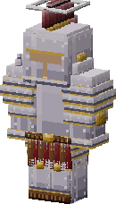
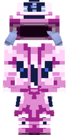
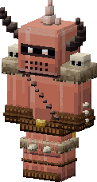
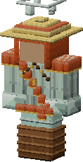
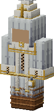
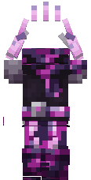
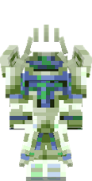
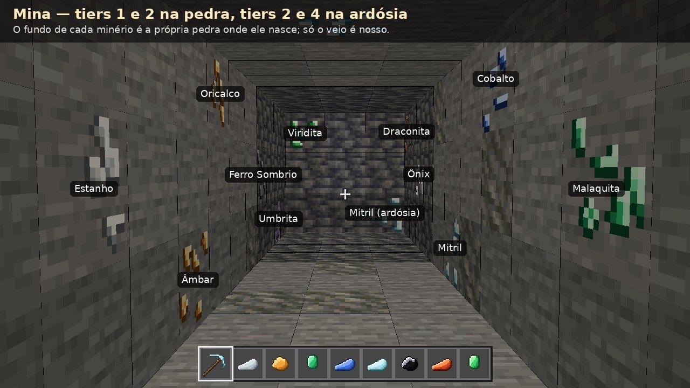

---
hide:
  - toc
  - navigation
---

<h1>Velária</h1>

Mil anos depois da queda da Estrela Partida, você acorda no cais de Porto Alvorada sem lembrar do próprio nome.
Escolha sua Linhagem, jure a uma Ordem, forje suas armas e suba os 5 tiers de um MMORPG feito em Minecraft.

<a href="comecando.html">Começar aqui</a><a class="sec" href="tiers.html">Como subir de tier</a>

## Por onde começar

<a class="card" href="comecando.html"><h3><svg class="mi" width="22" height="22" fill="currentColor" xmlns="http://www.w3.org/2000/svg" viewBox="0 0 24 24"><path d="M14.4 6H20v10h-7l-.4-2H7v7H5V4h9zm-.4 8h2v-2h2v-2h-2V8h-2v2l-1-2V6h-2v2H9V6H7v2h2v2H7v2h2v-2h2v2h2v-2l1 2zm-3-4V8h2v2zm3 0h2v2h-2z"/></svg> Seu primeiro dia</h3>
Passo a passo do que fazer ao entrar, sem pular nada.
</a>
<a class="card" href="linhagens.html"><h3><svg class="mi" width="22" height="22" fill="currentColor" xmlns="http://www.w3.org/2000/svg" viewBox="0 0 24 24"><path d="M12 5.5A3.5 3.5 0 0 1 15.5 9a3.5 3.5 0 0 1-3.5 3.5A3.5 3.5 0 0 1 8.5 9 3.5 3.5 0 0 1 12 5.5M5 8c.56 0 1.08.15 1.53.42-.15 1.43.27 2.85 1.13 3.96C7.16 13.34 6.16 14 5 14a3 3 0 0 1-3-3 3 3 0 0 1 3-3m14 0a3 3 0 0 1 3 3 3 3 0 0 1-3 3c-1.16 0-2.16-.66-2.66-1.62a5.54 5.54 0 0 0 1.13-3.96c.45-.27.97-.42 1.53-.42M5.5 18.25c0-2.07 2.91-3.75 6.5-3.75s6.5 1.68 6.5 3.75V20h-13zM0 20v-1.5c0-1.39 1.89-2.56 4.45-2.9-.59.68-.95 1.62-.95 2.65V20zm24 0h-3.5v-1.75c0-1.03-.36-1.97-.95-2.65 2.56.34 4.45 1.51 4.45 2.9z"/></svg> Linhagens</h3>
13 povos. Cada um tem um talento e uma fraqueza de verdade.
</a>
<a class="card" href="ordens.html"><h3><svg class="mi" width="22" height="22" fill="currentColor" xmlns="http://www.w3.org/2000/svg" viewBox="0 0 24 24"><path d="M12 1 3 5v6c0 5.5 3.8 10.7 9 12 5.2-1.3 9-6.5 9-12V5zm3 14h-2v3h-2v-3H9v-2h2l-1-5.9 2-1.6 2 1.6-1 5.9h2z"/></svg> Ordens</h3>
11 classes, cada uma com armadura própria em todos os tiers.
</a>
<a class="card" href="tiers.html"><h3><svg class="mi" width="22" height="22" fill="currentColor" xmlns="http://www.w3.org/2000/svg" viewBox="0 0 24 24"><path d="M15 6h7v3h-4v4h-4v4h-4v4H3v-3h4v-4h4v-4h4zm-4.83.66-5.51 5.51-1.83-1.83 5.51-5.51L6.5 3H12v5.5z"/></svg> Os 5 tiers</h3>
Até onde você pode andar e o que precisa para subir.
</a>
<a class="card" href="minerios.html"><h3><svg class="mi" width="22" height="22" fill="currentColor" xmlns="http://www.w3.org/2000/svg" viewBox="0 0 24 24"><path d="M14.79 10.62 3.5 21.9l-1.4-1.4L13.38 9.21zm4.48-2.89.59-.59-.79-.79.64-.64-1.42-1.42-.64.64-.79-.79-.59.59c-1.74-1.42-3.7-2.56-5.8-3.36l-.83 1.79c1.75.92 3.36 2.03 4.86 3.34L14 7l3 3 .5-.5c1.31 1.5 2.42 3.11 3.34 4.86l1.79-.83c-.8-2.1-1.94-4.06-3.36-5.8"/></svg> Minérios</h3>
Onde nasce cada minério, com fotos de como ele aparece no mundo.
</a>
<a class="card" href="forja.html"><h3><svg class="mi" width="22" height="22" fill="currentColor" xmlns="http://www.w3.org/2000/svg" viewBox="0 0 24 24"><path d="M9 5v5c4.03 2.47-.56 4.97-3 6v3h15v-3c-6.41-2.73-3.53-7 1-8V5zM2 6c.81 2.13 2.42 3.5 5 4V6z"/></svg> A forja</h3>
Bigornas, ligas e como fazer uma peça Obra-prima.
</a>
<a class="card" href="equipamentos.html"><h3>Armas e armaduras</h3>
O equipamento de cada Ordem, tier por tier, com os materiais animados.
</a>
<a class="card" href="economia.html"><h3><svg class="mi" width="22" height="22" fill="currentColor" xmlns="http://www.w3.org/2000/svg" viewBox="0 0 24 24"><path d="M5 6h18v12H5zm9 3a3 3 0 0 1 3 3 3 3 0 0 1-3 3 3 3 0 0 1-3-3 3 3 0 0 1 3-3M9 8a2 2 0 0 1-2 2v4a2 2 0 0 1 2 2h10a2 2 0 0 1 2-2v-4a2 2 0 0 1-2-2zm-8 2h2v10h16v2H1z"/></svg> Economia</h3>
Moedas, contratos, leilão e caça a procurados.
</a>
<a class="card" href="receitas.html"><h3><svg class="mi" width="22" height="22" fill="currentColor" xmlns="http://www.w3.org/2000/svg" viewBox="0 0 24 24"><path d="M15.5 12c2.5 0 4.5 2 4.5 4.5 0 .88-.25 1.71-.69 2.4l3.08 3.1L21 23.39l-3.12-3.07c-.69.43-1.51.68-2.38.68-2.5 0-4.5-2-4.5-4.5s2-4.5 4.5-4.5m0 2a2.5 2.5 0 0 0-2.5 2.5 2.5 2.5 0 0 0 2.5 2.5 2.5 2.5 0 0 0 2.5-2.5 2.5 2.5 0 0 0-2.5-2.5M6 22a2 2 0 0 1-2-2V4a2 2 0 0 1 2-2h1v7l2.5-1.5L12 9V2h6a2 2 0 0 1 2 2v7.81A6.48 6.48 0 0 0 15.5 10 6.5 6.5 0 0 0 9 16.5c0 2.31 1.21 4.35 3.03 5.5z"/></svg> Receitas no jogo</h3>
Como achar qualquer receita apertando uma tecla.
</a>

## Velária em 30 segundos

<h3>Você sobe sozinho</h3>
Tier só sobe se você estava lá quando o chefe morreu. Ninguém sobe de carona.

<h3>Sua Ordem, suas armas</h3>
Cada Ordem tem materiais exclusivos. Item de outra Ordem cai do seu inventário.

<h3>Tudo é forjado</h3>
Armas e armaduras saem da bigorna, com qualidade de Ruim a Obra-prima.

<h3>Moeda não se fabrica</h3>
Dinheiro vem de contratos, vendas, chefes e recompensas.

