# Magia

As magias usam o **Spell Engine**: Mago (Wizards), Sacerdote e Paladino (Paladins), Lâmina Arcana (Spellblades) e as habilidades das outras classes. Este guia é do **Mago**, mas as regras de runas e árvore valem para todos.

!!! warning "Sem runa, sem magia"
    Toda magia gasta **1 runa da escola dela** a cada lançamento. Se o cajado não solta nada, faltam runas. Quem jura pelo Círculo Arcano ganha 32 runas de cada escola e uma **Bolsa de Runas**.

## Como lançar

1. Segure uma **varinha** ou **cajado**. A barra de magias aparece no lugar da hotbar.
2. Use as teclas **1 a 9** para escolher a magia e o **botão direito** para lançar.
3. Segure **Alt** para voltar à hotbar normal sem largar o cajado.
4. Aperte **K → Class Skills** e escolha a raiz **Arcano, Fogo ou Gelo**. Cada ponto destranca uma magia nova. Os pontos vêm de matar monstros.

## Runas

<figure>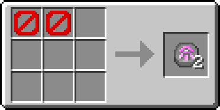<figcaption>Runa Arcana (bancada)</figcaption></figure>
<figure>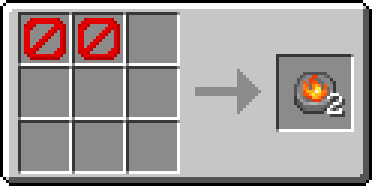<figcaption>Runa de Fogo</figcaption></figure>
<figure>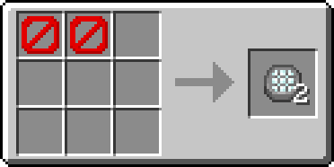<figcaption>Runa de Gelo</figcaption></figure>
<figure>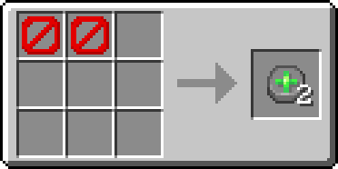<figcaption>Runa de Cura</figcaption></figure>
<figure>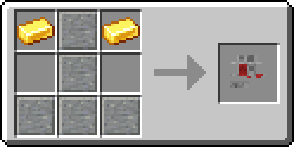<figcaption>Altar de Runas (16 por vez)</figcaption></figure>
<figure>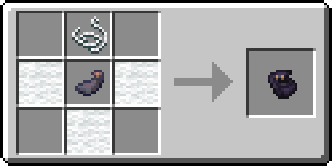<figcaption>Bolsa de Runas</figcaption></figure>

## Varinhas e cajados por tier

| Tier | Arma | Receita |
| --- | --- | --- |
| 1 | **Varinha do Novato (vem no kit)** | 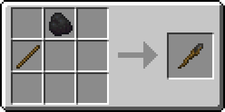 |
| 1 | **Varinha Arcana** | 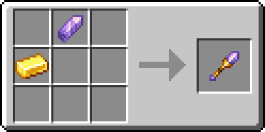 |
| 1 | **Varinha de Fogo** | 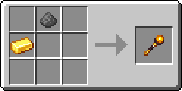 |
| 1 | **Varinha de Gelo** | 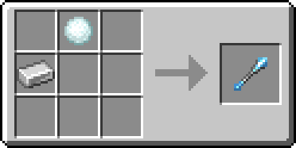 |
| 2 | **Cajado do Mago** | 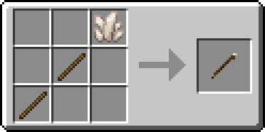 |
| 3 | **Cajado Arcano** | 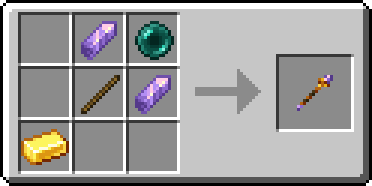 |
| 3 | **Cajado de Fogo** | 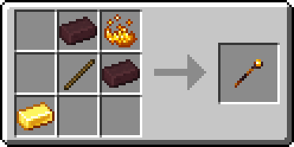 |
| 3 | **Cajado de Gelo** | 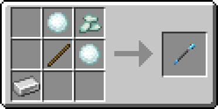 |
| 4 | **Cajado Arcano de Netherite** | 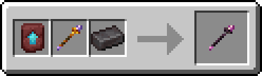 |
| 4 | **Cajado de Fogo de Netherite** | 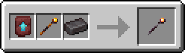 |
| 4 | **Cajado de Gelo de Netherite** | 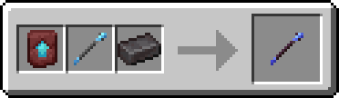 |

## Mantos

Mantos dão pouca armadura e muito **poder mágico**. Só o Círculo Arcano veste.

<figure>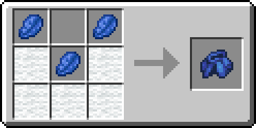<figcaption>Manto do Mago (tiers 1–2)</figcaption></figure>
<figure>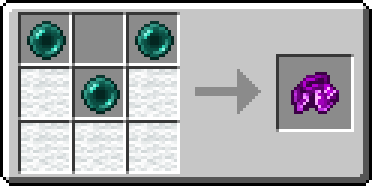<figcaption>Manto Arcano (tier 3)</figcaption></figure>
<figure>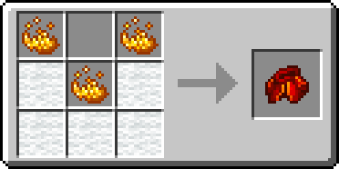<figcaption>Manto de Fogo (tier 3)</figcaption></figure>
<figure>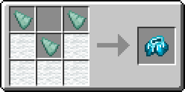<figcaption>Manto de Gelo (tier 3)</figcaption></figure>
<figure>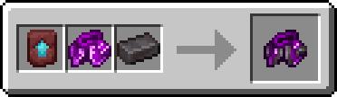<figcaption>Manto Arcano de Netherite (tier 4)</figcaption></figure>

No tier 5 vêm os mantos do **Armory**: Tempestade, Fumegante e Tecelã do Gelo, melhorados com o Cristal do Conquistador (Arcano e Fogo) ou do Vencedor (Gelo) na mesa de ferraria.

## Tomos de magia

A **Mesa de Vinculação** transforma um livro no **Tomo** da sua escola. Vincule as magias do tomo pagando níveis de XP e lápis, e equipe o tomo no slot de Livro de Magia (tecla **G**).

