# Ordens

A Ordem é a sua classe. Cada uma tem **duas armaduras em cada tier** (linha Guardiã e linha de Ataque), feitas só com os materiais dela, e **3 caminhos de arma**, cada um ligado a um deus.

!!! info "Como funciona o caminho de arma"
    Você ganha 1 ponto ao entrar na Ordem e mais 1 a cada tier. Gaste na aba **Caminhos** da árvore de habilidades.
    Se a sua **Graça** é do deus de um desses caminhos, lutar com essa arma dá a bênção maior. Veja as [Graças divinas](#gracas-divinas).

<h2>Legião de Ferro</h2>GuerreiroArmadura pesada

O tanque de linha de frente. Aguenta pancada e segura os inimigos para o grupo.

<figure>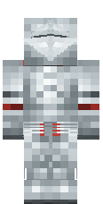<figcaption><b>Tier 1</b>Estanho</figcaption></figure><figure><figcaption><b>Tier 2</b>Oricalco</figcaption></figure><figure>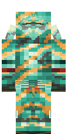<figcaption><b>Tier 3</b>Aço Legionário (liga)</figcaption></figure><figure><figcaption><b>Tier 4</b>Escama Legionária (liga)</figcaption></figure><figure>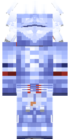<figcaption><b>Tier 5</b>Aço Estelar (liga)</figcaption></figure>

Linha de Ataque: Gladiador

<figure>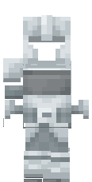<figcaption><b>Tier 1</b>Gladiador</figcaption></figure><figure>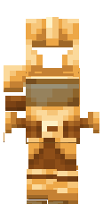<figcaption><b>Tier 2</b>Gladiador</figcaption></figure><figure>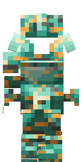<figcaption><b>Tier 3</b>Gladiador</figcaption></figure><figure>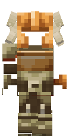<figcaption><b>Tier 4</b>Gladiador</figcaption></figure><figure>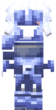<figcaption><b>Tier 5</b>Gladiador</figcaption></figure>

<b>Espada Longa</b> deus: Tyr

<b>Katana</b> deus: Susanoo

<b>Espada</b> deus: Ares

<h2>Ordem da Aurora</h2>PaladinoArmadura pesada

Guerreiro sagrado: bate forte, protege e cura um pouco os aliados.

<figure><figcaption><b>Tier 1</b>Bronze Solar (liga)</figcaption></figure><figure>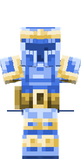<figcaption><b>Tier 2</b>Cobalto</figcaption></figure><figure>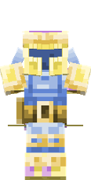<figcaption><b>Tier 3</b>Aço Auroral (liga)</figcaption></figure><figure><figcaption><b>Tier 4</b>Escama Áurea (liga)</figcaption></figure><figure><figcaption><b>Tier 5</b>Estelita</figcaption></figure>

Linha de Ataque: Portador da Luz

<figure>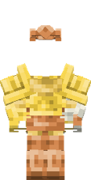<figcaption><b>Tier 1</b>Portador da Luz</figcaption></figure><figure>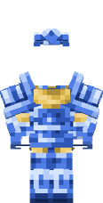<figcaption><b>Tier 2</b>Portador da Luz</figcaption></figure><figure>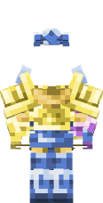<figcaption><b>Tier 3</b>Portador da Luz</figcaption></figure><figure>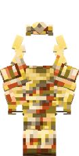<figcaption><b>Tier 4</b>Portador da Luz</figcaption></figure><figure>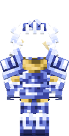<figcaption><b>Tier 5</b>Portador da Luz</figcaption></figure>

<b>Martelo e Maça</b> deus: Thor

<b>Espada</b> deus: Ares

<b>Lança</b> deus: Atena

<h2>Clã da Fúria</h2>BerserkerArmadura pesada

Quanto mais apanha, mais forte fica. Fúria e machado.

<figure><figcaption><b>Tier 1</b>Ferro-Brasa (liga)</figcaption></figure><figure>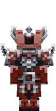<figcaption><b>Tier 2</b>Ferro Sombrio</figcaption></figure><figure>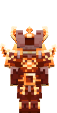<figcaption><b>Tier 3</b>Vulcanita</figcaption></figure><figure>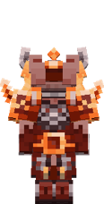<figcaption><b>Tier 4</b>Sangue de Dragão (liga)</figcaption></figure><figure>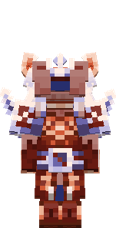<figcaption><b>Tier 5</b>Supernova (liga)</figcaption></figure>

Linha de Ataque: Nortenho

<figure>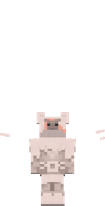<figcaption><b>Tier 1</b>Nortenho</figcaption></figure><figure>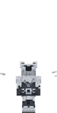<figcaption><b>Tier 2</b>Nortenho</figcaption></figure><figure>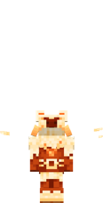<figcaption><b>Tier 3</b>Nortenho</figcaption></figure><figure>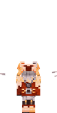<figcaption><b>Tier 4</b>Nortenho</figcaption></figure><figure>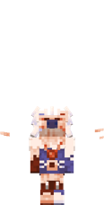<figcaption><b>Tier 5</b>Nortenho</figcaption></figure>

<b>Machado de Guerra</b> deus: Perun

<b>Martelo e Maça</b> deus: Thor

<b>Espada Longa</b> deus: Tyr

<h2>Irmandade do Véu</h2>LadinoArmadura média

Rápido e escondido. Dano enorme pelas costas, pouca vida.

<figure>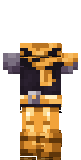<figcaption><b>Tier 1</b>Âmbar</figcaption></figure><figure>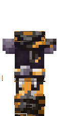<figcaption><b>Tier 2</b>Sombraço (liga)</figcaption></figure><figure>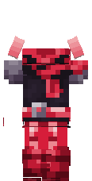<figcaption><b>Tier 3</b>Sangue Velado (liga)</figcaption></figure><figure>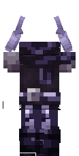<figcaption><b>Tier 4</b>Umbrita</figcaption></figure><figure>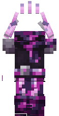<figcaption><b>Tier 5</b>Vazio Velado (liga)</figcaption></figure>

Linha de Ataque: Shinobi

<figure>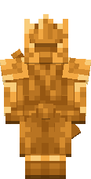<figcaption><b>Tier 1</b>Shinobi</figcaption></figure><figure>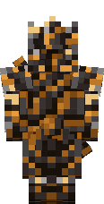<figcaption><b>Tier 2</b>Shinobi</figcaption></figure><figure>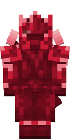<figcaption><b>Tier 3</b>Shinobi</figcaption></figure><figure>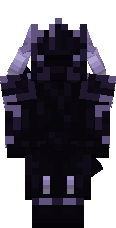<figcaption><b>Tier 4</b>Shinobi</figcaption></figure><figure>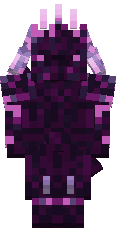<figcaption><b>Tier 5</b>Shinobi</figcaption></figure>

<b>Adagas</b> deus: Loki

<b>Espada</b> deus: Ares

<b>Besta</b> deus: Ullr

<h2>Patrulheiros do Vento</h2>ArqueiroArmadura média

Mata de longe com arco e besta. Fraco se o inimigo chega perto.

<figure>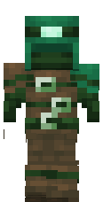<figcaption><b>Tier 1</b>Verdecobre (liga)</figcaption></figure><figure>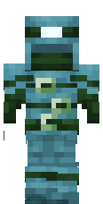<figcaption><b>Tier 2</b>Mitril</figcaption></figure><figure>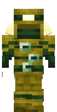<figcaption><b>Tier 3</b>Tempestita</figcaption></figure><figure><figcaption><b>Tier 4</b>Asa Tempestuosa (liga)</figcaption></figure><figure>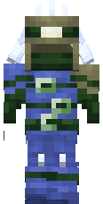<figcaption><b>Tier 5</b>Cometa (liga)</figcaption></figure>

Linha de Ataque: Andarilho

<figure>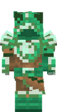<figcaption><b>Tier 1</b>Andarilho</figcaption></figure><figure>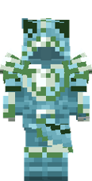<figcaption><b>Tier 2</b>Andarilho</figcaption></figure><figure>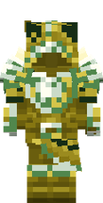<figcaption><b>Tier 3</b>Andarilho</figcaption></figure><figure>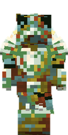<figcaption><b>Tier 4</b>Andarilho</figcaption></figure><figure>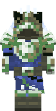<figcaption><b>Tier 5</b>Andarilho</figcaption></figure>

<b>Arco</b> deus: Ártemis

<b>Besta</b> deus: Ullr

<b>Lança</b> deus: Atena

<h2>Escola do Lobo</h2>Bruxo (Witcher)Armadura média

Caçador de monstros: espada, sinais mágicos e poções.

<figure><figcaption><b>Tier 1</b>Prata Lupina (liga)</figcaption></figure><figure><figcaption><b>Tier 2</b>Glaciarita</figcaption></figure><figure><figcaption><b>Tier 3</b>Abissita</figcaption></figure><figure>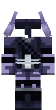<figcaption><b>Tier 4</b>Lobo-Sombra (liga)</figcaption></figure><figure>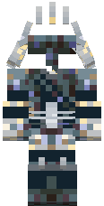<figcaption><b>Tier 5</b>Eclipse Lupino (liga)</figcaption></figure>

Linha de Ataque: Escola do Gato

<figure>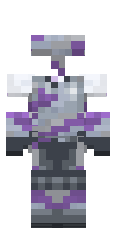<figcaption><b>Tier 1</b>Escola do Gato</figcaption></figure><figure>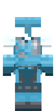<figcaption><b>Tier 2</b>Escola do Gato</figcaption></figure><figure>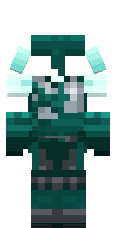<figcaption><b>Tier 3</b>Escola do Gato</figcaption></figure><figure>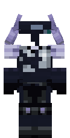<figcaption><b>Tier 4</b>Escola do Gato</figcaption></figure><figure>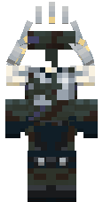<figcaption><b>Tier 5</b>Escola do Gato</figcaption></figure>

<b>Espada</b> deus: Ares

<b>Espada e Sinais</b> deus: Veles

<b>Besta</b> deus: Ullr

<h2>Mosteiro do Punho</h2>MongeArmadura média

Luta de mãos (manoplas) e é o mais veloz de todos.

<figure><figcaption><b>Tier 1</b>Jade Monástico (liga)</figcaption></figure><figure><figcaption><b>Tier 2</b>Ônix</figcaption></figure><figure><figcaption><b>Tier 3</b>Trovejade (liga)</figcaption></figure><figure><figcaption><b>Tier 4</b>Draconita</figcaption></figure><figure><figcaption><b>Tier 5</b>Jade Celestial (liga)</figcaption></figure>

Linha de Ataque: Mestre Samurai

<figure><figcaption><b>Tier 1</b>Mestre Samurai</figcaption></figure><figure><figcaption><b>Tier 2</b>Mestre Samurai</figcaption></figure><figure><figcaption><b>Tier 3</b>Mestre Samurai</figcaption></figure><figure><figcaption><b>Tier 4</b>Mestre Samurai</figcaption></figure><figure><figcaption><b>Tier 5</b>Mestre Samurai</figcaption></figure>

<b>Manoplas</b> deus: Hanuman

<b>Lança</b> deus: Atena

<b>Katana</b> deus: Susanoo

<h2>Lâminas do Crepúsculo</h2>Lâmina ArcanaArmadura média

Mistura espada e magia: golpes que soltam feitiços.

<figure><figcaption><b>Tier 1</b>Âmbar Crepuscular (liga)</figcaption></figure><figure><figcaption><b>Tier 2</b>Ônix Crepuscular (liga)</figcaption></figure><figure><figcaption><b>Tier 3</b>Sangrita</figcaption></figure><figure><figcaption><b>Tier 4</b>Crepúsculo Eterno (liga)</figcaption></figure><figure><figcaption><b>Tier 5</b>Eclipsita</figcaption></figure>

Linha de Ataque: Ronin

<figure><figcaption><b>Tier 1</b>Ronin</figcaption></figure><figure><figcaption><b>Tier 2</b>Ronin</figcaption></figure><figure><figcaption><b>Tier 3</b>Ronin</figcaption></figure><figure><figcaption><b>Tier 4</b>Ronin</figcaption></figure><figure><figcaption><b>Tier 5</b>Ronin</figcaption></figure>

<b>Lâmina Arcana</b> deus: Hécate

<b>Katana</b> deus: Susanoo

<b>Espada Longa</b> deus: Tyr

<h2>Chama Branca</h2>SacerdoteArmadura leve

O curandeiro. Mantém o grupo vivo e queima mortos-vivos.

<figure><figcaption><b>Tier 1</b>Prata</figcaption></figure><figure><figcaption><b>Tier 2</b>Argêntea Celeste (liga)</figcaption></figure><figure><figcaption><b>Tier 3</b>Animita</figcaption></figure><figure><figcaption><b>Tier 4</b>Chama Pálida (liga)</figcaption></figure><figure><figcaption><b>Tier 5</b>Alva Estrela (liga)</figcaption></figure>

Linha de Ataque: Absolvição

<figure><figcaption><b>Tier 1</b>Absolvição</figcaption></figure><figure><figcaption><b>Tier 2</b>Absolvição</figcaption></figure><figure><figcaption><b>Tier 3</b>Absolvição</figcaption></figure><figure><figcaption><b>Tier 4</b>Absolvição</figcaption></figure><figure><figcaption><b>Tier 5</b>Absolvição</figcaption></figure>

<b>Cajado Sagrado</b> deus: Amaterasu

<b>Martelo e Maça</b> deus: Thor

<b>Lança</b> deus: Atena

<h2>Círculo Arcano</h2>MagoArmadura leve

Iron's Spells: escolhe um dos 7 Caminhos Elementais (Arcano, Fogo, Gelo, Tempestade, Luz, Trevas, Natureza) e sobe 5 Círculos. Sem armas físicas. Muito frágil, muito poderoso.

<figure><figcaption><b>Tier 1</b>Âmbar Rúnico (liga)</figcaption></figure><figure><figcaption><b>Tier 2</b>Cobalto Rúnico (liga)</figcaption></figure><figure><figcaption><b>Tier 3</b>Adamantita</figcaption></figure><figure><figcaption><b>Tier 4</b>Umbra Arcana (liga)</figcaption></figure><figure><figcaption><b>Tier 5</b>Vacuíta</figcaption></figure>

Linha de Ataque: Elementalista

<figure><figcaption><b>Tier 1</b>Elementalista</figcaption></figure><figure><figcaption><b>Tier 2</b>Elementalista</figcaption></figure><figure><figcaption><b>Tier 3</b>Elementalista</figcaption></figure><figure><figcaption><b>Tier 4</b>Elementalista</figcaption></figure><figure><figcaption><b>Tier 5</b>Elementalista</figcaption></figure>

<b>Cajado e Orbe</b> deus: Thoth

<b>7 Caminhos Elementais</b> aba Caminhos (K)

<b>5 Círculos</b> 1 por tier

<h2>Círculo do Carvalho</h2>DruidaArmadura leve

Magia da natureza: cura, raízes e invocações.

<figure><figcaption><b>Tier 1</b>Malaquita</figcaption></figure><figure><figcaption><b>Tier 2</b>Bronze Verdejante (liga)</figcaption></figure><figure><figcaption><b>Tier 3</b>Ferrocerne (liga)</figcaption></figure><figure><figcaption><b>Tier 4</b>Viridita</figcaption></figure><figure><figcaption><b>Tier 5</b>Seiva Estelar (liga)</figcaption></figure>

Linha de Ataque: Selvagem

<figure><figcaption><b>Tier 1</b>Selvagem</figcaption></figure><figure><figcaption><b>Tier 2</b>Selvagem</figcaption></figure><figure><figcaption><b>Tier 3</b>Selvagem</figcaption></figure><figure><figcaption><b>Tier 4</b>Selvagem</figcaption></figure><figure><figcaption><b>Tier 5</b>Selvagem</figcaption></figure>

<b>Bastão da Natureza</b> deus: Cernunnos

<b>Foice</b> deus: Morrígan

<b>Lança</b> deus: Atena

## Graças divinas

A Graça é a **4ª tela da criação do personagem**: você escolhe o deus, não é sorteio. Cada deus dá duas coisas:

- **Bênção menor:** vale sempre, para qualquer Ordem.
- **Bênção maior:** com a arma do caminho do deus na mão, **+8% de dano** (ou **+1,5** em arco, besta e magia). Só funciona se a sua Ordem usa essa arma. O nó **Devoção** dobra.

Quer trocar? Use o **Tomo do Destino**: ele reabre a escolha da Graça. Também dá para escolher **Sem Graça** e seguir sem deuses.

| Deus | Bênção menor (sempre) | Arma da bênção maior | Ordens que aproveitam a bênção maior |
|---|---|---|---|
| **Ares** (grego) | +1 de dano corpo a corpo. | Espada | Guerreiro, Paladino, Ladino, Bruxo |
| **Susanoo** (japonês) | 5% mais rápido. | Katana | Guerreiro, Monge, Lâmina Arcana |
| **Tyr** (nórdico) | +15% de resistência a repulsão. | Espada Longa | Guerreiro, Berserker, Lâmina Arcana |
| **Loki** (nórdico) | Alcança criaturas meio bloco mais longe. Anda agachado 30% mais rápido. | Adagas | Ladino |
| **Atena** (grego) | +2 de armadura. | Lança | Paladino, Sacerdote, Arqueiro, Druida, Monge |
| **Thor** (nórdico) | +1 de resistência da armadura. | Martelo e Maça | Paladino, Sacerdote, Berserker |
| **Perun** (eslavo) | Seus golpes empurram mais longe. | Machado de Guerra | Berserker |
| **Morrígan** (celta) | Ataca 5% mais rápido. | Foice | Druida |
| **Hanuman** (hindu) | Pula mais alto. Cai 3 blocos a mais sem se machucar. | Manoplas | Monge |
| **Ártemis** (grego) | +1 de sorte (pesca e baús melhores). | Arco | Arqueiro |
| **Ullr** (nórdico) | +4% de dano à distância. | Besta | Ladino, Arqueiro, Bruxo |
| **Thoth** (egípcio) | +5% de poder mágico. | Cajado (Mago) | Mago (+8% de poder mágico com o cajado; o Arquimago dobra) |
| **Amaterasu** (japonês) | +2 de vida máxima (1 coração). | Cajado Sagrado | Sacerdote |
| **Cernunnos** (celta) | Sobe blocos inteiros sem pular. | Bastão da Natureza | Druida |
| **Hécate** (grego) | Fogo queima você pela metade do tempo. | Lâmina Arcana | Lâmina Arcana |
| **Veles** (eslavo) | Fica mais tempo sem ar e nada mais rápido. Anda melhor dentro da água. | Espada e Sinais | Bruxo |
| **Sem Graça** | Nada. Você renuncia aos deuses. | — | — |
