# Ordens

A Ordem é a sua classe. Cada uma tem **uma armadura própria em cada tier**, feita só com os materiais dela, e **3 caminhos de arma**, cada um ligado a um deus.

!!! info "Como funciona o caminho de arma"
    Você ganha 1 ponto ao entrar na Ordem e mais 1 a cada tier. Gaste na aba **Caminhos** da árvore de habilidades.
    Lutando com a arma do **seu deus**, você ganha **+8% de dano** (ou **+1,5** em arco e magia). O nó **Devoção** dobra esse bônus.

<h2>Legião de Ferro</h2>GuerreiroArmadura pesada

O tanque de linha de frente. Aguenta pancada e segura os inimigos para o grupo.

<figure><figcaption><b>Tier 1</b>Estanho</figcaption></figure><figure>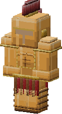<figcaption><b>Tier 2</b>Oricalco</figcaption></figure><figure><figcaption><b>Tier 3</b>Aço Legionário (liga)</figcaption></figure><figure>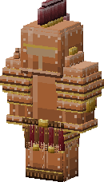<figcaption><b>Tier 4</b>Escama Legionária (liga)</figcaption></figure><figure><figcaption><b>Tier 5</b>Aço Estelar (liga)</figcaption></figure>

<b>Espada Longa</b> deus: Tyr

<b>Katana</b> deus: Susanoo

<b>Espada</b> deus: Ares

<h2>Ordem da Aurora</h2>PaladinoArmadura pesada

Guerreiro sagrado: bate forte, protege e cura um pouco os aliados.

<figure>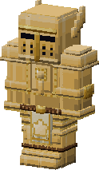<figcaption><b>Tier 1</b>Bronze Solar (liga)</figcaption></figure><figure><figcaption><b>Tier 2</b>Cobalto</figcaption></figure><figure><figcaption><b>Tier 3</b>Aço Auroral (liga)</figcaption></figure><figure>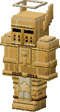<figcaption><b>Tier 4</b>Escama Áurea (liga)</figcaption></figure><figure>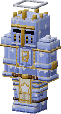<figcaption><b>Tier 5</b>Estelita</figcaption></figure>

<b>Martelo e Maça</b> deus: Thor

<b>Espada</b> deus: Ares

<b>Lança</b> deus: Atena

<h2>Clã da Fúria</h2>BerserkerArmadura pesada

Quanto mais apanha, mais forte fica. Fúria e machado.

<figure>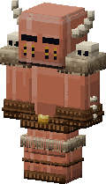<figcaption><b>Tier 1</b>Ferro-Brasa (liga)</figcaption></figure><figure><figcaption><b>Tier 2</b>Ferro Sombrio</figcaption></figure><figure><figcaption><b>Tier 3</b>Vulcanita</figcaption></figure><figure><figcaption><b>Tier 4</b>Sangue de Dragão (liga)</figcaption></figure><figure><figcaption><b>Tier 5</b>Supernova (liga)</figcaption></figure>

<b>Machado de Guerra</b> deus: Perun

<b>Martelo e Maça</b> deus: Thor

<b>Espada Longa</b> deus: Tyr

<h2>Irmandade do Véu</h2>LadinoArmadura média

Rápido e escondido. Dano enorme pelas costas, pouca vida.

<figure><figcaption><b>Tier 1</b>Âmbar</figcaption></figure><figure><figcaption><b>Tier 2</b>Sombraço (liga)</figcaption></figure><figure><figcaption><b>Tier 3</b>Sangue Velado (liga)</figcaption></figure><figure><figcaption><b>Tier 4</b>Umbrita</figcaption></figure><figure><figcaption><b>Tier 5</b>Vazio Velado (liga)</figcaption></figure>

<b>Adagas</b> deus: Loki

<b>Espada</b> deus: Ares

<b>Besta</b> deus: Ullr

<h2>Patrulheiros do Vento</h2>ArqueiroArmadura média

Mata de longe com arco e besta. Fraco se o inimigo chega perto.

<figure><figcaption><b>Tier 1</b>Verdecobre (liga)</figcaption></figure><figure><figcaption><b>Tier 2</b>Mitril</figcaption></figure><figure><figcaption><b>Tier 3</b>Tempestita</figcaption></figure><figure>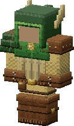<figcaption><b>Tier 4</b>Asa Tempestuosa (liga)</figcaption></figure><figure><figcaption><b>Tier 5</b>Cometa (liga)</figcaption></figure>

<b>Arco</b> deus: Ártemis

<b>Besta</b> deus: Ullr

<b>Lança</b> deus: Atena

<h2>Escola do Lobo</h2>Bruxo (Witcher)Armadura média

Caçador de monstros: espada, sinais mágicos e poções.

<figure>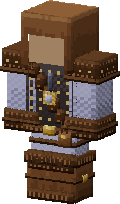<figcaption><b>Tier 1</b>Prata Lupina (liga)</figcaption></figure><figure>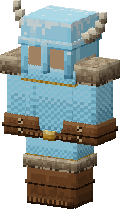<figcaption><b>Tier 2</b>Glaciarita</figcaption></figure><figure>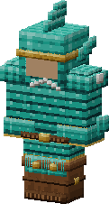<figcaption><b>Tier 3</b>Abissita</figcaption></figure><figure><figcaption><b>Tier 4</b>Lobo-Sombra (liga)</figcaption></figure><figure><figcaption><b>Tier 5</b>Eclipse Lupino (liga)</figcaption></figure>

<b>Espada</b> deus: Ares

<b>Espada e Sinais</b> deus: Veles

<b>Besta</b> deus: Ullr

<h2>Mosteiro do Punho</h2>MongeArmadura média

Luta de mãos (manoplas) e é o mais veloz de todos.

<figure><figcaption><b>Tier 1</b>Jade Monástico (liga)</figcaption></figure><figure><figcaption><b>Tier 2</b>Ônix</figcaption></figure><figure>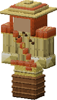<figcaption><b>Tier 3</b>Trovejade (liga)</figcaption></figure><figure><figcaption><b>Tier 4</b>Draconita</figcaption></figure><figure><figcaption><b>Tier 5</b>Jade Celestial (liga)</figcaption></figure>

<b>Manoplas</b> deus: Hanuman

<b>Lança</b> deus: Atena

<b>Katana</b> deus: Susanoo

<h2>Lâminas do Crepúsculo</h2>Lâmina ArcanaArmadura média

Mistura espada e magia: golpes que soltam feitiços.

<figure>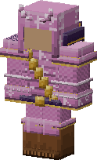<figcaption><b>Tier 1</b>Âmbar Crepuscular (liga)</figcaption></figure><figure>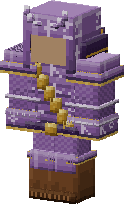<figcaption><b>Tier 2</b>Ônix Crepuscular (liga)</figcaption></figure><figure><figcaption><b>Tier 3</b>Sangrita</figcaption></figure><figure><figcaption><b>Tier 4</b>Crepúsculo Eterno (liga)</figcaption></figure><figure><figcaption><b>Tier 5</b>Eclipsita</figcaption></figure>

<b>Lâmina Arcana</b> deus: Hécate

<b>Katana</b> deus: Susanoo

<b>Espada Longa</b> deus: Tyr

<h2>Chama Branca</h2>SacerdoteArmadura leve

O curandeiro. Mantém o grupo vivo e queima mortos-vivos.

<figure><figcaption><b>Tier 1</b>Prata</figcaption></figure><figure><figcaption><b>Tier 2</b>Argêntea Celeste (liga)</figcaption></figure><figure><figcaption><b>Tier 3</b>Animita</figcaption></figure><figure><figcaption><b>Tier 4</b>Chama Pálida (liga)</figcaption></figure><figure>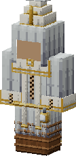<figcaption><b>Tier 5</b>Alva Estrela (liga)</figcaption></figure>

<b>Cajado Sagrado</b> deus: Amaterasu

<b>Martelo e Maça</b> deus: Thor

<b>Lança</b> deus: Atena

<h2>Círculo Arcano</h2>MagoArmadura leve

Dano mágico em área. Muito frágil, muito poderoso.

<figure><figcaption><b>Tier 1</b>Âmbar Rúnico (liga)</figcaption></figure><figure><figcaption><b>Tier 2</b>Cobalto Rúnico (liga)</figcaption></figure><figure><figcaption><b>Tier 3</b>Adamantita</figcaption></figure><figure><figcaption><b>Tier 4</b>Umbra Arcana (liga)</figcaption></figure><figure><figcaption><b>Tier 5</b>Vacuíta</figcaption></figure>

<b>Cajado Arcano</b> deus: Thoth

<b>Adagas</b> deus: Loki

<b>Foice</b> deus: Morrígan

<h2>Círculo do Carvalho</h2>DruidaArmadura leve

Magia da natureza: cura, raízes e invocações.

<figure><figcaption><b>Tier 1</b>Malaquita</figcaption></figure><figure><figcaption><b>Tier 2</b>Bronze Verdejante (liga)</figcaption></figure><figure><figcaption><b>Tier 3</b>Ferrocerne (liga)</figcaption></figure><figure><figcaption><b>Tier 4</b>Viridita</figcaption></figure><figure><figcaption><b>Tier 5</b>Seiva Estelar (liga)</figcaption></figure>

<b>Bastão da Natureza</b> deus: Cernunnos

<b>Foice</b> deus: Morrígan

<b>Lança</b> deus: Atena

