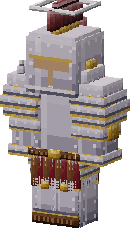
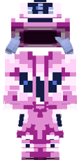
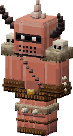
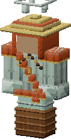
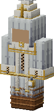
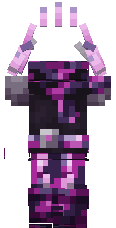
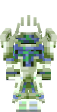
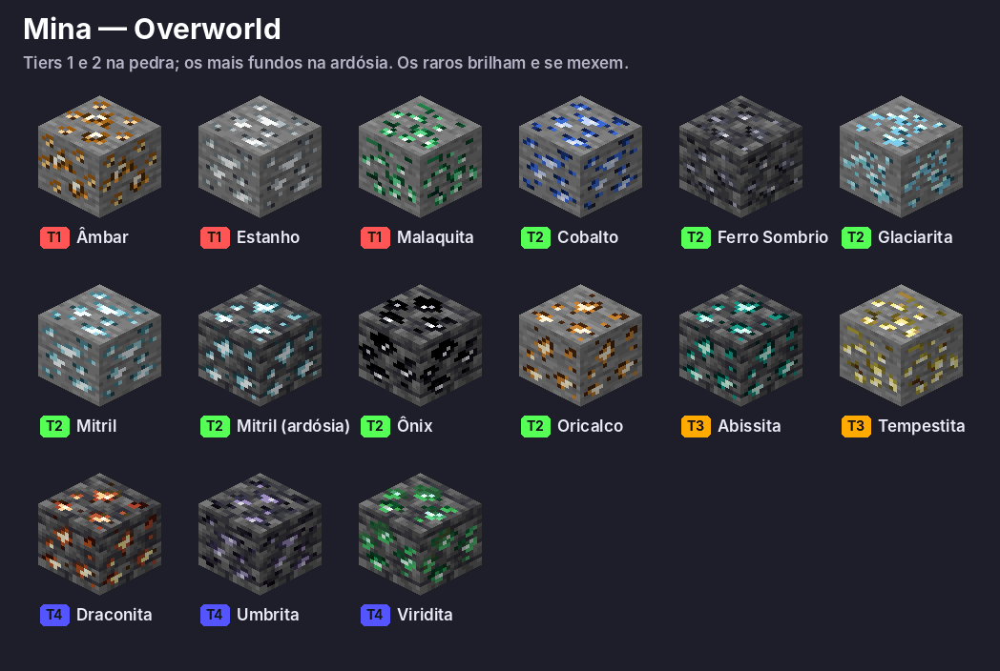

# Velária

Mil anos depois da queda da Estrela Partida, você acorda no cais de Porto Alvorada sem lembrar do próprio nome. Escolha sua Linhagem, jure a uma Ordem, forje suas armas e suba os 5 tiers de um MMORPG feito em Minecraft.

**[Começar aqui →](comecando.md)** · **[Como subir de tier →](tiers.md)**

      

## Novidades da 1.1.19

* **[Mago do Iron's Spells](magia.md)** — 7 Caminhos Elementais, 5 Círculos, livros de magia por tier. Sem armas físicas: cajado e orbe.
* **[Duas linhas de armadura](equipamentos.md)** — Cada material forja a linha Guardiã (defesa) e uma linha de Ataque com tema novo.
* **[Endgame das Ordens](equipamentos.md#endgame-o-equipamento-da-ordem-e-o-melhor-do-jogo)** — Tiers 4 e 5 mais fortes; equipamento de outros mods reduzido.
* **[Efeitos visuais](equipamentos.md#efeitos-visuais)** — Armaduras com brilho animado e aura, golpes com rastro e flechas com rastro.

## Por onde começar

* **[Seu primeiro dia](comecando.md)** — Passo a passo do que fazer ao entrar, sem pular nada.
* **[Linhagens](linhagens.md)** — 13 povos. Cada um tem um talento e uma fraqueza de verdade.
* **[Ordens](ordens.md)** — 11 classes, cada uma com armadura própria em todos os tiers.
* **[Os 5 tiers](tiers.md)** — Até onde você pode andar e o que precisa para subir.
* **[Minérios](minerios.md)** — Onde nasce cada minério, com fotos de como ele aparece no mundo.
* **[A forja](forja.md)** — Bigornas, ligas e como fazer uma peça Obra-prima.
* **[Armas e armaduras](equipamentos.md)** — O equipamento de cada Ordem, tier por tier, com os materiais animados.
* **[Economia](economia.md)** — Moedas, contratos, leilão e caça a procurados.
* **[Receitas no jogo](receitas.md)** — Como achar qualquer receita apertando uma tecla.

## Velária em 30 segundos

* **Você sobe sozinho** — Tier só sobe se você estava lá quando o chefe morreu. Ninguém sobe de carona.
* **Sua Ordem, suas armas** — Cada Ordem tem materiais exclusivos. Item de outra Ordem cai do seu inventário.
* **Tudo é forjado** — Armas e armaduras saem da bigorna, com qualidade de Ruim a Obra-prima.
* **Moeda não se fabrica** — Dinheiro vem de contratos, vendas, chefes e recompensas.

