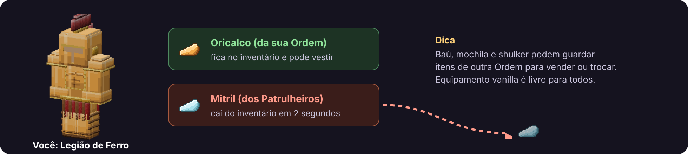

# Seu primeiro dia

## Antes de entrar

1. **Instale o modpack** — Baixe o arquivo **Velaria-MMORPG** (`.mrpack`) mais recente e importe no **Modrinth App** (Adicionar instância → Importar). Ele já traz todos os mods, inclusive os do CurseForge. Use sempre a versão mais nova: com versão velha o servidor recusa a entrada.
2. **Tem Minecraft original?** — Entre direto. O servidor reconhece sua conta e não pede senha.
3. **Não tem original?** — Também pode jogar. Na primeira vez, digite `/register suasenha suasenha`. Nas próximas, `/login suasenha`. Antes de logar você fica parado e sem ver o inventário. Quem entra do mesmo IP no mesmo dia não precisa digitar de novo.
4. **Escolha sua skin** — Sem conta original você aparece como Steve. Digite `/skin set NomeDeAlguém` com o nick de qualquer conta original para usar a skin dela.


**Guarde sua senha**

Se esquecer, peça para um admin redefinir. Trocar a senha dentro do jogo: `/auth changepassword nova nova`.


## No jogo

Faça estes passos na ordem. Em 20 minutos você já está minerando e forjando.

1. **Entre e leia a introdução** — Aparece **VELÁRIA** na tela e a história no chat. Você ganha o **Diário do Desperto**: clique direito nele quando tiver dúvida.
2. **Escolha sua Linhagem e seu Ofício** — A Linhagem é o seu povo: Humano, Anão, Elfo, Orc... Cada um tem um ponto forte e uma fraqueza. Logo depois vem o **Ofício**, sua profissão: minerador, ferreiro, cozinheiro... Veja [Linhagens e Ofícios](linhagens.md).
3. **Jure a uma Ordem** — É a sua classe. Ela decide sua armadura, suas armas e seus materiais. **Não dá para usar o equipamento de outra Ordem.** Veja as [11 Ordens](ordens.md).
4. **Escolha a Graça de um deus** — A última tela. Cada deus dá uma bênção que vale sempre e outra mais forte com a arma dele na mão. Escolha um deus que use uma arma da sua Ordem. Veja as [Graças](ordens.md#gracas-divinas).
5. **Pegue um contrato** — Na praça de Porto Alvorada, fale com o **Mercante de Contratos**. Contrato é a forma mais fácil de ganhar as primeiras moedas.
6. **Minere o tier 1** — Faça a picareta de cobre e procure **Estanho**, **Âmbar** e **Malaquita** na pedra. Cada minério só cai com a picareta do anterior.
7. **Monte sua primeira bigorna** — Agache (Shift) e clique direito numa pedra com um martelo de ferreiro: ela vira a **Bigorna de Pedra**. Veja [como forjar](forja.md).
8. **Mate Elites para subir ao tier 2** — Elites são monstros mais fortes, com nome. Estar perto quando 3 a 6 deles morrem sobe você de tier.


**Perdeu algo? Aperte `/menu`**

O menu mostra seu tier, sua Ordem, sua Graça e os comandos principais.


## O Juramento: por que meu item caiu?

<figure><figcaption>
Itens de outra Ordem caem do inventário a cada 2 segundos, até armadura vestida.
</figcaption></figure>
