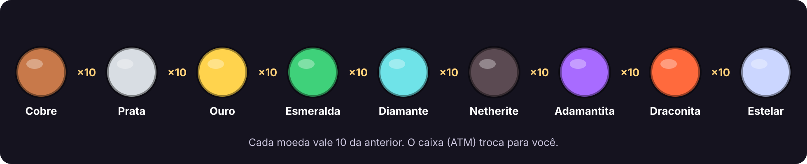

# Economia

**Moeda não se fabrica.** Todo dinheiro do servidor vem de trabalho: contratos, vendas, Elites, chefes e recompensas.

<figure><figcaption>
As moedas de Velária, da menor para a maior.
</figcaption></figure>

## Onde ganhar e gastar em Porto Alvorada

* **Mercante de Contratos** — Contratos de coleta, de caça e do Chefe Lendário. Você paga pelo contrato e recebe mais ao cumprir.
* **Bancas das Ordens** — Uma por Ordem. Troca as Insígnias da sua Ordem por equipamento e consumíveis.
* **Comprador do Rei** — O servidor compra seus lingotes e gemas até o tier 4.
* **Casa de Leilões** — Venda entre jogadores. Material do tier 5 só se negocia aqui.

## Honra e caça a procurados

Matar jogadores sem motivo baixa sua **Honra**. Com honra baixa, você vira **Procurado** e quem te matar ganha a recompensa. A **Carta de Perdão** limpa sua ficha.

## Viagem rápida

As **Waystones** são caras de propósito: só compradas de aldeão nível 100+ ou feitas com minério de tier alto. Antes disso, use os **pergaminhos de retorno e de teleporte**.
