# Armas e armaduras

Todo equipamento de Ordem sai da **bigorna** (veja [A forja](forja.md)). O desenho vem do mod da própria classe: o Guerreiro veste a armadura gótica do Epic Knights, o Mago o manto do Wizards, o Bruxo a armadura do Lobo do Witcher. O **material** pinta a peça, e os **frisos e tecidos** levam a cor da Ordem.

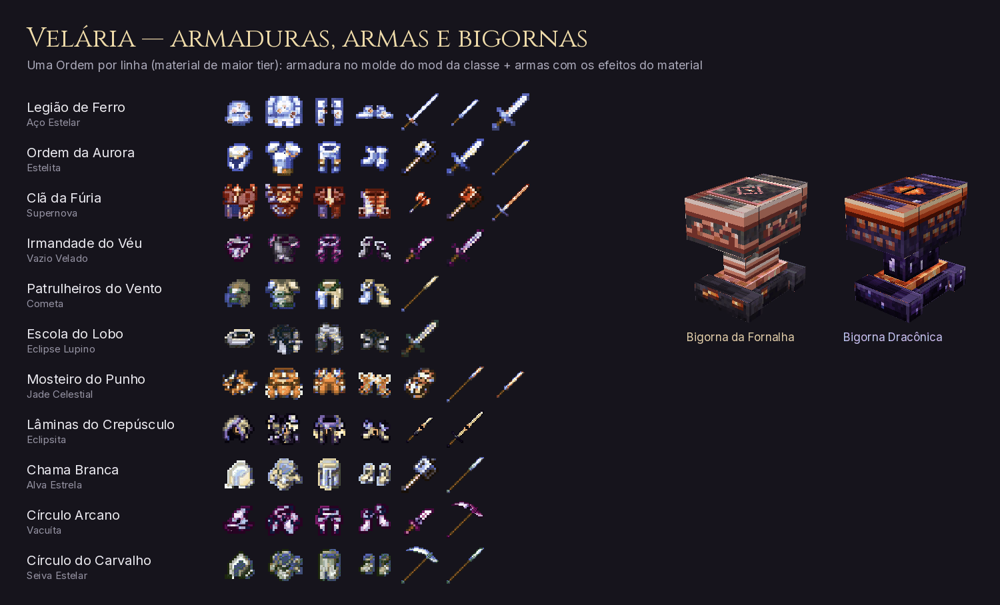

## Materiais que ganham vida

Os materiais raros têm **efeito animado** em tudo que é feito com eles: lingote, picareta, arma e armadura.

* **Estelita** — Estrelas piscando no metal.
* **Vacuíta** — Um vazio girando no centro da peça.
* **Eclipsita** — Um eclipse dourado que pulsa.
* **Draconita** — Brasas que acendem e apagam.
* **Umbrita** — Sombra escorrendo da peça.
* **Adamantita** — Um brilho violeta correndo pelo metal.
* **Gemas raras** — Tempestita solta faíscas; Vulcanita, Animita, Sangrita e Viridita pulsam na própria cor.
* **Ligas de tier 4 e 5** — Um brilho corre pela peça; no tier 5 aparece uma estrela.

## Equipamento de cada Ordem

Cada linha é um tier, com a armadura (cabeça, peito, pernas e pés) e as armas da Ordem.



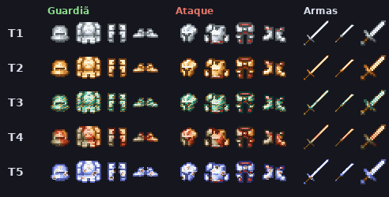


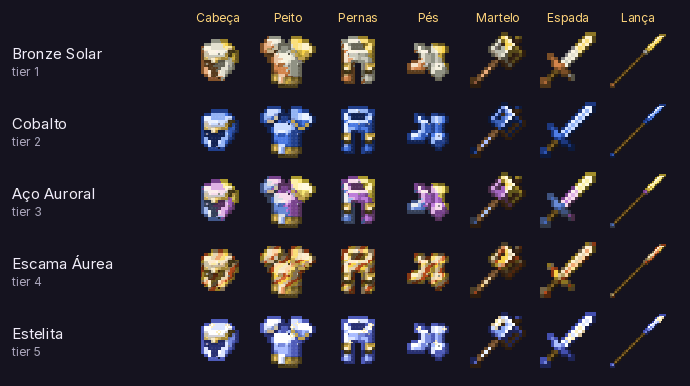


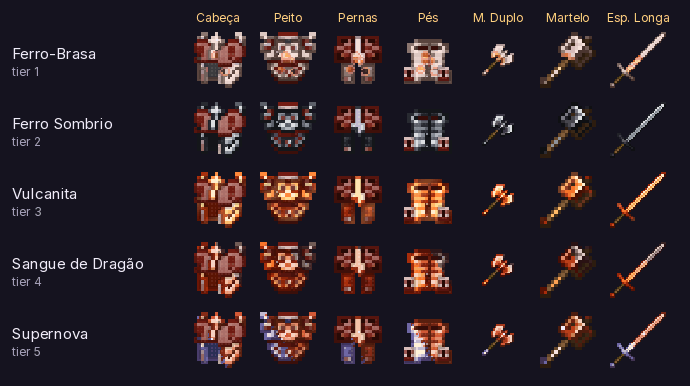


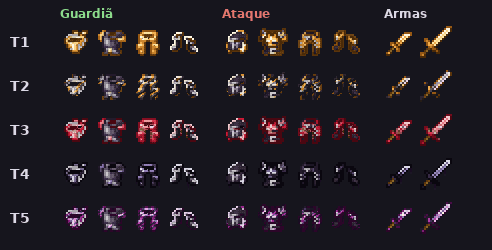


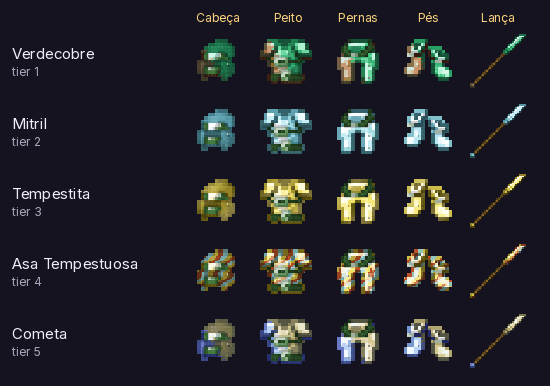


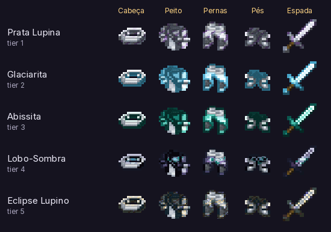


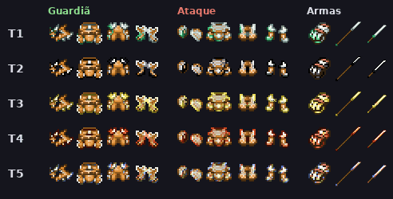


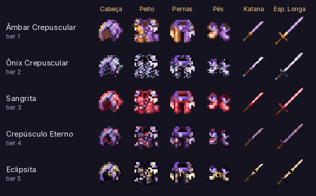


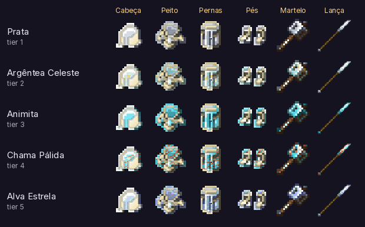


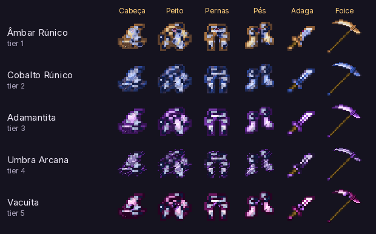


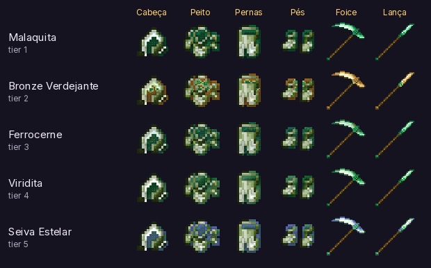



## Na mão e no corpo

As armas têm volume quando você segura, e as armaduras saltam do corpo em 3D.



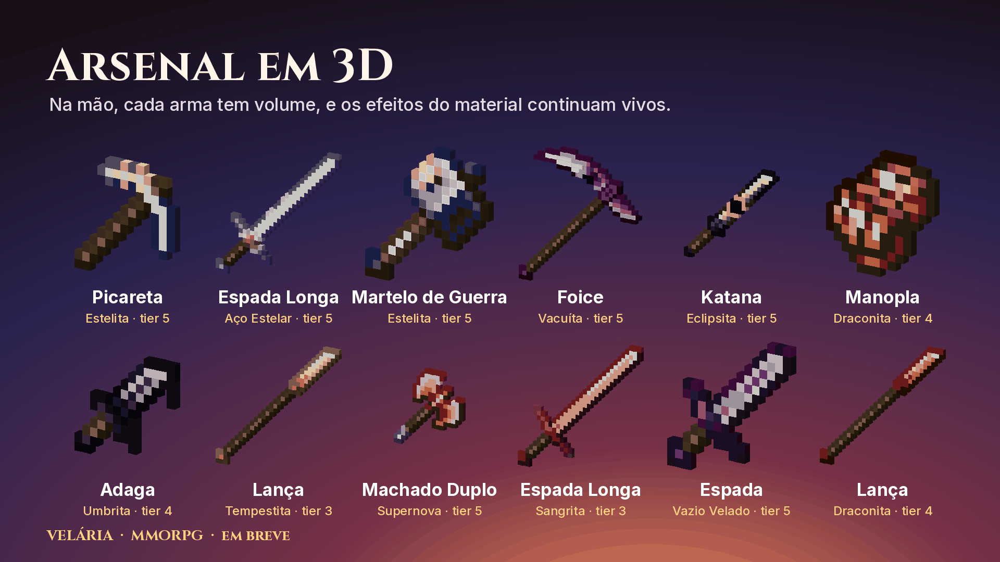


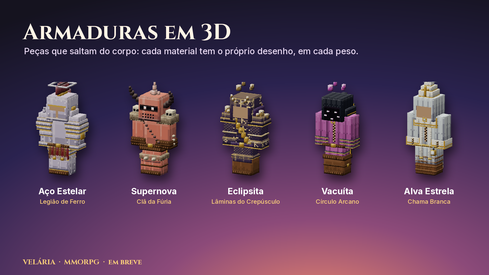



## Picaretas

As picaretas seguem a cadeia de minérios: cada uma quebra o minério seguinte. O molde é o da picareta de ferro do Minecraft.

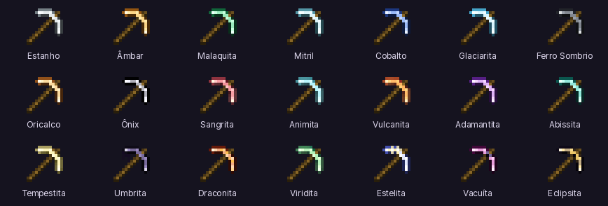


**Magia**

Mago, Sacerdote e Druida lançam magia com **cajado ou varinha** na mão: o Mago começa com a Varinha de Novato, o Sacerdote com a Varinha de Acólito e o Druida com a Varinha da Natureza. Com adaga, foice, martelo ou lança, eles lutam corpo a corpo.

