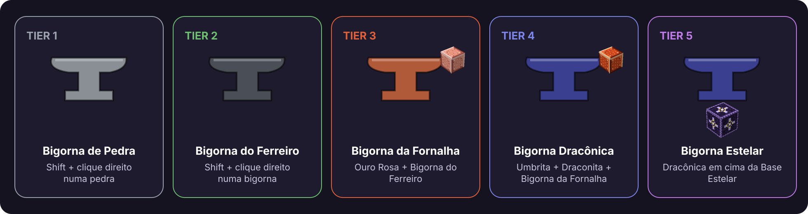
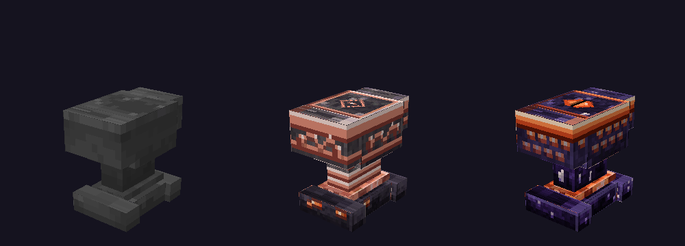
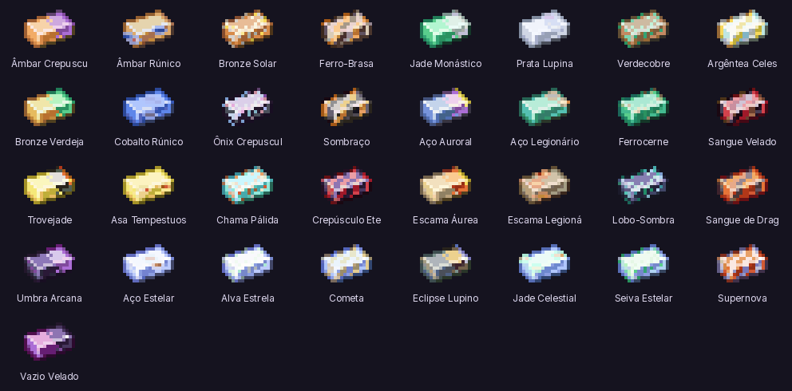
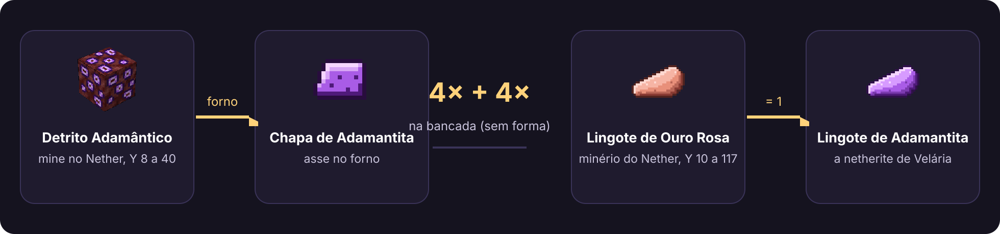

# A forja

Armas, armaduras e ligas **não são feitas na bancada**: elas são forjadas na **bigorna**, com marteladas. Quanto melhor você martela, melhor a peça.

## As 5 bigornas

Cada tier pede uma bigorna melhor. Para montar a próxima, você precisa do minério do tier atual.

<figure><figcaption>
A bigorna certa aparece na receita do EMI. Material do tier 5 só é forjado com a Base Estelar embaixo.
</figcaption></figure>

As bigornas de tier alto são vivas: na **Bigorna da Fornalha** as brasas da base respiram, e na **Bigorna Dracônica** o olho e a mesa pulsam como brasa, enquanto as lágrimas de obsidiana cintilam.

## Como forjar, passo a passo

1. **Coloque os materiais na bigorna** — Clique direito na bigorna com o material na mão, no formato da receita (veja no EMI).
2. **Pegue o martelo e agache** — Segure Shift e clique na bigorna com o martelo de ferreiro para começar o minigame.
3. **Acerte o ritmo** — Martele quando o marcador estiver na zona certa. Cada acerto melhora a qualidade.
4. **Pegue a peça** — A qualidade aparece no nome do item. Armaduras levam várias marteladas: tenha paciência.

## Qualidade da peça

| Qualidade | Bônus |
|---|---|
| Ruim | −0,5 |
| Boa | 0 |
| Especialista | +0,5 |
| Perfeita | +0,75 |
| Obra-prima | +1 |

*Bônus de armadura por peça. No dano das armas vai de −0,5 (Ruim) a +1,5 (Obra-prima).*

## Ligas: misturando minérios

33 dos 55 materiais são **ligas**: você mistura minérios na bigorna e ganha 2 lingotes de um metal novo, exclusivo da sua Ordem. A receita de cada liga está no EMI.

Cada liga parece feita dos metais da receita: um metal virando o outro, pedaços cravados com a borda derretida, veios escorrendo ou camadas dobradas como aço damasco.

## Adamantita: a netherite de Velária

<figure><figcaption>
O Detrito Adamântico vira chapa no forno. 4 chapas + 4 lingotes de Ouro Rosa = 1 lingote de Adamantita.
</figcaption></figure>


**Armas e armaduras dos outros mods também vão para a bigorna**

Epic Knights, Immersive Armors, Fantasy Armor, Samurai Dynasty, Simply Swords, os mods de classe e o aço de dragão do Ice and Fire.
Cobre e ouro: Bigorna de Pedra. Ferro e diamante: Bigorna do Ferreiro. Netherite: Bigorna da Fornalha. Aço de dragão: Bigorna Dracônica.
Roupas de pano, couro, cajados e arcos continuam na bancada.

