# Forja de cada Ordem

Armaduras e armas das Ordens saem da **bigorna** (Overgeared): o formato é o mesmo da bancada, mas você martela no minigame e a peça ganha **qualidade** (Ruim até Obra-prima). Escolha sua Ordem:




Tier 1: Estanho

<figure>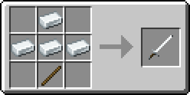<figcaption>
Espada Longa de Estanho
</figcaption></figure>

<figure>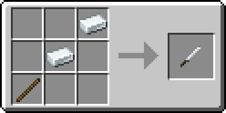<figcaption>
Katana de Estanho
</figcaption></figure>

<figure>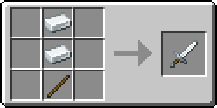<figcaption>
Espada de Estanho
</figcaption></figure>

<figure>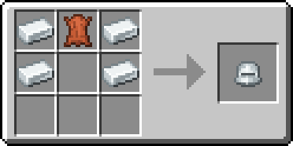<figcaption>
Elmo de Estanho
</figcaption></figure>

<figure>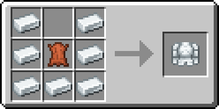<figcaption>
Peitoral de Estanho
</figcaption></figure>

<figure>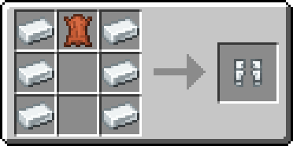<figcaption>
Grevas de Estanho
</figcaption></figure>

<figure>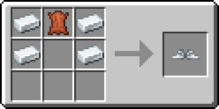<figcaption>
Botas de Estanho
</figcaption></figure>

<figure>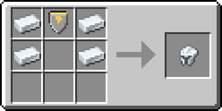<figcaption>
Elmo Feroz de Estanho
</figcaption></figure>

<figure>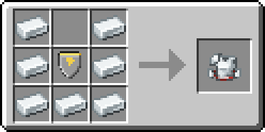<figcaption>
Peitoral Feroz de Estanho
</figcaption></figure>

<figure>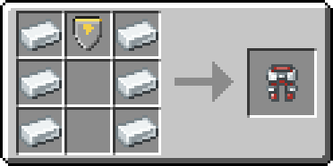<figcaption>
Grevas Ferozes de Estanho
</figcaption></figure>

<figure>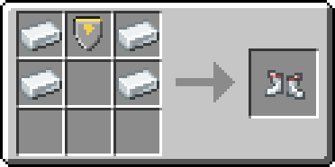<figcaption>
Botas Ferozes de Estanho
</figcaption></figure>

Tier 2: Oricalco

<figure>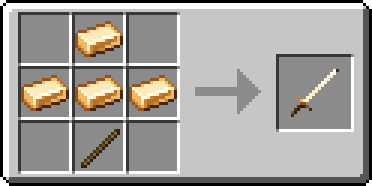<figcaption>
Espada Longa de Oricalco
</figcaption></figure>

<figure>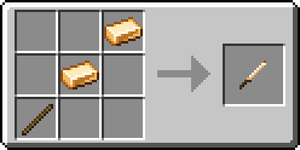<figcaption>
Katana de Oricalco
</figcaption></figure>

<figure>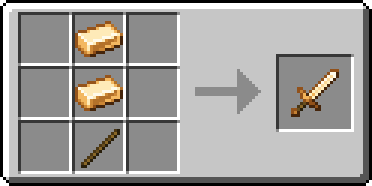<figcaption>
Espada de Oricalco
</figcaption></figure>

<figure>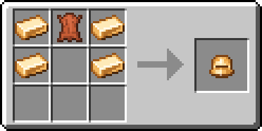<figcaption>
Elmo de Oricalco
</figcaption></figure>

<figure>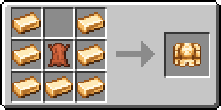<figcaption>
Peitoral de Oricalco
</figcaption></figure>

<figure>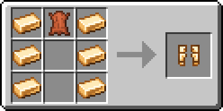<figcaption>
Grevas de Oricalco
</figcaption></figure>

<figure>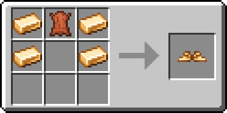<figcaption>
Botas de Oricalco
</figcaption></figure>

<figure>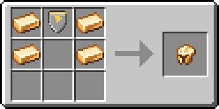<figcaption>
Elmo Feroz de Oricalco
</figcaption></figure>

<figure>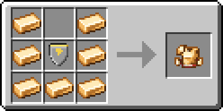<figcaption>
Peitoral Feroz de Oricalco
</figcaption></figure>

<figure>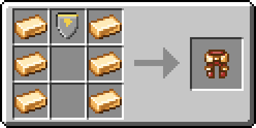<figcaption>
Grevas Ferozes de Oricalco
</figcaption></figure>

<figure>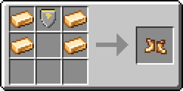<figcaption>
Botas Ferozes de Oricalco
</figcaption></figure>

Tier 3: Aço Legionário

<figure>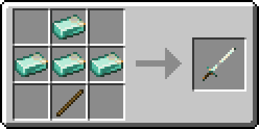<figcaption>
Espada Longa de Aço Legionário
</figcaption></figure>

<figure>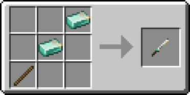<figcaption>
Katana de Aço Legionário
</figcaption></figure>

<figure>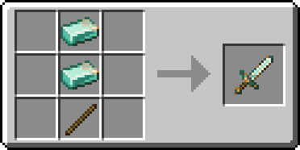<figcaption>
Espada de Aço Legionário
</figcaption></figure>

<figure>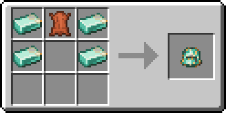<figcaption>
Elmo de Aço Legionário
</figcaption></figure>

<figure>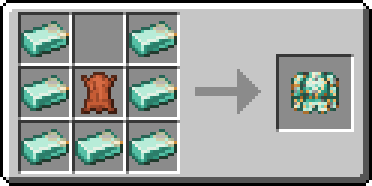<figcaption>
Peitoral de Aço Legionário
</figcaption></figure>

<figure>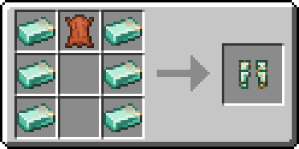<figcaption>
Grevas de Aço Legionário
</figcaption></figure>

<figure>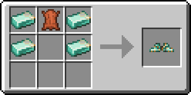<figcaption>
Botas de Aço Legionário
</figcaption></figure>

<figure>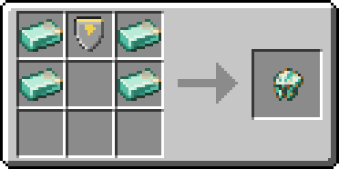<figcaption>
Elmo Feroz de Aço Legionário
</figcaption></figure>

<figure>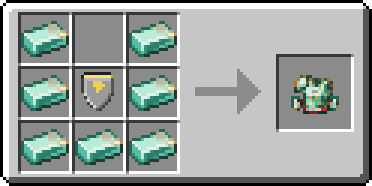<figcaption>
Peitoral Feroz de Aço Legionário
</figcaption></figure>

<figure>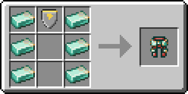<figcaption>
Grevas Ferozes de Aço Legionário
</figcaption></figure>

<figure>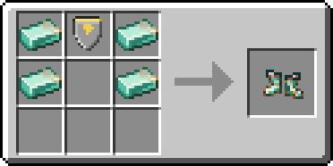<figcaption>
Botas Ferozes de Aço Legionário
</figcaption></figure>

Tier 4: Escama Legionária

<figure>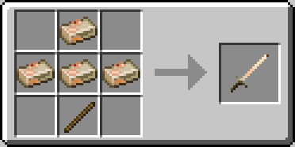<figcaption>
Espada Longa de Escama Legionária
</figcaption></figure>

<figure>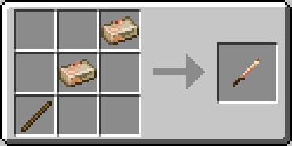<figcaption>
Katana de Escama Legionária
</figcaption></figure>

<figure>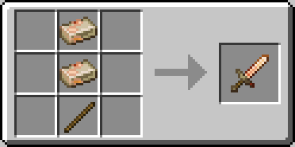<figcaption>
Espada de Escama Legionária
</figcaption></figure>

<figure>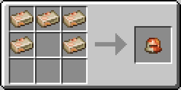<figcaption>
Elmo de Escama Legionária
</figcaption></figure>

<figure>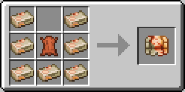<figcaption>
Peitoral de Escama Legionária
</figcaption></figure>

<figure>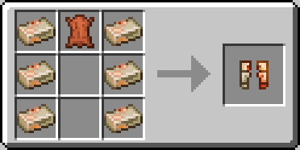<figcaption>
Grevas de Escama Legionária
</figcaption></figure>

<figure>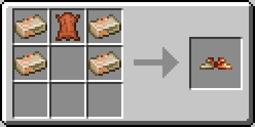<figcaption>
Botas de Escama Legionária
</figcaption></figure>

<figure>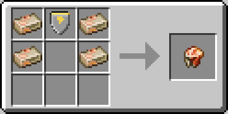<figcaption>
Elmo Feroz de Escama Legionária
</figcaption></figure>

<figure>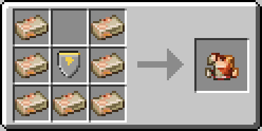<figcaption>
Peitoral Feroz de Escama Legionária
</figcaption></figure>

<figure>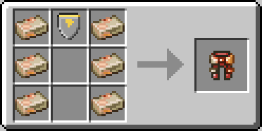<figcaption>
Grevas Ferozes de Escama Legionária
</figcaption></figure>

<figure>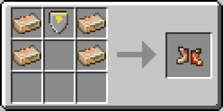<figcaption>
Botas Ferozes de Escama Legionária
</figcaption></figure>

Tier 5: Aço Estelar

<figure>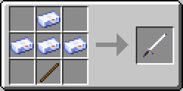<figcaption>
Espada Longa de Aço Estelar
</figcaption></figure>

<figure>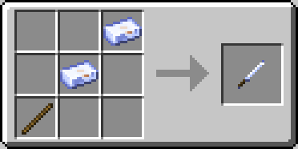<figcaption>
Katana de Aço Estelar
</figcaption></figure>

<figure>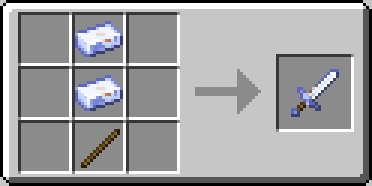<figcaption>
Espada de Aço Estelar
</figcaption></figure>

<figure>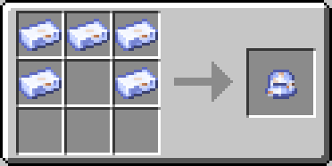<figcaption>
Elmo de Aço Estelar
</figcaption></figure>

<figure>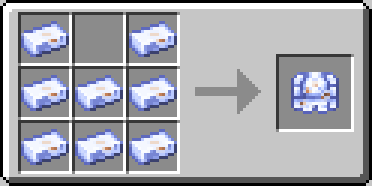<figcaption>
Peitoral de Aço Estelar
</figcaption></figure>

<figure>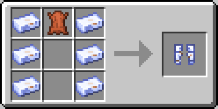<figcaption>
Grevas de Aço Estelar
</figcaption></figure>

<figure><figcaption>
Botas de Aço Estelar
</figcaption></figure>

<figure><figcaption>
Elmo Feroz de Aço Estelar
</figcaption></figure>

<figure><figcaption>
Peitoral Feroz de Aço Estelar
</figcaption></figure>

<figure><figcaption>
Grevas Ferozes de Aço Estelar
</figcaption></figure>

<figure><figcaption>
Botas Ferozes de Aço Estelar
</figcaption></figure>




Tier 1: Bronze Solar

<figure><figcaption>
Martelo de Guerra de Bronze Solar
</figcaption></figure>

<figure><figcaption>
Espada de Bronze Solar
</figcaption></figure>

<figure><figcaption>
Lança de Bronze Solar
</figcaption></figure>

<figure><figcaption>
Elmo de Bronze Solar
</figcaption></figure>

<figure><figcaption>
Peitoral de Bronze Solar
</figcaption></figure>

<figure><figcaption>
Grevas de Bronze Solar
</figcaption></figure>

<figure><figcaption>
Botas de Bronze Solar
</figcaption></figure>

<figure><figcaption>
Elmo Radiante de Bronze Solar
</figcaption></figure>

<figure><figcaption>
Peitoral Radiante de Bronze Solar
</figcaption></figure>

<figure><figcaption>
Grevas Radiantes de Bronze Solar
</figcaption></figure>

<figure><figcaption>
Botas Radiantes de Bronze Solar
</figcaption></figure>

Tier 2: Cobalto

<figure><figcaption>
Martelo de Guerra de Cobalto
</figcaption></figure>

<figure><figcaption>
Espada de Cobalto
</figcaption></figure>

<figure><figcaption>
Lança de Cobalto
</figcaption></figure>

<figure><figcaption>
Elmo de Cobalto
</figcaption></figure>

<figure><figcaption>
Peitoral de Cobalto
</figcaption></figure>

<figure><figcaption>
Grevas de Cobalto
</figcaption></figure>

<figure><figcaption>
Botas de Cobalto
</figcaption></figure>

<figure><figcaption>
Elmo Radiante de Cobalto
</figcaption></figure>

<figure><figcaption>
Peitoral Radiante de Cobalto
</figcaption></figure>

<figure><figcaption>
Grevas Radiantes de Cobalto
</figcaption></figure>

<figure><figcaption>
Botas Radiantes de Cobalto
</figcaption></figure>

Tier 3: Aço Auroral

<figure><figcaption>
Martelo de Guerra de Aço Auroral
</figcaption></figure>

<figure><figcaption>
Espada de Aço Auroral
</figcaption></figure>

<figure><figcaption>
Lança de Aço Auroral
</figcaption></figure>

<figure><figcaption>
Elmo de Aço Auroral
</figcaption></figure>

<figure><figcaption>
Peitoral de Aço Auroral
</figcaption></figure>

<figure><figcaption>
Grevas de Aço Auroral
</figcaption></figure>

<figure><figcaption>
Botas de Aço Auroral
</figcaption></figure>

<figure><figcaption>
Elmo Radiante de Aço Auroral
</figcaption></figure>

<figure><figcaption>
Peitoral Radiante de Aço Auroral
</figcaption></figure>

<figure><figcaption>
Grevas Radiantes de Aço Auroral
</figcaption></figure>

<figure><figcaption>
Botas Radiantes de Aço Auroral
</figcaption></figure>

Tier 4: Escama Áurea

<figure><figcaption>
Martelo de Guerra de Escama Áurea
</figcaption></figure>

<figure><figcaption>
Espada de Escama Áurea
</figcaption></figure>

<figure><figcaption>
Lança de Escama Áurea
</figcaption></figure>

<figure><figcaption>
Elmo de Escama Áurea
</figcaption></figure>

<figure><figcaption>
Peitoral de Escama Áurea
</figcaption></figure>

<figure><figcaption>
Grevas de Escama Áurea
</figcaption></figure>

<figure><figcaption>
Botas de Escama Áurea
</figcaption></figure>

<figure><figcaption>
Elmo Radiante de Escama Áurea
</figcaption></figure>

<figure><figcaption>
Peitoral Radiante de Escama Áurea
</figcaption></figure>

<figure><figcaption>
Grevas Radiantes de Escama Áurea
</figcaption></figure>

<figure><figcaption>
Botas Radiantes de Escama Áurea
</figcaption></figure>

Tier 5: Estelita

<figure><figcaption>
Martelo de Guerra de Estelita
</figcaption></figure>

<figure><figcaption>
Espada de Estelita
</figcaption></figure>

<figure><figcaption>
Lança de Estelita
</figcaption></figure>

<figure><figcaption>
Elmo de Estelita
</figcaption></figure>

<figure><figcaption>
Peitoral de Estelita
</figcaption></figure>

<figure><figcaption>
Grevas de Estelita
</figcaption></figure>

<figure><figcaption>
Botas de Estelita
</figcaption></figure>

<figure><figcaption>
Elmo Radiante de Estelita
</figcaption></figure>

<figure><figcaption>
Peitoral Radiante de Estelita
</figcaption></figure>

<figure><figcaption>
Grevas Radiantes de Estelita
</figcaption></figure>

<figure><figcaption>
Botas Radiantes de Estelita
</figcaption></figure>




Tier 1: Prata

<figure><figcaption>
Martelo de Guerra de Prata
</figcaption></figure>

<figure><figcaption>
Lança de Prata
</figcaption></figure>

<figure><figcaption>
Capuz de Prata
</figcaption></figure>

<figure><figcaption>
Manto de Prata
</figcaption></figure>

<figure><figcaption>
Calças de Prata
</figcaption></figure>

<figure><figcaption>
Sapatos de Prata
</figcaption></figure>

<figure><figcaption>
Capuz Celeste de Prata
</figcaption></figure>

<figure><figcaption>
Manto Celeste de Prata
</figcaption></figure>

<figure><figcaption>
Calças Celestes de Prata
</figcaption></figure>

<figure><figcaption>
Sapatos Celestes de Prata
</figcaption></figure>

Tier 2: Argêntea Celeste

<figure><figcaption>
Martelo de Guerra de Argêntea Celeste
</figcaption></figure>

<figure><figcaption>
Lança de Argêntea Celeste
</figcaption></figure>

<figure><figcaption>
Capuz de Argêntea Celeste
</figcaption></figure>

<figure><figcaption>
Manto de Argêntea Celeste
</figcaption></figure>

<figure><figcaption>
Calças de Argêntea Celeste
</figcaption></figure>

<figure><figcaption>
Sapatos de Argêntea Celeste
</figcaption></figure>

<figure><figcaption>
Capuz Celeste de Argêntea Celeste
</figcaption></figure>

<figure><figcaption>
Manto Celeste de Argêntea Celeste
</figcaption></figure>

<figure><figcaption>
Calças Celestes de Argêntea Celeste
</figcaption></figure>

<figure><figcaption>
Sapatos Celestes de Argêntea Celeste
</figcaption></figure>

Tier 3: Animita

<figure><figcaption>
Martelo de Guerra de Animita
</figcaption></figure>

<figure><figcaption>
Lança de Animita
</figcaption></figure>

<figure><figcaption>
Capuz de Animita
</figcaption></figure>

<figure><figcaption>
Manto de Animita
</figcaption></figure>

<figure><figcaption>
Calças de Animita
</figcaption></figure>

<figure><figcaption>
Sapatos de Animita
</figcaption></figure>

<figure><figcaption>
Capuz Celeste de Animita
</figcaption></figure>

<figure><figcaption>
Manto Celeste de Animita
</figcaption></figure>

<figure><figcaption>
Calças Celestes de Animita
</figcaption></figure>

<figure><figcaption>
Sapatos Celestes de Animita
</figcaption></figure>

Tier 4: Chama Pálida

<figure><figcaption>
Martelo de Guerra de Chama Pálida
</figcaption></figure>

<figure><figcaption>
Lança de Chama Pálida
</figcaption></figure>

<figure><figcaption>
Capuz de Chama Pálida
</figcaption></figure>

<figure><figcaption>
Manto de Chama Pálida
</figcaption></figure>

<figure><figcaption>
Calças de Chama Pálida
</figcaption></figure>

<figure><figcaption>
Sapatos de Chama Pálida
</figcaption></figure>

<figure><figcaption>
Capuz Celeste de Chama Pálida
</figcaption></figure>

<figure><figcaption>
Manto Celeste de Chama Pálida
</figcaption></figure>

<figure><figcaption>
Calças Celestes de Chama Pálida
</figcaption></figure>

<figure><figcaption>
Sapatos Celestes de Chama Pálida
</figcaption></figure>

Tier 5: Alva Estrela

<figure><figcaption>
Martelo de Guerra de Alva Estrela
</figcaption></figure>

<figure><figcaption>
Lança de Alva Estrela
</figcaption></figure>

<figure><figcaption>
Capuz de Alva Estrela
</figcaption></figure>

<figure><figcaption>
Manto de Alva Estrela
</figcaption></figure>

<figure><figcaption>
Calças de Alva Estrela
</figcaption></figure>

<figure><figcaption>
Sapatos de Alva Estrela
</figcaption></figure>

<figure><figcaption>
Capuz Celeste de Alva Estrela
</figcaption></figure>

<figure><figcaption>
Manto Celeste de Alva Estrela
</figcaption></figure>

<figure><figcaption>
Calças Celestes de Alva Estrela
</figcaption></figure>

<figure><figcaption>
Sapatos Celestes de Alva Estrela
</figcaption></figure>




Tier 1: Âmbar Rúnico

<figure><figcaption>
Cajado de Âmbar Rúnico
</figcaption></figure>

<figure><figcaption>
Orbe de Âmbar Rúnico
</figcaption></figure>

<figure><figcaption>
Capuz de Âmbar Rúnico
</figcaption></figure>

<figure><figcaption>
Manto de Âmbar Rúnico
</figcaption></figure>

<figure><figcaption>
Calças de Âmbar Rúnico
</figcaption></figure>

<figure><figcaption>
Sapatos de Âmbar Rúnico
</figcaption></figure>

<figure><figcaption>
Capuz Elemental de Âmbar Rúnico
</figcaption></figure>

<figure><figcaption>
Manto Elemental de Âmbar Rúnico
</figcaption></figure>

<figure><figcaption>
Calças Elementais de Âmbar Rúnico
</figcaption></figure>

<figure><figcaption>
Sapatos Elementais de Âmbar Rúnico
</figcaption></figure>

Tier 2: Cobalto Rúnico

<figure><figcaption>
Cajado de Cobalto Rúnico
</figcaption></figure>

<figure><figcaption>
Orbe de Cobalto Rúnico
</figcaption></figure>

<figure><figcaption>
Capuz de Cobalto Rúnico
</figcaption></figure>

<figure><figcaption>
Manto de Cobalto Rúnico
</figcaption></figure>

<figure><figcaption>
Calças de Cobalto Rúnico
</figcaption></figure>

<figure><figcaption>
Sapatos de Cobalto Rúnico
</figcaption></figure>

<figure><figcaption>
Capuz Elemental de Cobalto Rúnico
</figcaption></figure>

<figure><figcaption>
Manto Elemental de Cobalto Rúnico
</figcaption></figure>

<figure><figcaption>
Calças Elementais de Cobalto Rúnico
</figcaption></figure>

<figure><figcaption>
Sapatos Elementais de Cobalto Rúnico
</figcaption></figure>

Tier 3: Adamantita

<figure><figcaption>
Cajado de Adamantita
</figcaption></figure>

<figure><figcaption>
Orbe de Adamantita
</figcaption></figure>

<figure><figcaption>
Capuz de Adamantita
</figcaption></figure>

<figure><figcaption>
Manto de Adamantita
</figcaption></figure>

<figure><figcaption>
Calças de Adamantita
</figcaption></figure>

<figure><figcaption>
Sapatos de Adamantita
</figcaption></figure>

<figure><figcaption>
Capuz Elemental de Adamantita
</figcaption></figure>

<figure><figcaption>
Manto Elemental de Adamantita
</figcaption></figure>

<figure><figcaption>
Calças Elementais de Adamantita
</figcaption></figure>

<figure><figcaption>
Sapatos Elementais de Adamantita
</figcaption></figure>

Tier 4: Umbra Arcana

<figure><figcaption>
Cajado de Umbra Arcana
</figcaption></figure>

<figure><figcaption>
Orbe de Umbra Arcana
</figcaption></figure>

<figure><figcaption>
Capuz de Umbra Arcana
</figcaption></figure>

<figure><figcaption>
Manto de Umbra Arcana
</figcaption></figure>

<figure><figcaption>
Calças de Umbra Arcana
</figcaption></figure>

<figure><figcaption>
Sapatos de Umbra Arcana
</figcaption></figure>

<figure><figcaption>
Capuz Elemental de Umbra Arcana
</figcaption></figure>

<figure><figcaption>
Manto Elemental de Umbra Arcana
</figcaption></figure>

<figure><figcaption>
Calças Elementais de Umbra Arcana
</figcaption></figure>

<figure><figcaption>
Sapatos Elementais de Umbra Arcana
</figcaption></figure>

Tier 5: Vacuíta

<figure><figcaption>
Cajado de Vacuíta
</figcaption></figure>

<figure><figcaption>
Orbe de Vacuíta
</figcaption></figure>

<figure><figcaption>
Capuz de Vacuíta
</figcaption></figure>

<figure><figcaption>
Manto de Vacuíta
</figcaption></figure>

<figure><figcaption>
Calças de Vacuíta
</figcaption></figure>

<figure><figcaption>
Sapatos de Vacuíta
</figcaption></figure>

<figure><figcaption>
Capuz Elemental de Vacuíta
</figcaption></figure>

<figure><figcaption>
Manto Elemental de Vacuíta
</figcaption></figure>

<figure><figcaption>
Calças Elementais de Vacuíta
</figcaption></figure>

<figure><figcaption>
Sapatos Elementais de Vacuíta
</figcaption></figure>




Tier 1: Âmbar

<figure><figcaption>
Adaga de Âmbar
</figcaption></figure>

<figure><figcaption>
Espada de Âmbar
</figcaption></figure>

<figure><figcaption>
Capacete de Âmbar
</figcaption></figure>

<figure><figcaption>
Cota de Âmbar
</figcaption></figure>

<figure><figcaption>
Perneiras de Âmbar
</figcaption></figure>

<figure><figcaption>
Botas de Âmbar
</figcaption></figure>

<figure><figcaption>
Capacete Fúnebre de Âmbar
</figcaption></figure>

<figure><figcaption>
Cota Fúnebre de Âmbar
</figcaption></figure>

<figure><figcaption>
Perneiras Fúnebres de Âmbar
</figcaption></figure>

<figure><figcaption>
Botas Fúnebres de Âmbar
</figcaption></figure>

Tier 2: Sombraço

<figure><figcaption>
Adaga de Sombraço
</figcaption></figure>

<figure><figcaption>
Espada de Sombraço
</figcaption></figure>

<figure><figcaption>
Capacete de Sombraço
</figcaption></figure>

<figure><figcaption>
Cota de Sombraço
</figcaption></figure>

<figure><figcaption>
Perneiras de Sombraço
</figcaption></figure>

<figure><figcaption>
Botas de Sombraço
</figcaption></figure>

<figure><figcaption>
Capacete Fúnebre de Sombraço
</figcaption></figure>

<figure><figcaption>
Cota Fúnebre de Sombraço
</figcaption></figure>

<figure><figcaption>
Perneiras Fúnebres de Sombraço
</figcaption></figure>

<figure><figcaption>
Botas Fúnebres de Sombraço
</figcaption></figure>

Tier 3: Sangue Velado

<figure><figcaption>
Adaga de Sangue Velado
</figcaption></figure>

<figure><figcaption>
Espada de Sangue Velado
</figcaption></figure>

<figure><figcaption>
Capacete de Sangue Velado
</figcaption></figure>

<figure><figcaption>
Cota de Sangue Velado
</figcaption></figure>

<figure><figcaption>
Perneiras de Sangue Velado
</figcaption></figure>

<figure><figcaption>
Botas de Sangue Velado
</figcaption></figure>

<figure><figcaption>
Capacete Fúnebre de Sangue Velado
</figcaption></figure>

<figure><figcaption>
Cota Fúnebre de Sangue Velado
</figcaption></figure>

<figure><figcaption>
Perneiras Fúnebres de Sangue Velado
</figcaption></figure>

<figure><figcaption>
Botas Fúnebres de Sangue Velado
</figcaption></figure>

Tier 4: Umbrita

<figure><figcaption>
Adaga de Umbrita
</figcaption></figure>

<figure><figcaption>
Espada de Umbrita
</figcaption></figure>

<figure><figcaption>
Capacete de Umbrita
</figcaption></figure>

<figure><figcaption>
Cota de Umbrita
</figcaption></figure>

<figure><figcaption>
Perneiras de Umbrita
</figcaption></figure>

<figure><figcaption>
Botas de Umbrita
</figcaption></figure>

<figure><figcaption>
Capacete Fúnebre de Umbrita
</figcaption></figure>

<figure><figcaption>
Cota Fúnebre de Umbrita
</figcaption></figure>

<figure><figcaption>
Perneiras Fúnebres de Umbrita
</figcaption></figure>

<figure><figcaption>
Botas Fúnebres de Umbrita
</figcaption></figure>

Tier 5: Vazio Velado

<figure><figcaption>
Adaga de Vazio Velado
</figcaption></figure>

<figure><figcaption>
Espada de Vazio Velado
</figcaption></figure>

<figure><figcaption>
Capacete de Vazio Velado
</figcaption></figure>

<figure><figcaption>
Cota de Vazio Velado
</figcaption></figure>

<figure><figcaption>
Perneiras de Vazio Velado
</figcaption></figure>

<figure><figcaption>
Botas de Vazio Velado
</figcaption></figure>

<figure><figcaption>
Capacete Fúnebre de Vazio Velado
</figcaption></figure>

<figure><figcaption>
Cota Fúnebre de Vazio Velado
</figcaption></figure>

<figure><figcaption>
Perneiras Fúnebres de Vazio Velado
</figcaption></figure>

<figure><figcaption>
Botas Fúnebres de Vazio Velado
</figcaption></figure>




Tier 1: Verdecobre

<figure><figcaption>
Lança de Verdecobre
</figcaption></figure>

<figure><figcaption>
Capacete de Verdecobre
</figcaption></figure>

<figure><figcaption>
Cota de Verdecobre
</figcaption></figure>

<figure><figcaption>
Perneiras de Verdecobre
</figcaption></figure>

<figure><figcaption>
Botas de Verdecobre
</figcaption></figure>

<figure><figcaption>
Capacete Errante de Verdecobre
</figcaption></figure>

<figure><figcaption>
Cota Errante de Verdecobre
</figcaption></figure>

<figure><figcaption>
Perneiras Errantes de Verdecobre
</figcaption></figure>

<figure><figcaption>
Botas Errantes de Verdecobre
</figcaption></figure>

Tier 2: Mitril

<figure><figcaption>
Lança de Mitril
</figcaption></figure>

<figure><figcaption>
Capacete de Mitril
</figcaption></figure>

<figure><figcaption>
Cota de Mitril
</figcaption></figure>

<figure><figcaption>
Perneiras de Mitril
</figcaption></figure>

<figure><figcaption>
Botas de Mitril
</figcaption></figure>

<figure><figcaption>
Capacete Errante de Mitril
</figcaption></figure>

<figure><figcaption>
Cota Errante de Mitril
</figcaption></figure>

<figure><figcaption>
Perneiras Errantes de Mitril
</figcaption></figure>

<figure><figcaption>
Botas Errantes de Mitril
</figcaption></figure>

Tier 3: Tempestita

<figure><figcaption>
Lança de Tempestita
</figcaption></figure>

<figure><figcaption>
Capacete de Tempestita
</figcaption></figure>

<figure><figcaption>
Cota de Tempestita
</figcaption></figure>

<figure><figcaption>
Perneiras de Tempestita
</figcaption></figure>

<figure><figcaption>
Botas de Tempestita
</figcaption></figure>

<figure><figcaption>
Capacete Errante de Tempestita
</figcaption></figure>

<figure><figcaption>
Cota Errante de Tempestita
</figcaption></figure>

<figure><figcaption>
Perneiras Errantes de Tempestita
</figcaption></figure>

<figure><figcaption>
Botas Errantes de Tempestita
</figcaption></figure>

Tier 4: Asa Tempestuosa

<figure><figcaption>
Lança de Asa Tempestuosa
</figcaption></figure>

<figure><figcaption>
Capacete de Asa Tempestuosa
</figcaption></figure>

<figure><figcaption>
Cota de Asa Tempestuosa
</figcaption></figure>

<figure><figcaption>
Perneiras de Asa Tempestuosa
</figcaption></figure>

<figure><figcaption>
Botas de Asa Tempestuosa
</figcaption></figure>

<figure><figcaption>
Capacete Errante de Asa Tempestuosa
</figcaption></figure>

<figure><figcaption>
Cota Errante de Asa Tempestuosa
</figcaption></figure>

<figure><figcaption>
Perneiras Errantes de Asa Tempestuosa
</figcaption></figure>

<figure><figcaption>
Botas Errantes de Asa Tempestuosa
</figcaption></figure>

Tier 5: Cometa

<figure><figcaption>
Lança de Cometa
</figcaption></figure>

<figure><figcaption>
Capacete de Cometa
</figcaption></figure>

<figure><figcaption>
Cota de Cometa
</figcaption></figure>

<figure><figcaption>
Perneiras de Cometa
</figcaption></figure>

<figure><figcaption>
Botas de Cometa
</figcaption></figure>

<figure><figcaption>
Capacete Errante de Cometa
</figcaption></figure>

<figure><figcaption>
Cota Errante de Cometa
</figcaption></figure>

<figure><figcaption>
Perneiras Errantes de Cometa
</figcaption></figure>

<figure><figcaption>
Botas Errantes de Cometa
</figcaption></figure>




Tier 1: Ferro-Brasa

<figure><figcaption>
Machado Duplo de Ferro-Brasa
</figcaption></figure>

<figure><figcaption>
Martelo de Guerra de Ferro-Brasa
</figcaption></figure>

<figure><figcaption>
Espada Longa de Ferro-Brasa
</figcaption></figure>

<figure><figcaption>
Elmo de Ferro-Brasa
</figcaption></figure>

<figure><figcaption>
Peitoral de Ferro-Brasa
</figcaption></figure>

<figure><figcaption>
Grevas de Ferro-Brasa
</figcaption></figure>

<figure><figcaption>
Botas de Ferro-Brasa
</figcaption></figure>

<figure><figcaption>
Elmo Boreal de Ferro-Brasa
</figcaption></figure>

<figure><figcaption>
Peitoral Boreal de Ferro-Brasa
</figcaption></figure>

<figure><figcaption>
Grevas Boreais de Ferro-Brasa
</figcaption></figure>

<figure><figcaption>
Botas Boreais de Ferro-Brasa
</figcaption></figure>

Tier 2: Ferro Sombrio

<figure><figcaption>
Machado Duplo de Ferro Sombrio
</figcaption></figure>

<figure><figcaption>
Martelo de Guerra de Ferro Sombrio
</figcaption></figure>

<figure><figcaption>
Espada Longa de Ferro Sombrio
</figcaption></figure>

<figure><figcaption>
Elmo de Ferro Sombrio
</figcaption></figure>

<figure><figcaption>
Peitoral de Ferro Sombrio
</figcaption></figure>

<figure><figcaption>
Grevas de Ferro Sombrio
</figcaption></figure>

<figure><figcaption>
Botas de Ferro Sombrio
</figcaption></figure>

<figure><figcaption>
Elmo Boreal de Ferro Sombrio
</figcaption></figure>

<figure><figcaption>
Peitoral Boreal de Ferro Sombrio
</figcaption></figure>

<figure><figcaption>
Grevas Boreais de Ferro Sombrio
</figcaption></figure>

<figure><figcaption>
Botas Boreais de Ferro Sombrio
</figcaption></figure>

Tier 3: Vulcanita

<figure><figcaption>
Machado Duplo de Vulcanita
</figcaption></figure>

<figure><figcaption>
Martelo de Guerra de Vulcanita
</figcaption></figure>

<figure><figcaption>
Espada Longa de Vulcanita
</figcaption></figure>

<figure><figcaption>
Elmo de Vulcanita
</figcaption></figure>

<figure><figcaption>
Peitoral de Vulcanita
</figcaption></figure>

<figure><figcaption>
Grevas de Vulcanita
</figcaption></figure>

<figure><figcaption>
Botas de Vulcanita
</figcaption></figure>

<figure><figcaption>
Elmo Boreal de Vulcanita
</figcaption></figure>

<figure><figcaption>
Peitoral Boreal de Vulcanita
</figcaption></figure>

<figure><figcaption>
Grevas Boreais de Vulcanita
</figcaption></figure>

<figure><figcaption>
Botas Boreais de Vulcanita
</figcaption></figure>

Tier 4: Sangue de Dragão

<figure><figcaption>
Machado Duplo de Sangue de Dragão
</figcaption></figure>

<figure><figcaption>
Martelo de Guerra de Sangue de Dragão
</figcaption></figure>

<figure><figcaption>
Espada Longa de Sangue de Dragão
</figcaption></figure>

<figure><figcaption>
Elmo de Sangue de Dragão
</figcaption></figure>

<figure><figcaption>
Peitoral de Sangue de Dragão
</figcaption></figure>

<figure><figcaption>
Grevas de Sangue de Dragão
</figcaption></figure>

<figure><figcaption>
Botas de Sangue de Dragão
</figcaption></figure>

<figure><figcaption>
Elmo Boreal de Sangue de Dragão
</figcaption></figure>

<figure><figcaption>
Peitoral Boreal de Sangue de Dragão
</figcaption></figure>

<figure><figcaption>
Grevas Boreais de Sangue de Dragão
</figcaption></figure>

<figure><figcaption>
Botas Boreais de Sangue de Dragão
</figcaption></figure>

Tier 5: Supernova

<figure><figcaption>
Machado Duplo de Supernova
</figcaption></figure>

<figure><figcaption>
Martelo de Guerra de Supernova
</figcaption></figure>

<figure><figcaption>
Espada Longa de Supernova
</figcaption></figure>

<figure><figcaption>
Elmo de Supernova
</figcaption></figure>

<figure><figcaption>
Peitoral de Supernova
</figcaption></figure>

<figure><figcaption>
Grevas de Supernova
</figcaption></figure>

<figure><figcaption>
Botas de Supernova
</figcaption></figure>

<figure><figcaption>
Elmo Boreal de Supernova
</figcaption></figure>

<figure><figcaption>
Peitoral Boreal de Supernova
</figcaption></figure>

<figure><figcaption>
Grevas Boreais de Supernova
</figcaption></figure>

<figure><figcaption>
Botas Boreais de Supernova
</figcaption></figure>




Tier 1: Prata Lupina

<figure><figcaption>
Espada de Prata Lupina
</figcaption></figure>

<figure><figcaption>
Capacete de Prata Lupina
</figcaption></figure>

<figure><figcaption>
Cota de Prata Lupina
</figcaption></figure>

<figure><figcaption>
Perneiras de Prata Lupina
</figcaption></figure>

<figure><figcaption>
Botas de Prata Lupina
</figcaption></figure>

<figure><figcaption>
Capacete Ágil de Prata Lupina
</figcaption></figure>

<figure><figcaption>
Cota Ágil de Prata Lupina
</figcaption></figure>

<figure><figcaption>
Perneiras Ágeis de Prata Lupina
</figcaption></figure>

<figure><figcaption>
Botas Ágeis de Prata Lupina
</figcaption></figure>

Tier 2: Glaciarita

<figure><figcaption>
Espada de Glaciarita
</figcaption></figure>

<figure><figcaption>
Capacete de Glaciarita
</figcaption></figure>

<figure><figcaption>
Cota de Glaciarita
</figcaption></figure>

<figure><figcaption>
Perneiras de Glaciarita
</figcaption></figure>

<figure><figcaption>
Botas de Glaciarita
</figcaption></figure>

<figure><figcaption>
Capacete Ágil de Glaciarita
</figcaption></figure>

<figure><figcaption>
Cota Ágil de Glaciarita
</figcaption></figure>

<figure><figcaption>
Perneiras Ágeis de Glaciarita
</figcaption></figure>

<figure><figcaption>
Botas Ágeis de Glaciarita
</figcaption></figure>

Tier 3: Abissita

<figure><figcaption>
Espada de Abissita
</figcaption></figure>

<figure><figcaption>
Capacete de Abissita
</figcaption></figure>

<figure><figcaption>
Cota de Abissita
</figcaption></figure>

<figure><figcaption>
Perneiras de Abissita
</figcaption></figure>

<figure><figcaption>
Botas de Abissita
</figcaption></figure>

<figure><figcaption>
Capacete Ágil de Abissita
</figcaption></figure>

<figure><figcaption>
Cota Ágil de Abissita
</figcaption></figure>

<figure><figcaption>
Perneiras Ágeis de Abissita
</figcaption></figure>

<figure><figcaption>
Botas Ágeis de Abissita
</figcaption></figure>

Tier 4: Lobo-Sombra

<figure><figcaption>
Espada de Lobo-Sombra
</figcaption></figure>

<figure><figcaption>
Capacete de Lobo-Sombra
</figcaption></figure>

<figure><figcaption>
Cota de Lobo-Sombra
</figcaption></figure>

<figure><figcaption>
Perneiras de Lobo-Sombra
</figcaption></figure>

<figure><figcaption>
Botas de Lobo-Sombra
</figcaption></figure>

<figure><figcaption>
Capacete Ágil de Lobo-Sombra
</figcaption></figure>

<figure><figcaption>
Cota Ágil de Lobo-Sombra
</figcaption></figure>

<figure><figcaption>
Perneiras Ágeis de Lobo-Sombra
</figcaption></figure>

<figure><figcaption>
Botas Ágeis de Lobo-Sombra
</figcaption></figure>

Tier 5: Eclipse Lupino

<figure><figcaption>
Espada de Eclipse Lupino
</figcaption></figure>

<figure><figcaption>
Capacete de Eclipse Lupino
</figcaption></figure>

<figure><figcaption>
Cota de Eclipse Lupino
</figcaption></figure>

<figure><figcaption>
Perneiras de Eclipse Lupino
</figcaption></figure>

<figure><figcaption>
Botas de Eclipse Lupino
</figcaption></figure>

<figure><figcaption>
Capacete Ágil de Eclipse Lupino
</figcaption></figure>

<figure><figcaption>
Cota Ágil de Eclipse Lupino
</figcaption></figure>

<figure><figcaption>
Perneiras Ágeis de Eclipse Lupino
</figcaption></figure>

<figure><figcaption>
Botas Ágeis de Eclipse Lupino
</figcaption></figure>




Tier 1: Malaquita

<figure><figcaption>
Foice de Malaquita
</figcaption></figure>

<figure><figcaption>
Lança de Malaquita
</figcaption></figure>

<figure><figcaption>
Capuz de Malaquita
</figcaption></figure>

<figure><figcaption>
Manto de Malaquita
</figcaption></figure>

<figure><figcaption>
Calças de Malaquita
</figcaption></figure>

<figure><figcaption>
Sapatos de Malaquita
</figcaption></figure>

<figure><figcaption>
Capuz Selvagem de Malaquita
</figcaption></figure>

<figure><figcaption>
Manto Selvagem de Malaquita
</figcaption></figure>

<figure><figcaption>
Calças Selvagens de Malaquita
</figcaption></figure>

<figure><figcaption>
Sapatos Selvagens de Malaquita
</figcaption></figure>

Tier 2: Bronze Verdejante

<figure><figcaption>
Foice de Bronze Verdejante
</figcaption></figure>

<figure><figcaption>
Lança de Bronze Verdejante
</figcaption></figure>

<figure><figcaption>
Capuz de Bronze Verdejante
</figcaption></figure>

<figure><figcaption>
Manto de Bronze Verdejante
</figcaption></figure>

<figure><figcaption>
Calças de Bronze Verdejante
</figcaption></figure>

<figure><figcaption>
Sapatos de Bronze Verdejante
</figcaption></figure>

<figure><figcaption>
Capuz Selvagem de Bronze Verdejante
</figcaption></figure>

<figure><figcaption>
Manto Selvagem de Bronze Verdejante
</figcaption></figure>

<figure><figcaption>
Calças Selvagens de Bronze Verdejante
</figcaption></figure>

<figure><figcaption>
Sapatos Selvagens de Bronze Verdejante
</figcaption></figure>

Tier 3: Ferrocerne

<figure><figcaption>
Foice de Ferrocerne
</figcaption></figure>

<figure><figcaption>
Lança de Ferrocerne
</figcaption></figure>

<figure><figcaption>
Capuz de Ferrocerne
</figcaption></figure>

<figure><figcaption>
Manto de Ferrocerne
</figcaption></figure>

<figure><figcaption>
Calças de Ferrocerne
</figcaption></figure>

<figure><figcaption>
Sapatos de Ferrocerne
</figcaption></figure>

<figure><figcaption>
Capuz Selvagem de Ferrocerne
</figcaption></figure>

<figure><figcaption>
Manto Selvagem de Ferrocerne
</figcaption></figure>

<figure><figcaption>
Calças Selvagens de Ferrocerne
</figcaption></figure>

<figure><figcaption>
Sapatos Selvagens de Ferrocerne
</figcaption></figure>

Tier 4: Viridita

<figure><figcaption>
Foice de Viridita
</figcaption></figure>

<figure><figcaption>
Lança de Viridita
</figcaption></figure>

<figure><figcaption>
Capuz de Viridita
</figcaption></figure>

<figure><figcaption>
Manto de Viridita
</figcaption></figure>

<figure><figcaption>
Calças de Viridita
</figcaption></figure>

<figure><figcaption>
Sapatos de Viridita
</figcaption></figure>

<figure><figcaption>
Capuz Selvagem de Viridita
</figcaption></figure>

<figure><figcaption>
Manto Selvagem de Viridita
</figcaption></figure>

<figure><figcaption>
Calças Selvagens de Viridita
</figcaption></figure>

<figure><figcaption>
Sapatos Selvagens de Viridita
</figcaption></figure>

Tier 5: Seiva Estelar

<figure><figcaption>
Foice de Seiva Estelar
</figcaption></figure>

<figure><figcaption>
Lança de Seiva Estelar
</figcaption></figure>

<figure><figcaption>
Capuz de Seiva Estelar
</figcaption></figure>

<figure><figcaption>
Manto de Seiva Estelar
</figcaption></figure>

<figure><figcaption>
Calças de Seiva Estelar
</figcaption></figure>

<figure><figcaption>
Sapatos de Seiva Estelar
</figcaption></figure>

<figure><figcaption>
Capuz Selvagem de Seiva Estelar
</figcaption></figure>

<figure><figcaption>
Manto Selvagem de Seiva Estelar
</figcaption></figure>

<figure><figcaption>
Calças Selvagens de Seiva Estelar
</figcaption></figure>

<figure><figcaption>
Sapatos Selvagens de Seiva Estelar
</figcaption></figure>




Tier 1: Jade Monástico

<figure><figcaption>
Manopla de Jade Monástico
</figcaption></figure>

<figure><figcaption>
Lança de Jade Monástico
</figcaption></figure>

<figure><figcaption>
Katana de Jade Monástico
</figcaption></figure>

<figure><figcaption>
Capacete de Jade Monástico
</figcaption></figure>

<figure><figcaption>
Cota de Jade Monástico
</figcaption></figure>

<figure><figcaption>
Perneiras de Jade Monástico
</figcaption></figure>

<figure><figcaption>
Botas de Jade Monástico
</figcaption></figure>

<figure><figcaption>
Capacete Imortal de Jade Monástico
</figcaption></figure>

<figure><figcaption>
Cota Imortal de Jade Monástico
</figcaption></figure>

<figure><figcaption>
Perneiras Imortais de Jade Monástico
</figcaption></figure>

<figure><figcaption>
Botas Imortais de Jade Monástico
</figcaption></figure>

Tier 2: Ônix

<figure><figcaption>
Manopla de Ônix
</figcaption></figure>

<figure><figcaption>
Lança de Ônix
</figcaption></figure>

<figure><figcaption>
Katana de Ônix
</figcaption></figure>

<figure><figcaption>
Capacete de Ônix
</figcaption></figure>

<figure><figcaption>
Cota de Ônix
</figcaption></figure>

<figure><figcaption>
Perneiras de Ônix
</figcaption></figure>

<figure><figcaption>
Botas de Ônix
</figcaption></figure>

<figure><figcaption>
Capacete Imortal de Ônix
</figcaption></figure>

<figure><figcaption>
Cota Imortal de Ônix
</figcaption></figure>

<figure><figcaption>
Perneiras Imortais de Ônix
</figcaption></figure>

<figure><figcaption>
Botas Imortais de Ônix
</figcaption></figure>

Tier 3: Trovejade

<figure><figcaption>
Manopla de Trovejade
</figcaption></figure>

<figure><figcaption>
Lança de Trovejade
</figcaption></figure>

<figure><figcaption>
Katana de Trovejade
</figcaption></figure>

<figure><figcaption>
Capacete de Trovejade
</figcaption></figure>

<figure><figcaption>
Cota de Trovejade
</figcaption></figure>

<figure><figcaption>
Perneiras de Trovejade
</figcaption></figure>

<figure><figcaption>
Botas de Trovejade
</figcaption></figure>

<figure><figcaption>
Capacete Imortal de Trovejade
</figcaption></figure>

<figure><figcaption>
Cota Imortal de Trovejade
</figcaption></figure>

<figure><figcaption>
Perneiras Imortais de Trovejade
</figcaption></figure>

<figure><figcaption>
Botas Imortais de Trovejade
</figcaption></figure>

Tier 4: Draconita

<figure><figcaption>
Manopla de Draconita
</figcaption></figure>

<figure><figcaption>
Lança de Draconita
</figcaption></figure>

<figure><figcaption>
Katana de Draconita
</figcaption></figure>

<figure><figcaption>
Capacete de Draconita
</figcaption></figure>

<figure><figcaption>
Cota de Draconita
</figcaption></figure>

<figure><figcaption>
Perneiras de Draconita
</figcaption></figure>

<figure><figcaption>
Botas de Draconita
</figcaption></figure>

<figure><figcaption>
Capacete Imortal de Draconita
</figcaption></figure>

<figure><figcaption>
Cota Imortal de Draconita
</figcaption></figure>

<figure><figcaption>
Perneiras Imortais de Draconita
</figcaption></figure>

<figure><figcaption>
Botas Imortais de Draconita
</figcaption></figure>

Tier 5: Jade Celestial

<figure><figcaption>
Manopla de Jade Celestial
</figcaption></figure>

<figure><figcaption>
Lança de Jade Celestial
</figcaption></figure>

<figure><figcaption>
Katana de Jade Celestial
</figcaption></figure>

<figure><figcaption>
Capacete de Jade Celestial
</figcaption></figure>

<figure><figcaption>
Cota de Jade Celestial
</figcaption></figure>

<figure><figcaption>
Perneiras de Jade Celestial
</figcaption></figure>

<figure><figcaption>
Botas de Jade Celestial
</figcaption></figure>

<figure><figcaption>
Capacete Imortal de Jade Celestial
</figcaption></figure>

<figure><figcaption>
Cota Imortal de Jade Celestial
</figcaption></figure>

<figure><figcaption>
Perneiras Imortais de Jade Celestial
</figcaption></figure>

<figure><figcaption>
Botas Imortais de Jade Celestial
</figcaption></figure>




Tier 1: Âmbar Crepuscular

<figure><figcaption>
Katana de Âmbar Crepuscular
</figcaption></figure>

<figure><figcaption>
Espada Longa de Âmbar Crepuscular
</figcaption></figure>

<figure><figcaption>
Capacete de Âmbar Crepuscular
</figcaption></figure>

<figure><figcaption>
Cota de Âmbar Crepuscular
</figcaption></figure>

<figure><figcaption>
Perneiras de Âmbar Crepuscular
</figcaption></figure>

<figure><figcaption>
Botas de Âmbar Crepuscular
</figcaption></figure>

<figure><figcaption>
Capacete Voraz de Âmbar Crepuscular
</figcaption></figure>

<figure><figcaption>
Cota Voraz de Âmbar Crepuscular
</figcaption></figure>

<figure><figcaption>
Perneiras Vorazes de Âmbar Crepuscular
</figcaption></figure>

<figure><figcaption>
Botas Vorazes de Âmbar Crepuscular
</figcaption></figure>

Tier 2: Ônix Crepuscular

<figure><figcaption>
Katana de Ônix Crepuscular
</figcaption></figure>

<figure><figcaption>
Espada Longa de Ônix Crepuscular
</figcaption></figure>

<figure><figcaption>
Capacete de Ônix Crepuscular
</figcaption></figure>

<figure><figcaption>
Cota de Ônix Crepuscular
</figcaption></figure>

<figure><figcaption>
Perneiras de Ônix Crepuscular
</figcaption></figure>

<figure><figcaption>
Botas de Ônix Crepuscular
</figcaption></figure>

<figure><figcaption>
Capacete Voraz de Ônix Crepuscular
</figcaption></figure>

<figure><figcaption>
Cota Voraz de Ônix Crepuscular
</figcaption></figure>

<figure><figcaption>
Perneiras Vorazes de Ônix Crepuscular
</figcaption></figure>

<figure><figcaption>
Botas Vorazes de Ônix Crepuscular
</figcaption></figure>

Tier 3: Sangrita

<figure><figcaption>
Katana de Sangrita
</figcaption></figure>

<figure><figcaption>
Espada Longa de Sangrita
</figcaption></figure>

<figure><figcaption>
Capacete de Sangrita
</figcaption></figure>

<figure><figcaption>
Cota de Sangrita
</figcaption></figure>

<figure><figcaption>
Perneiras de Sangrita
</figcaption></figure>

<figure><figcaption>
Botas de Sangrita
</figcaption></figure>

<figure><figcaption>
Capacete Voraz de Sangrita
</figcaption></figure>

<figure><figcaption>
Cota Voraz de Sangrita
</figcaption></figure>

<figure><figcaption>
Perneiras Vorazes de Sangrita
</figcaption></figure>

<figure><figcaption>
Botas Vorazes de Sangrita
</figcaption></figure>

Tier 4: Crepúsculo Eterno

<figure><figcaption>
Katana de Crepúsculo Eterno
</figcaption></figure>

<figure><figcaption>
Espada Longa de Crepúsculo Eterno
</figcaption></figure>

<figure><figcaption>
Capacete de Crepúsculo Eterno
</figcaption></figure>

<figure><figcaption>
Cota de Crepúsculo Eterno
</figcaption></figure>

<figure><figcaption>
Perneiras de Crepúsculo Eterno
</figcaption></figure>

<figure><figcaption>
Botas de Crepúsculo Eterno
</figcaption></figure>

<figure><figcaption>
Capacete Voraz de Crepúsculo Eterno
</figcaption></figure>

<figure><figcaption>
Cota Voraz de Crepúsculo Eterno
</figcaption></figure>

<figure><figcaption>
Perneiras Vorazes de Crepúsculo Eterno
</figcaption></figure>

<figure><figcaption>
Botas Vorazes de Crepúsculo Eterno
</figcaption></figure>

Tier 5: Eclipsita

<figure><figcaption>
Katana de Eclipsita
</figcaption></figure>

<figure><figcaption>
Espada Longa de Eclipsita
</figcaption></figure>

<figure><figcaption>
Capacete de Eclipsita
</figcaption></figure>

<figure><figcaption>
Cota de Eclipsita
</figcaption></figure>

<figure><figcaption>
Perneiras de Eclipsita
</figcaption></figure>

<figure><figcaption>
Botas de Eclipsita
</figcaption></figure>

<figure><figcaption>
Capacete Voraz de Eclipsita
</figcaption></figure>

<figure><figcaption>
Cota Voraz de Eclipsita
</figcaption></figure>

<figure><figcaption>
Perneiras Vorazes de Eclipsita
</figcaption></figure>

<figure><figcaption>
Botas Vorazes de Eclipsita
</figcaption></figure>



