# Magia

O **Mago** de Velária usa o **Iron's Spells 'n Spellbooks**: mana, livros de magia, pergaminhos e 7 Caminhos Elementais com progressão longa (5 Círculos). As outras classes mágicas (Sacerdote, Paladino, Druida, Lâmina Arcana) continuam no **Spell Engine** com runas, no fim desta página.


**Sem armas físicas**

O Mago não usa espada, adaga nem foice. Ele luta com o **cajado** (mão principal) e o **orbe** (mão secundária): os dois dão poder mágico, mana e recarga menor. Ao jurar, você recebe o Cajado e o Orbe de Cobre e o **Diário Frágil** (o primeiro livro de magia).


## Como lançar

1. Coloque o **livro de magia** no slot **Livro** dos acessórios (tecla **G**).
2. Segure **Alt esquerdo** para abrir a **roda de magias** e escolha a magia.
3. Aperte **H** para lançar a magia escolhida. Pergaminhos também lançam uma vez com o botão direito.
4. Toda magia gasta **mana** (a barra azul). Ela volta sozinha; o orbe e as peças de Mago aumentam a mana.

## Os 7 Caminhos Elementais

No primeiro ponto da aba **Caminhos** (tecla **K**) você escolhe **uma** escola. A escolha fecha as outras: só as magias da sua escola funcionam e só elas entram no livro. Ao escolher, o Círculo te dá **2 pergaminhos** da escola.

| Caminho | Escolas do Iron's | O que faz | Pergaminhos iniciais |
| --- | --- | --- | --- |
|  **Arcano** | ender, evocation | Mísseis, portais, lâminas conjuradas e buracos negros. O espadachim-mago: espadas espectrais e golpes ecoantes, sem arma física. | Míssil Mágico, Teleporte |
| 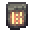 **Fogo** | fire | Bolas de fogo, muralhas de chamas, tempestade de blaze. | Raio de Fogo, Investida Ardente |
|  **Gelo** | ice | Cones de frio, prisões de gelo, nevasca e urso polar. | Estalactite, Passo Gélido |
|  **Tempestade** | lightning | Raios em cadeia, lança de relâmpago, ascensão e tempestade. | Eletrocutar, Carga |
|  **Luz** | holy | Cura, raio de sol, golpe divino e asas de anjo. | Cura, Fogo-fátuo |
| 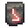 **Trevas** | blood, eldritch | Sangue e o Eldritch: drenar vida, erguer mortos, tentáculos de sculk e o rugido sônico. | Corte de Sangue, Agulhas de Sangue |
|  **Natureza** | nature | Raízes, terremoto, veneno, ácido e enxame de vagalumes. | Flecha Venenosa, Raízes |


**Arcano: o espadachim-mago**

O Caminho Arcano tem **Lâminas Conjuradas**, **Golpes Ecoantes**, **Corte das Sombras** e o **Martelo Espectral**: luta corpo a corpo com magia, sem arma física. Quem quer espada de verdade com magia joga de **Lâmina Arcana** (Spellblades).


## Os 5 Círculos

Cada tier que você sobe dá **+1 ponto** na aba Caminhos. Os pontos sobem o **Círculo** embaixo da sua escola. O Círculo limita o **nível máximo** que as suas magias alcançam (uma fração do nível máximo de cada feitiço) e soma **+5% de poder da escola** por Círculo.

| Círculo | Nível das magias | Poder da escola | Quando |
| --- | --- | --- | --- |
| **Aprendiz** | até 25% do máximo | +5% | ao escolher o Caminho |
| **Adepto** | até 45% do máximo | +10% | tier 2 |
| **Mago** | até 65% do máximo | +15% | tier 3 |
| **Mestre** | até 85% do máximo | +20% | tier 4 |
| **Arquimago** | até 100% do máximo | +25% | tier 5 · também dobra a sua Graça |

Veja o seu Caminho e Círculo no jogo com **/caminho_mago**.

## Livros de magia por tier

Cada livro usa o material do Mago daquele tier e o livro anterior. Livros maiores têm mais espaços de magia.

<figure>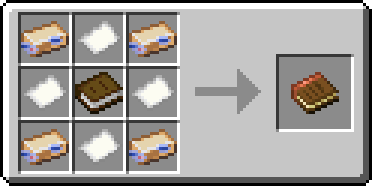<figcaption>
Diário Frágil (T1)
</figcaption></figure>

<figure>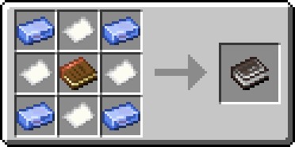<figcaption>
Tomo de Ferro (T2)
</figcaption></figure>

<figure>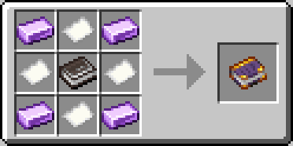<figcaption>
Livro do Aprendiz (T3)
</figcaption></figure>

<figure>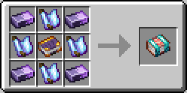<figcaption>
Livro Encantado (T4)
</figcaption></figure>

<figure>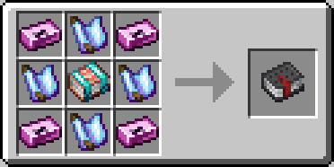<figcaption>
Códice Ancestral (T5)
</figcaption></figure>

## Cajados e orbes

Forjados na **bigorna** com **Essência Arcana** (sai de monstros mágicos e do Caldeirão Alquímico). Os números aparecem na dica do item.

| Tier | Cajado (mão principal) | Orbe (mão secundária) |
| --- | --- | --- |
| 1 | spell power +5%, max mana +25 | max mana +50, mana regen +5%, cooldown reduction +2% |
| 2 | spell power +10%, cast time reduction +3%, max mana +50 | max mana +100, mana regen +10%, cooldown reduction +4% |
| 3 | spell power +15%, cast time reduction +5%, max mana +75 | max mana +150, mana regen +15%, cooldown reduction +6% |
| 4 | spell power +22%, cast time reduction +8%, max mana +110 | max mana +220, mana regen +20%, cooldown reduction +9% |
| 5 | spell power +30%, cast time reduction +10%, max mana +150 | max mana +300, mana regen +25%, cooldown reduction +12% |

Receitas de cada tier na página **Forja de cada Ordem** (aba Mago).

## Mesa de Inscrição, Caldeirão e Bigorna Arcana

<figure>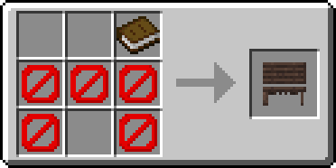<figcaption>
Mesa de Inscrição: grava pergaminhos no livro
</figcaption></figure>

<figure>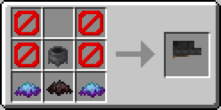<figcaption>
Caldeirão Alquímico: tintas e poções
</figcaption></figure>

<figure>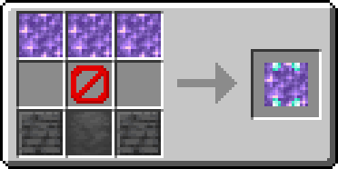<figcaption>
Bigorna Arcana: orbes de melhoria
</figcaption></figure>

- **Pergaminhos repetidos** viram tinta no caldeirão; tinta + papel na mesa faz o pergaminho de uma magia que você já tem, num nível maior.
- **Orbes de melhoria** na Bigorna Arcana aumentam o poder de uma escola, a mana ou a recarga de uma peça.
- O **Mitril** do Iron's é o **Mitril de Velária**: o minério do Iron's não nasce mais.

## Armaduras do Mago

As duas linhas de armadura leve do Mago (Guardiã e **Elementalista**) dão **mana máxima, poder mágico, recarga menor e resistência a magia** em cada peça. As armaduras de escola do Iron's (Piromante, Criomante...) continuam no jogo, mas com os atributos reduzidos: o endgame é o das Ordens.

## As outras classes mágicas (Spell Engine)

Sacerdote, Paladino, Druida e Lâmina Arcana usam o **Spell Engine**: segure a arma mágica, escolha a magia com **1 a 9** e lance com o **botão direito**. Cada magia gasta **1 runa** da escola dela.

<figure>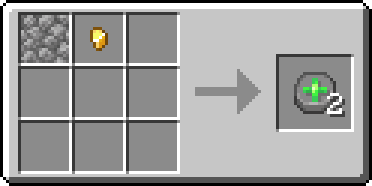<figcaption>
Runa de Cura
</figcaption></figure>

<figure>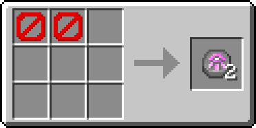<figcaption>
Runa Arcana
</figcaption></figure>

<figure>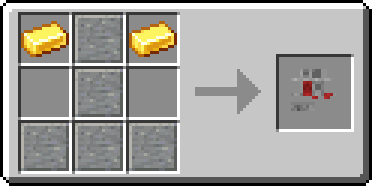<figcaption>
Altar de Runas (16 por vez)
</figcaption></figure>

<figure>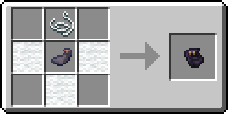<figcaption>
Bolsa de Runas
</figcaption></figure>
