# Minérios

Velária tem **22 minérios novos**. Eles usam o mesmo desenho dos minérios do Minecraft, por cima da pedra onde nascem (pedra, ardósia, netherrack, basalto ou pedra do End). Procure o **veio colorido**: nos minérios raros ele brilha e se mexe.



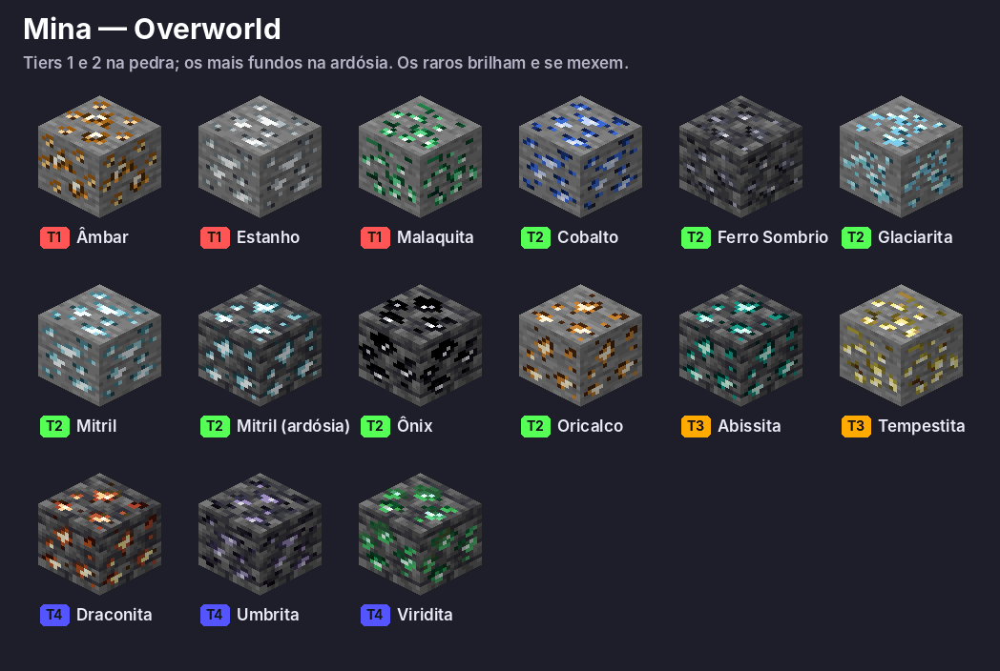


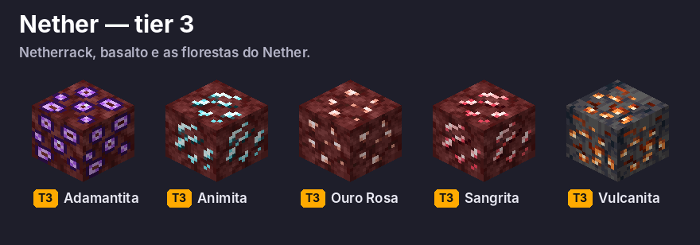


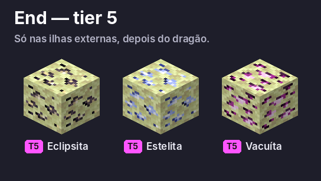



## Onde achar cada um

| Minério | Vira | Nome | Onde | Picareta mínima | Comprador do Rei | Para quem |
| --- | --- | --- | --- | --- | --- | --- |
| 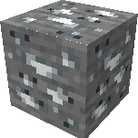 |  | **Estanho** · T1 | Overworld, Y 0 a 96 | Cobre | 5 cobre | Guerreiro |
| 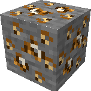 | 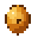 | **Âmbar** · T1 | Desertos e badlands, Y 30 a 120 | Ferro | 1 ferro | Ladino |
|  | 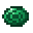 | **Malaquita** · T1 | Selvas e pântanos, Y −16 a 64 | Âmbar | 1 ferro | Druida |
| 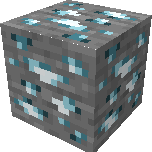 | 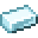 | **Mitril** · T2 | Overworld, Y −48 a 16, pedra e ardósia | Malaquita | 2 ouro | Arqueiro |
|  | 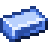 | **Cobalto** · T2 | Overworld, Y −16 a 48 | Mitril | 2 ouro | Paladino |
| 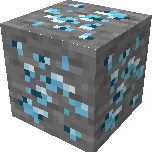 |  | **Glaciarita** · T2 | Biomas gelados, Y 40 a 200 | Cobalto | 2 ouro | Bruxo |
| 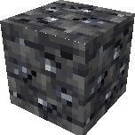 | 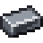 | **Ferro Sombrio** · T2 | Overworld fundo, Y −64 a −24 | Glaciarita | 2 ouro | Berserker |
|  | 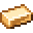 | **Oricalco** · T2 | Montanhas, Y 80 a 220 | Ferro Sombrio | 2 ouro | Guerreiro |
|  | 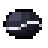 | **Ônix** · T2 | Overworld fundo, Y −64 a 0 | Oricalco | 2 ouro | Monge |
|  | 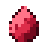 | **Sangrita** · T3 | Floresta Carmesim (Nether) | Diamante | 1 esmeralda | Lâmina Arcana |
| 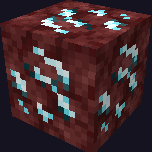 | 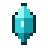 | **Animita** · T3 | Vale das Almas (Nether) | Sangrita | 1 esmeralda | Sacerdote |
|  | 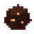 | **Vulcanita** · T3 | Deltas de basalto (Nether) | Netherite | 1 esmeralda | Berserker |
|  | 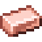 | **Ouro Rosa** · T3 | Nether inteiro, Y 10 a 117 | Netherite | 1 esmeralda | ingrediente de liga |
| 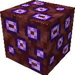 | 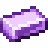 | **Adamantita** · T3 | Nether, Y 8 a 40, nunca exposto ao ar | Vulcanita | 1 esmeralda | Mago |
|  | 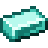 | **Abissita** · T3 | Sob os oceanos profundos, Y −40 a 0 | Adamantita | 1 esmeralda | Bruxo |
|  | 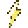 | **Tempestita** · T3 | Picos das montanhas, Y 140 a 256 | Abissita | 1 esmeralda | Arqueiro |
| 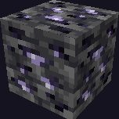 | 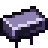 | **Umbrita** · T4 | Escuridão Antiga (deep dark) | Tempestita | 3 esmeralda | Ladino |
| 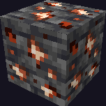 | 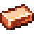 | **Draconita** · T4 | Fundo do mundo, Y −64 a −50, raríssimo | Umbrita | 5 esmeralda | Monge |
| 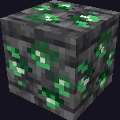 |  | **Viridita** · T4 | Cavernas exuberantes, Y −60 a −20 | Draconita | 3 esmeralda | Druida |
|  |  | **Estelita** · T5 | Ilhas externas do End, Y 20 a 80 | Viridita | Não compra: só leilão | Paladino |
| 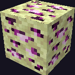 | 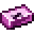 | **Vacuíta** · T5 | Ilhas externas do End, Y 10 a 60 | Estelita | Não compra: só leilão | Mago |
|  | 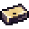 | **Eclipsita** · T5 | Ilhas externas do End, Y 20 a 90 | Vacuíta | Não compra: só leilão | Lâmina Arcana |


**Picareta em cadeia**

Cada minério só cai com a **picareta do minério anterior**. Se o bloco quebrar e não soltar nada, sua picareta é fraca demais.



**Ultimine (quebrar o veio inteiro)**

Segure a tecla do Ultimine para quebrar o veio todo de uma vez. Nos tiers 1 e 2 funciona só em minério; a partir do tier 3 também em terra e pedra. Madeira nunca.


## Minério bruto

Os metais caem como **minério bruto**, igual ao ferro do Minecraft. Asse no forno (ou no alto-forno, mais rápido) para virar lingote. **Fortuna** aumenta quantos brutos caem; **Toque Suave** pega o bloco inteiro. Nove brutos fazem um bloco de minério bruto.

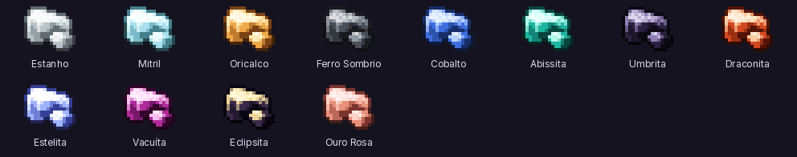


**Adamantita é diferente**

O **Detrito Adamântico** cai como o próprio bloco. Asse no forno para virar **Chapa de Adamantita**. O resto do caminho até o lingote está em [A forja](forja.md#adamantita-a-netherite-de-velaria).


## Lingotes e gemas

Os lingotes usam o molde do lingote de ferro do Minecraft. Os metais raros são animados.






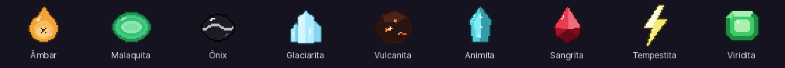



## Todos os itens e blocos

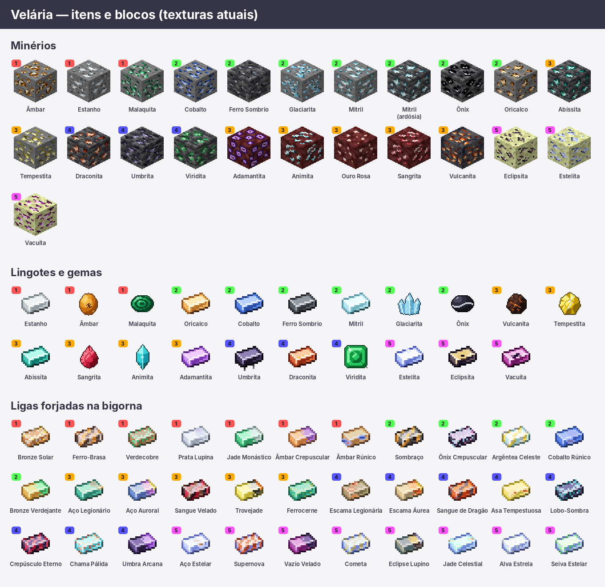
