# Minérios

Velária tem **22 minérios novos**. Eles usam o mesmo desenho dos minérios do Minecraft, por cima da pedra onde nascem (pedra, ardósia, netherrack, basalto ou pedra do End). Procure o **veio colorido**: nos minérios raros ele brilha e se mexe.



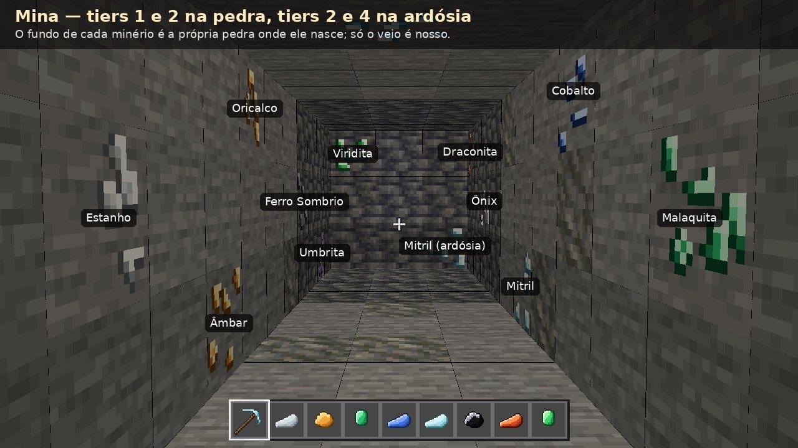


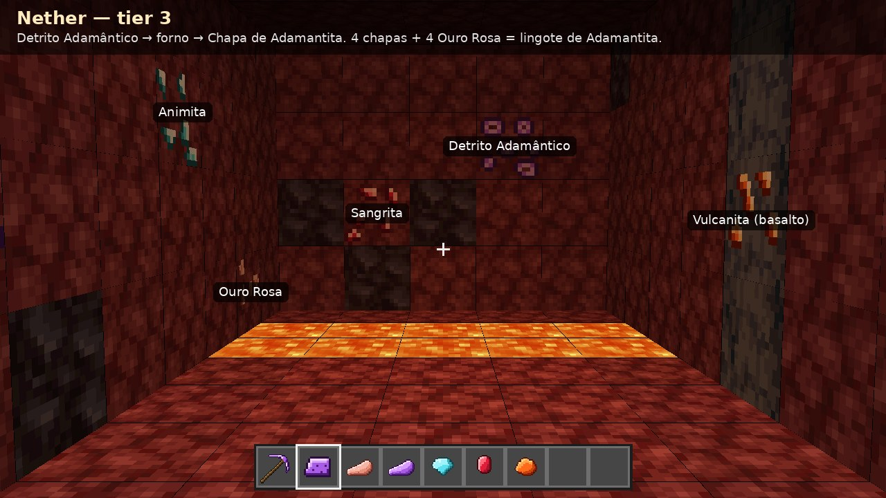


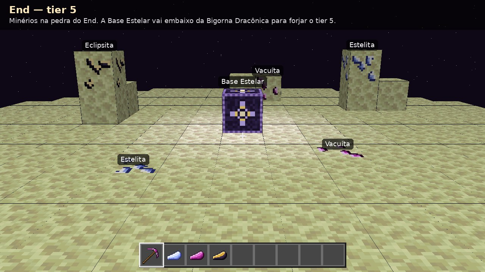



## Onde achar cada um

| | Minério | Tier | Onde | Ordem que usa |
| --- | --- | --- | --- | --- |
|  | **Minério de Âmbar** | T1 | Desertos e badlands, Y 30 a 120 | Irmandade do Véu |
|  | **Minério de Estanho** | T1 | Overworld, Y 0 a 96 | Legião de Ferro |
| 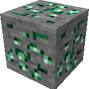 | **Minério de Malaquita** | T1 | Selvas e pântanos, Y −16 a 64 | Círculo do Carvalho |
| 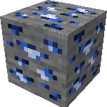 | **Minério de Cobalto** | T2 | Overworld, Y −16 a 48 | Ordem da Aurora |
|  | **Minério de Ferro Sombrio** | T2 | Overworld fundo, Y −64 a −24 | Clã da Fúria |
|  | **Minério de Glaciarita** | T2 | Biomas gelados, Y 40 a 200 | Escola do Lobo |
|  | **Minério de Mitril** | T2 | Overworld, Y −48 a 16, pedra e ardósia | Patrulheiros do Vento |
| 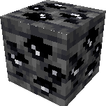 | **Minério de Ônix** | T2 | Overworld fundo, Y −64 a 0 | Mosteiro do Punho |
| 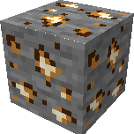 | **Minério de Oricalco** | T2 | Montanhas, Y 80 a 220 | Legião de Ferro |
| 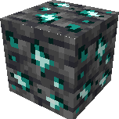 | **Minério de Abissita** | T3 | Sob os oceanos profundos, Y −40 a 0 | Escola do Lobo |
|  | **Detrito Adamântico** | T3 | Nether, Y 8 a 40, nunca exposto ao ar | Círculo Arcano |
|  | **Minério de Animita** | T3 | Vale das Almas (Nether) | Chama Branca |
| 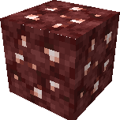 | **Minério de Ouro Rosa** | T3 | Nether inteiro, Y 10 a 117 | ingrediente de liga |
| 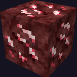 | **Minério de Sangrita** | T3 | Floresta Carmesim (Nether) | Lâminas do Crepúsculo |
| 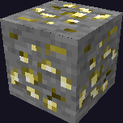 | **Minério de Tempestita** | T3 | Picos das montanhas, Y 140 a 256 | Patrulheiros do Vento |
| 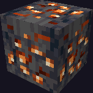 | **Minério de Vulcanita** | T3 | Deltas de basalto (Nether) | Clã da Fúria |
|  | **Minério de Draconita** | T4 | Fundo do mundo, Y −64 a −50, raríssimo | Mosteiro do Punho |
|  | **Minério de Umbrita** | T4 | Escuridão Antiga (deep dark) | Irmandade do Véu |
|  | **Minério de Viridita** | T4 | Cavernas exuberantes, Y −60 a −20 | Círculo do Carvalho |
| 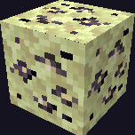 | **Minério de Eclipsita** | T5 | Ilhas externas do End, Y 20 a 90 | Lâminas do Crepúsculo |
| 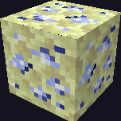 | **Minério de Estelita** | T5 | Ilhas externas do End, Y 20 a 80 | Ordem da Aurora |
|  | **Minério de Vacuíta** | T5 | Ilhas externas do End, Y 10 a 60 | Círculo Arcano |


**Picareta em cadeia**

Cada minério só cai com a **picareta do minério anterior**. Se o bloco quebrar e não soltar nada, sua picareta é fraca demais.



**Ultimine (quebrar o veio inteiro)**

Segure a tecla do Ultimine para quebrar o veio todo de uma vez. Nos tiers 1 e 2 funciona só em minério; a partir do tier 3 também em terra e pedra. Madeira nunca.


## Minério bruto

Os metais caem como **minério bruto**, igual ao ferro do Minecraft. Asse no forno (ou no alto-forno, mais rápido) para virar lingote. **Fortuna** aumenta quantos brutos caem; **Toque Suave** pega o bloco inteiro. Nove brutos fazem um bloco de minério bruto.


**Adamantita é diferente**

O **Detrito Adamântico** cai como o próprio bloco. Asse no forno para virar **Chapa de Adamantita**. O resto do caminho até o lingote está em [A forja](forja.md#adamantita-a-netherite-de-velaria).


## Lingotes e gemas

Os lingotes usam o molde do lingote de ferro do Minecraft. Os metais raros são animados.



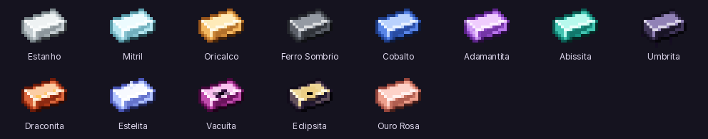






## Todos os itens e blocos

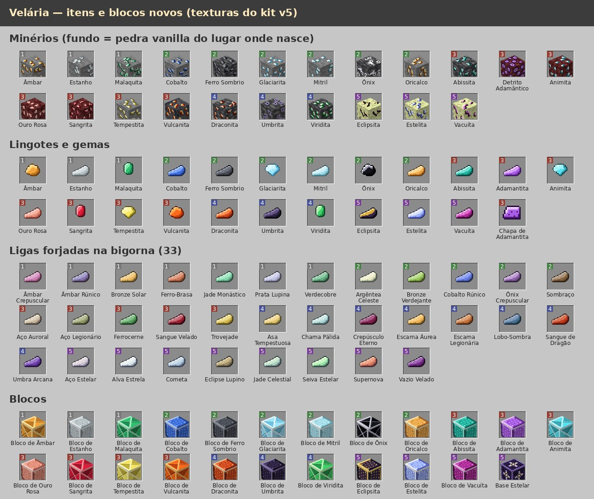
