# Ordens

A Ordem é a sua classe. Cada uma tem **duas armaduras em cada tier** (**linha de Defesa**, a Guardiã, e **linha de Ataque**, com o estilo próprio de cada Ordem), feitas só com os materiais dela, e **3 caminhos de arma**, cada um ligado a um deus.


**Como funciona o caminho de arma**

Você ganha 1 ponto ao entrar na Ordem e mais 1 a cada tier. Gaste na aba **Caminhos** da árvore de habilidades.
Se a sua **Graça** é do deus de um desses caminhos, lutar com essa arma dá a bênção maior. Veja as [Graças divinas](#gracas-divinas).


## Legião de Ferro

`Guerreiro` · `Armadura pesada`

O tanque de linha de frente. Aguenta pancada e segura os inimigos para o grupo.

Linha de Defesa: Guardiã

Linha de Ataque: Gladiador

| Tier 1 | Tier 2 | Tier 3 | Tier 4 | Tier 5 |
|---|---|---|---|---|
| 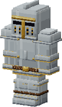 | 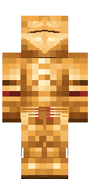 | 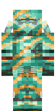 | 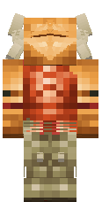 | 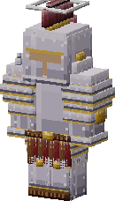 |
| Estanho | Oricalco | Aço Legionário (liga) | Escama Legionária (liga) | Aço Estelar (liga) |

**Caminhos de arma:** **Espada Longa** (deus: Tyr) · **Katana** (deus: Susanoo) · **Espada** (deus: Ares)

## Ordem da Aurora

`Paladino` · `Armadura pesada`

Guerreiro sagrado: bate forte, protege e cura um pouco os aliados.

Linha de Defesa: Guardiã

Linha de Ataque: Portador da Luz

| Tier 1 | Tier 2 | Tier 3 | Tier 4 | Tier 5 |
|---|---|---|---|---|
| 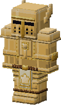 | 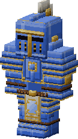 | 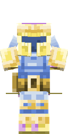 | 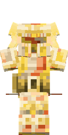 | 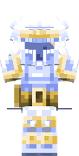 |
| Bronze Solar (liga) | Cobalto | Aço Auroral (liga) | Escama Áurea (liga) | Estelita |

**Caminhos de arma:** **Martelo e Maça** (deus: Thor) · **Espada** (deus: Ares) · **Lança** (deus: Atena)

## Clã da Fúria

`Berserker` · `Armadura pesada`

Quanto mais apanha, mais forte fica. Fúria e machado.

Linha de Defesa: Guardiã

Linha de Ataque: Nortenho

| Tier 1 | Tier 2 | Tier 3 | Tier 4 | Tier 5 |
|---|---|---|---|---|
|  | 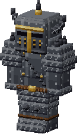 | 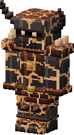 | 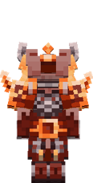 |  |
| Ferro-Brasa (liga) | Ferro Sombrio | Vulcanita | Sangue de Dragão (liga) | Supernova (liga) |

**Caminhos de arma:** **Machado de Guerra** (deus: Perun) · **Martelo e Maça** (deus: Thor) · **Espada Longa** (deus: Tyr)

## Irmandade do Véu

`Ladino` · `Armadura média`

Rápido e escondido. Dano enorme pelas costas, pouca vida.

Linha de Defesa: Guardiã

Linha de Ataque: Shinobi

| Tier 1 | Tier 2 | Tier 3 | Tier 4 | Tier 5 |
|---|---|---|---|---|
| 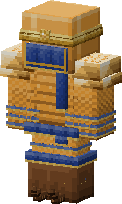 | 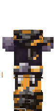 |  |  | 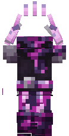 |
| Âmbar | Sombraço (liga) | Sangue Velado (liga) | Umbrita | Vazio Velado (liga) |

**Caminhos de arma:** **Adagas** (deus: Loki) · **Espada** (deus: Ares) · **Besta** (deus: Ullr)

## Patrulheiros do Vento

`Arqueiro` · `Armadura média`

Mata de longe com arco e besta. Fraco se o inimigo chega perto.

Linha de Defesa: Guardiã

Linha de Ataque: Andarilho

| Tier 1 | Tier 2 | Tier 3 | Tier 4 | Tier 5 |
|---|---|---|---|---|
|  | 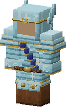 | 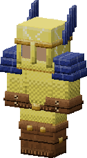 |  |  |
| Verdecobre (liga) | Mitril | Tempestita | Asa Tempestuosa (liga) | Cometa (liga) |

**Caminhos de arma:** **Arco** (deus: Ártemis) · **Besta** (deus: Ullr) · **Lança** (deus: Atena)

## Escola do Lobo

`Bruxo (Witcher)` · `Armadura média`

Caçador de monstros: espada, sinais mágicos e poções.

Linha de Defesa: Guardiã

Linha de Ataque: Escola do Gato

| Tier 1 | Tier 2 | Tier 3 | Tier 4 | Tier 5 |
|---|---|---|---|---|
|  | 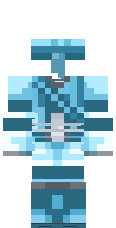 | 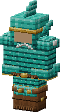 | 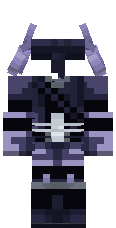 | 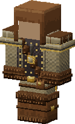 |
| Prata Lupina (liga) | Glaciarita | Abissita | Lobo-Sombra (liga) | Eclipse Lupino (liga) |

**Caminhos de arma:** **Espada** (deus: Ares) · **Espada e Sinais** (deus: Veles) · **Besta** (deus: Ullr)

## Mosteiro do Punho

`Monge` · `Armadura média`

Luta de mãos (manoplas) e é o mais veloz de todos.

Linha de Defesa: Guardiã

Linha de Ataque: Mestre Samurai

| Tier 1 | Tier 2 | Tier 3 | Tier 4 | Tier 5 |
|---|---|---|---|---|
| 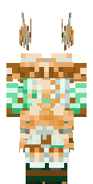 | 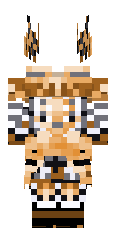 | 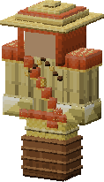 | 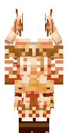 | 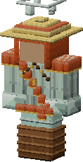 |
| Jade Monástico (liga) | Ônix | Trovejade (liga) | Draconita | Jade Celestial (liga) |

**Caminhos de arma:** **Manoplas** (deus: Hanuman) · **Lança** (deus: Atena) · **Katana** (deus: Susanoo)

## Lâminas do Crepúsculo

`Lâmina Arcana` · `Armadura média`

Mistura espada e magia: golpes que soltam feitiços.

Linha de Defesa: Guardiã

Linha de Ataque: Ronin

| Tier 1 | Tier 2 | Tier 3 | Tier 4 | Tier 5 |
|---|---|---|---|---|
| 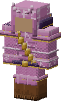 | 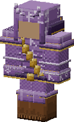 |  | 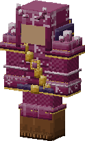 | 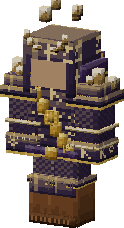 |
| Âmbar Crepuscular (liga) | Ônix Crepuscular (liga) | Sangrita | Crepúsculo Eterno (liga) | Eclipsita |

**Caminhos de arma:** **Lâmina Arcana** (deus: Hécate) · **Katana** (deus: Susanoo) · **Espada Longa** (deus: Tyr)

## Chama Branca

`Sacerdote` · `Armadura leve`

O curandeiro. Mantém o grupo vivo e queima mortos-vivos.

Linha de Defesa: Guardiã

Linha de Ataque: Absolvição

| Tier 1 | Tier 2 | Tier 3 | Tier 4 | Tier 5 |
|---|---|---|---|---|
| 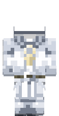 | 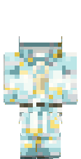 |  | 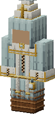 | 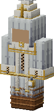 |
| Prata | Argêntea Celeste (liga) | Animita | Chama Pálida (liga) | Alva Estrela (liga) |

**Caminhos de arma:** **Cajado Sagrado** (deus: Amaterasu) · **Martelo e Maça** (deus: Thor) · **Lança** (deus: Atena)

## Círculo Arcano

`Mago` · `Armadura leve`

Iron's Spells: escolhe um dos 7 Caminhos Elementais (Arcano, Fogo, Gelo, Tempestade, Luz, Trevas, Natureza) e sobe 5 Círculos. Sem armas físicas. Muito frágil, muito poderoso.

Linha de Defesa: Guardiã

Linha de Ataque: Elementalista

| Tier 1 | Tier 2 | Tier 3 | Tier 4 | Tier 5 |
|---|---|---|---|---|
| 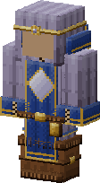 | 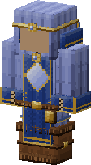 | 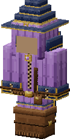 | 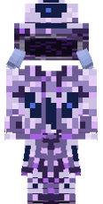 |  |
| Âmbar Rúnico (liga) | Cobalto Rúnico (liga) | Adamantita | Umbra Arcana (liga) | Vacuíta |

**Caminhos de arma:** **Cajado e Orbe** (deus: Thoth) · **7 Caminhos Elementais** (aba Caminhos (K)) · **5 Círculos** (1 por tier)

## Círculo do Carvalho

`Druida` · `Armadura leve`

Magia da natureza: cura, raízes e invocações.

Linha de Defesa: Guardiã

Linha de Ataque: Selvagem

| Tier 1 | Tier 2 | Tier 3 | Tier 4 | Tier 5 |
|---|---|---|---|---|
|  | 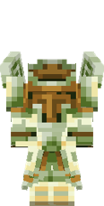 | 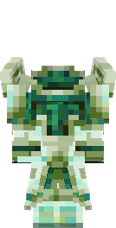 |  | 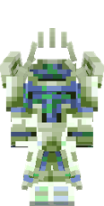 |
| Malaquita | Bronze Verdejante (liga) | Ferrocerne (liga) | Viridita | Seiva Estelar (liga) |

**Caminhos de arma:** **Bastão da Natureza** (deus: Cernunnos) · **Foice** (deus: Morrígan) · **Lança** (deus: Atena)

## Graças divinas

A Graça é a **4ª tela da criação do personagem**: você escolhe o deus, não é sorteio. Cada deus dá duas coisas:

- **Bênção menor:** vale sempre, para qualquer Ordem.
- **Bênção maior:** com a arma do caminho do deus na mão, **+8% de dano** (ou **+1,5** em arco, besta e magia). Só funciona se a sua Ordem usa essa arma. O nó **Devoção** dobra.

Quer trocar? Use o **Tomo do Destino**: ele reabre a escolha da Graça. Também dá para escolher **Sem Graça** e seguir sem deuses.

| Deus | Bênção menor (sempre) | Arma da bênção maior | Ordens que aproveitam a bênção maior |
|---|---|---|---|
| **Ares** (grego) | +1 de dano corpo a corpo. | Espada | Guerreiro, Paladino, Ladino, Bruxo |
| **Susanoo** (japonês) | 5% mais rápido. | Katana | Guerreiro, Monge, Lâmina Arcana |
| **Tyr** (nórdico) | +15% de resistência a repulsão. | Espada Longa | Guerreiro, Berserker, Lâmina Arcana |
| **Loki** (nórdico) | Alcança criaturas meio bloco mais longe. Anda agachado 30% mais rápido. | Adagas | Ladino |
| **Atena** (grego) | +2 de armadura. | Lança | Paladino, Sacerdote, Arqueiro, Druida, Monge |
| **Thor** (nórdico) | +1 de resistência da armadura. | Martelo e Maça | Paladino, Sacerdote, Berserker |
| **Perun** (eslavo) | Seus golpes empurram mais longe. | Machado de Guerra | Berserker |
| **Morrígan** (celta) | Ataca 5% mais rápido. | Foice | Druida |
| **Hanuman** (hindu) | Pula mais alto. Cai 3 blocos a mais sem se machucar. | Manoplas | Monge |
| **Ártemis** (grego) | +1 de sorte (pesca e baús melhores). | Arco | Arqueiro |
| **Ullr** (nórdico) | +4% de dano à distância. | Besta | Ladino, Arqueiro, Bruxo |
| **Thoth** (egípcio) | +5% de poder mágico. | Cajado (Mago) | Mago (+8% de poder mágico com o cajado; o Arquimago dobra) |
| **Amaterasu** (japonês) | +2 de vida máxima (1 coração). | Cajado Sagrado | Sacerdote |
| **Cernunnos** (celta) | Sobe blocos inteiros sem pular. | Bastão da Natureza | Druida |
| **Hécate** (grego) | Fogo queima você pela metade do tempo. | Lâmina Arcana | Lâmina Arcana |
| **Veles** (eslavo) | Fica mais tempo sem ar e nada mais rápido. Anda melhor dentro da água. | Espada e Sinais | Bruxo |
| **Sem Graça** | Nada. Você renuncia aos deuses. | — | — |
