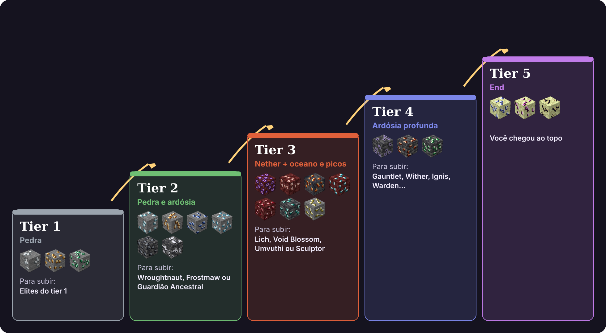
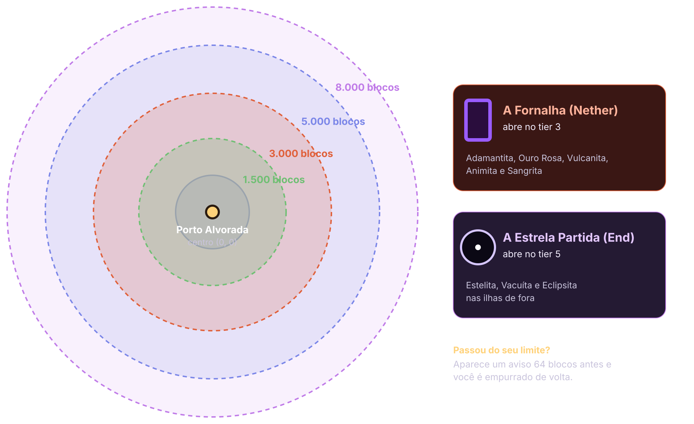

# Os 5 tiers

Seu tier vai de **1 a 5** e decide até onde você pode andar, quais dimensões abrem e o que você consegue forjar.

<figure><figcaption>
Cada degrau: onde minerar, os minérios do tier e o que você precisa derrotar para subir.
</figcaption></figure>

## Como eu subo de tier?

Só existem dois jeitos, e os dois exigem que **você esteja lá** (até 48 blocos do monstro quando ele morre):

* **Matar Elites** — Monstros mais fortes, com nome. 3 a 6 Elites do seu tier mortos perto de você = próximo tier.
* **Derrotar um chefe** — Estar perto quando um chefe do seu tier morre sobe você na hora.
* **O que NÃO conta** — Quest de time, item dado por amigo, comando. Ninguém sobe de carona.

## Até onde eu posso ir?

<figure><figcaption>
O mapa é medido a partir de Porto Alvorada (0, 0). Cada tier libera um círculo maior.
</figcaption></figure>

| Tier | Distância máxima | Dimensões | Estruturas |
| --- | --- | --- | --- |
| T1 | 1.500 blocos | Mundo normal | Só as comuns |
| T2 | 3.000 blocos | Mundo normal | Masmorras do tier 2 |
| T3 | 5.000 blocos | + Nether | Masmorras do tier 3 |
| T4 | 8.000 blocos | + Nether | Masmorras do tier 4 |
| T5 | Sem limite | + End | Todas |


**Monstros ficam mais fortes longe do centro**

Quanto mais longe de Porto Alvorada, maior o nível dos monstros e das vilas.

